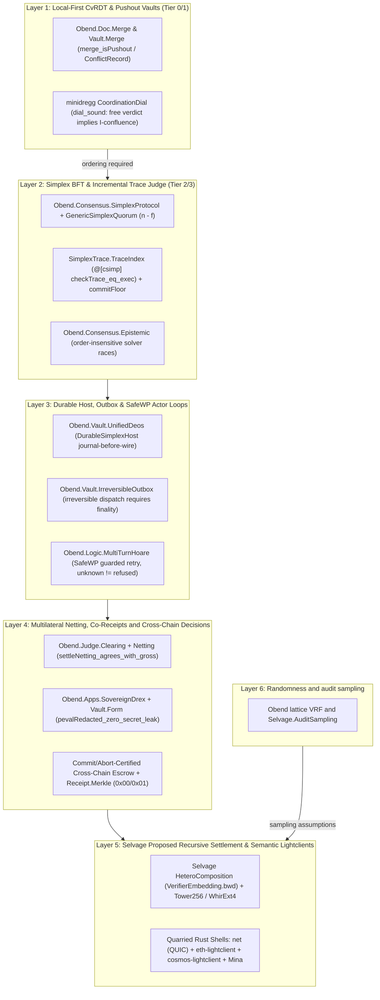

# `breadstuffs` Blocklace Consensus, Federation, Lightclients & Cross-Chain Settlement — Supervisory Audit & `obend`-Centered Extrapolation Blueprint

[REPORTED] 2026-11-21 · Lane `bread-blocklace-chain`. The original dossier attributes its shard reviews to Claude Fable 5.2 and Codex gpt-6.2-astra, with Carbon synthesis.

[SOURCE] **Companion Note (`<= 220` lines):** [breadstuffs-blocklace-consensus-and-settlement-revival.md](file:///Users/ember/dev/zkml-research/notes/breadstuffs-blocklace-consensus-and-settlement-revival.md)

[SOURCE] **Sibling Dossiers:** [BREADSTUFFS_PROMPTS_AND_CLAUDE_REPLIES.md](file:///Users/ember/dev/zkml-research/research/breadstuffs_revival_2026_11_21/BREADSTUFFS_PROMPTS_AND_CLAUDE_REPLIES.md) · [METATHEORY_AND_EFFECTS_AUDIT.md](file:///Users/ember/dev/zkml-research/research/breadstuffs_revival_2026_11_21/METATHEORY_AND_EFFECTS_AUDIT.md) · [DISTRIBUTED_UI_AND_OBEND_SYNTHESIS.md](file:///Users/ember/dev/zkml-research/research/breadstuffs_revival_2026_11_21/DISTRIBUTED_UI_AND_OBEND_SYNTHESIS.md)

**Original lane revisions:** `breadstuffs@93f2893d89670f96fe4074051f3ab148b9e2af44`, `obend@88d18a77cf14a2910f7d9e31710020ff7a760010`, `minidregg@0ce6d9cf8e668c4a8f1636fa617ab345a12405f3`, `zkml-research@71dafc3816806bbcf0dfd4c54b775a548efe5a18` `[EXECUTED]`

[EXECUTED] Pass 2 read the working trees. `git rev-parse HEAD` matched the original Breadstuffs, Minidregg and research pins. In Obend, `git log --oneline -n 5` returned `5731d70f`, `f6db518b`, `c39d4e3d`, `afbd7fd9`, `d50cb853` in order. At `5731d70fdd15164785e8dce0ebd644385c9c46d3`, `git diff --name-only 88d18a77cf -- <linked Obend paths>` listed `quarry/obend-apex.toml` and `lean/Obend/Logic/MultiTurnHoare.lean`. `guardedRetry_loop_safeWP` remains at line 712. The linked Consensus and IrreversibleOutbox sources match the original revision. Both Simplex registrations appear in the [current manifest](file:///Users/ember/dev/obend/quarry/obend-apex.toml#L1841-L1853).

[EXECUTED] Pass 3 (Claude Fable 5.2 cross-audit editor, 2026-11-21) found `git rev-parse HEAD` unchanged in all three companion trees (Obend at `5731d70f`). It reread the cited ranges for C1–C13 and S1–S12, reran the §1 recount and the S5 76-coordinate comparison (76 historical matches, 0 current), and resolved every `file://` link in this dossier and its note to an in-range line. Findings C2, C7–C12, S7, S8 and S10–S12 now carry one label per claim. Dispositions were reconciled with the [master ledger](file:///Users/ember/dev/zkml-research/research/breadstuffs_revival_2026_11_21/MASTER_REVIVAL_ALIGNMENT.md) in §1.4.

[REPORTED] The originating lane used the frozen conversation index and local trees with zero Scry, Kagi or eprint requests. [CV_WAVES_INDEX.json](file:///Users/ember/dev/zkml-research/research/breadstuffs_revival_2026_11_21/CV_WAVES_INDEX.json)

---

## 0. Executive Verdict & Post-`#114` Strategic Frame

[DERIVED] Under the reported #114 direction, carry the parts that have a checked interface into Obend and Selvage. Keep local merge, committee finality, execution validity and bridge release as separate obligations. [SOURCE] The Rust module uses `WhirExt4Pcs` as a documentation label. The batch verifier is [verify_whir_batch_ext4](file:///Users/ember/dev/zkml-research/native/qwen35audit/src/whir_ext4.rs#L1991-L1996). See [whir_ext4.rs](file:///Users/ember/dev/zkml-research/native/qwen35audit/src/whir_ext4.rs#L1-L3).

1. **Consensus and coordination**
   - [SOURCE] The compiled ordering path caches final-leader search, then uses uncached rounds in both the predecessor walk and the segment sort. [OPEN] Its present running time and asymptotic bound are unestablished. See C1 for the cache boundary, the earlier timing and the timeout policy.
   - [SOURCE] Cordiality and prefix-extension premises remain open at ingress. The Rust and Lean linearizers can choose different orders. [DERIVED] Keep the identity cursor until the protocol guarantees prefix stability. See C2.
   - [DERIVED] Preserve causal DAG evidence for mergeable operations. Use Obend’s checked Simplex trace as the starting point for ordered operations. [SOURCE] Its Rust FFI fixture and Minidregg’s quorum arithmetic are separate artifacts. [simplex_trace_kernel.rs](file:///Users/ember/dev/obend/crates/obend-ffi/tests/simplex_trace_kernel.rs#L74-L150) · [GenericSimplexQuorum.lean](file:///Users/ember/dev/minidregg/Kernel/GenericSimplexQuorum.lean#L62-L86)

2. **Settlement and custody**
   - [DERIVED] The three settlement consumers enforce proof verification and root continuity. Their shared statement omits committee finality and full-turn authority. A divergent accepted span changes the head required of subsequent submissions. See S1.
   - [REPORTED] The deployment ledger records a July Base-Sepolia fixture transaction with the static verifier, its adapter and `DreggSettlement`. [OPEN] Deployment or exposure of the other contracts, and bytecode parity with the November sources, were not established. [DEPLOYMENTS.md](file:///Users/ember/dev/breadstuffs/chain/DEPLOYMENTS.md#L1-L21)
   - [DERIVED] Solana needs distinct authorizations for pooled unlocks and escrow releases. Each chain also needs evidence that its terminal outcome agrees with the other legs of a swap. See S2–S3.
   - [DERIVED] The two messaging adapters use different Merkle conventions. Each needs an authenticated root type, leaf encoding and tree shape before its acceptance can imply message membership. See S4 and S9.
   - [SOURCE] The current wrapped segment shape is pinned to two turns. The upgradeable verifier seed, static deployment fixture and Cosmos test pin disagree with current artifacts in different ways. See S5–S7.
   - [DERIVED] The legacy budgets, route-table installation and co-turn propagation need independent checks before reuse. See C3, C6 and C13.

---

## 1. Inventory of 37 Breadstuffs crates and directories

[EXECUTED] Matrix Rust counts come from `git ls-files` under each directory. The three columns count tracked `.rs` files, newline bytes and literal `#[test]` occurrences, respectively. They exclude async test attributes. The root `Cargo.toml` lists 232 member paths. Caller examples denote source references or manifest dependencies, not runtime traffic. Supplemental counts use the displayed extensions and newline bytes in tracked files, excluding lib, target, out, cache, broadcast and node_modules directories. Direct dependents (reverse path dependencies) were checked by parsing tracked Cargo.toml path declarations, including workspace-inherited, dev/build and target-specific dependencies. [EXECUTED] For example, `git ls-files node | rg "\.rs$" | wc -l` gives 136. The corresponding newline and literal-attribute sums are 153440 and 596.

[EXECUTED] Pass 3 parsed the root manifest with Python `tomllib`: 232 members, 150 default members, 19 excludes. The 37 directories split into 21 default members, 8 non-default members (`chain`, `eth-lightclient`, `cosmos-lightclient`, `dregg-interchain-gov`, `crypto-hashrand`, `crypto-xmvrf`, `pqvrf`, `tools/deployer-gate`), 4 excluded directories that each carry their own `[workspace]` table (`solana-lock`, `solana-settlement`, `poa-curator`, `poa-solana-gate`), 2 unlisted standalone workspaces (`cosmos-lock`, `cosmos-settlement`) and 2 directories without a manifest (`poa`, `poa-web`). Every file, line and `#[test]` figure in §1.1–§1.3 matched the recount.

### 1.1 Cluster A — Consensus, DAG, Transport, Coordination & Merge (14 Crates)

| Crate | `.rs` / LOC / `#[test]` | Workspace & Consumers | Implemented Reality vs Gaps | `#114` Disposition |
|---|---:|---|---|---|
| [SOURCE] `blocklace` | `21` / `20,142` / `280` | Default member. Direct dependents include `node`, `persist` and `coord` | The root [Block](file:///Users/ember/dev/breadstuffs/blocklace/src/lib.rs#L93) and [finality::Block](file:///Users/ember/dev/breadstuffs/blocklace/src/finality.rs#L294) are separate types. [CreatorTips::Pair](file:///Users/ember/dev/breadstuffs/blocklace/src/finality.rs#L961-L969) retains fork exhibits. [finality_of](file:///Users/ember/dev/breadstuffs/blocklace/src/finality.rs#L906-L916) ranks Ordered above Attested. The [threshold amendment](file:///Users/ember/dev/breadstuffs/blocklace/src/constitution.rs#L163-L178) can depart from the roster-derived threshold within cardinality bounds. [enroll_pq](file:///Users/ember/dev/breadstuffs/blocklace/src/finality.rs#L1098-L1100) replaces the indexed key. | [DERIVED] **EXTRAPOLATE CvRDT DAG (`CreatorTips::Pair`) $\to$ `obend` Pushouts; BURN CM `tau` & `constitution`** |
| [SOURCE] `braid-hook` | `3` / `588` / `3` | Default member; called by `dreggnet-companion` | [compose_entity](file:///Users/ember/dev/breadstuffs/braid-hook/src/lib.rs#L68-L86) deploys and composes without the `prove` feature. That feature gates the [app-root fold](file:///Users/ember/dev/breadstuffs/braid-hook/src/lib.rs#L336-L369) which binds the outcome octet and VK. The [weld canary](file:///Users/ember/dev/breadstuffs/braid-hook/tests/weld_canary.rs#L71) is ignored by default. | [DERIVED] **BURN (`p3` coupling); replace with `Selvage` `HeteroComposition`** |
| [SOURCE] `federation` | `33` / `18,656` / `248` | Default member; consumers include `node`, `sdk` and `persist` | Real hybrid Ed25519+ML-DSA-65 QCs & FROST DKG; the node has a separate committee replay path; `FederationReceipt::verify` allows classical-only `ReceiptQc::Votes` downgrade ([receipt.rs](file:///Users/ember/dev/breadstuffs/federation/src/receipt.rs#L370-L407)); `apply_epoch_transition` mutates `members` before `Err` ([epoch.rs](file:///Users/ember/dev/breadstuffs/federation/src/epoch.rs#L304-L325)). | [DERIVED] **QUARRY hybrid quorum checks and the separate classical FROST primitives $\to$ `obend-pq-mpc` + `Obend.Polis.PqThresholdCustody`; BURN classical downgrade** |
| [SOURCE] `dfa` | `7` / `4,347` / `55` | Default member. Direct dependents include `cell` and `dfa-federation`. The separate [policyc compiler](file:///Users/ember/dev/breadstuffs/metatheory/Policyc.lean#L2-L17) emits byte tables | [Regex canonicalization](file:///Users/ember/dev/breadstuffs/dfa/src/derivative.rs#L322) and [Moore minimization](file:///Users/ember/dev/breadstuffs/dfa/src/compiler.rs#L147). [verify_acceptance](file:///Users/ember/dev/breadstuffs/dfa/src/air.rs#L278-L317) checks the longest-match span subject to the start-state gap in C13. [GovernedRouter::new](file:///Users/ember/dev/breadstuffs/dfa/src/router.rs#L683-L695) uses the CAS-only stub. | [DERIVED] **QUARRY SHELL (`Re` + Moore `minimize` + `policyc`) $\to$ `Obend.Judge.SymbolicRegexBisim` + `minidregg` `Theory.GrammarTypedCapability`** |
| [SOURCE] `dfa-federation` | `1` / `262` / `2` | Default member; direct path dependency of `teasting` | The committee verifier authenticates old and new roots. The consuming router must also bind the installed table contents. See C13. [FederationQcVerifier](file:///Users/ember/dev/breadstuffs/dfa-federation/src/lib.rs#L72-L101) | [DERIVED] **BURN wrapper; fold epoch-bound route QC into `Obend.Judge` / `AuthenticatedSettlementFinality`** |
| [SOURCE] `coord` | `14` / `10,507` / `140` | Default member; called by `node` | The participant checks signature records, not distinct voters, and uses a carried execution height. The coordinator-side node handlers discard the commit message. Private legs use a separate Boolean proof model. See C3 and C6. | [DERIVED] **BURN Stingray & mock `PrivateLegProof`; extrapolate onto `Obend.Slot.Budget` + `Obend.Vault.Form` + `JointCoReceipt`** |
| [SOURCE] `turn` | `149` / `119,865` / `1,154` | Default member; core workspace hub | 38-variant [Effect](file:///Users/ember/dev/breadstuffs/turn/src/action.rs#L1081) enum; `Finality::default() == Final` with [serde default on the receipt field](file:///Users/ember/dev/breadstuffs/turn/src/turn.rs#L1177-L1181) ([turn.rs](file:///Users/ember/dev/breadstuffs/turn/src/turn.rs#L948-L960)); `ExerciseViaCapability` write-set under-approximation ([conflict.rs](file:///Users/ember/dev/breadstuffs/turn/src/conflict.rs#L251-L264)); the coordination fee exemption restricts `EmitEvent` to the agent’s own cell ([turn.rs](file:///Users/ember/dev/breadstuffs/turn/src/turn.rs#L791-L805)); the [receipt post-state commitment](file:///Users/ember/dev/breadstuffs/turn/src/executor/execute.rs#L792) is computed for the turn agent. | [DERIVED] **BURN 38-arm monolith; replace with `Obend.Core` Core4 + open `Effects.Revival` `LawfulRegistry`** |
| [SOURCE] `node` | `136` / `153,440` / `596` | Default member, node binary  | The standalone finalization-vote path lacks a signer-side durable reservation. Poll, staging, queue and retry findings are scoped in C1, C5 and C8. | [DERIVED] **BURN `153k`-LOC daemon; replace with narrow Rust host driving `Obend.Vault.UnifiedDeos` + `GrainCustodyHost`** |
| [SOURCE] `net` | `7` / `9,011` / `86` | Default member; called by `node` | Real QUIC `PeerNode` + Plumtree/anti-entropy `GossipNetwork` + `peer_score` ([gossip.rs](file:///Users/ember/dev/breadstuffs/net/src/gossip.rs#L399-L418)); classical Ed25519-only gossip, self-signed TLS without gossip key binding ([node.rs](file:///Users/ember/dev/breadstuffs/net/src/node.rs#L634-L651)), no recipient/epoch in `SignedEnvelope`, public fault injector ([:1854](file:///Users/ember/dev/breadstuffs/net/src/gossip.rs#L1854)). | [DERIVED] **QUARRY SHELL (QUIC + Plumtree anti-entropy); harden with hybrid PQ CapTP auth, domain/epoch nonces & bounded join queue** |
| [SOURCE] `dregg-sdk-net` | `17` / `14,799` / `106` | Default member; dependents `node`, `deos-hermes`, `dreggnet-tavern`, `preflight` | HTTP client, `NodeWorldSink`, `dregg-client-sign` (fixed local `signed.turn.hash()` lookup in `1b0750298`, but trusts single-node JSON without QC [dregg-client-sign.rs](file:///Users/ember/dev/breadstuffs/dregg-sdk-net/src/bin/dregg-client-sign.rs#L518-L560)), synchronous `TestNode` twin. | [DERIVED] **QUARRY thin signer/client patterns; require `Simplex` QC / `opens256` receipt proof; BURN `TestNode` twin** |
| [SOURCE] `dregg-merge` | `7` / `1,229` / `14` | Default member; **only** `dregg-umem` | [GrowSet](file:///Users/ember/dev/breadstuffs/dregg-merge/src/state.rs#L76-L84) exposes its map. [join](file:///Users/ember/dev/breadstuffs/dregg-merge/src/state.rs#L136-L148) checks cell equality with a debug assertion. The [state commitment](file:///Users/ember/dev/breadstuffs/dregg-merge/src/state.rs#L177-L185) uses entry keys. | [DERIVED] **EXTRAPOLATE ideas $\to$ `Obend.Doc.Merge` + `Obend.Vault.Merge` + `minidregg` `LaceMerge`/`CoordinationDial`; BURN crate** |
| [SOURCE] `dregg-epoch` | `1` / `503` / `11` | Default member; `dregg-season`, `dreggnet-adventure`, `dreggnet-cheevo` (NOT `node`) | [local_manifest](file:///Users/ember/dev/breadstuffs/dregg-epoch/src/lib.rs#L154-L168) derives the registry fingerprint and descriptor tag. [check_compatibility](file:///Users/ember/dev/breadstuffs/dregg-epoch/src/lib.rs#L207-L239) compares software compatibility, independently of committee authorization. | [DERIVED] **EXTRAPOLATE handshake concept $\to$ `Obend.Receipt.Negotiation` (`selectMinCostCommonJudge_minimal`) + `Judge.Genealogy`** |
| [SOURCE] `dregg-genesis-snapshot` | `2` / `491` / `5` | Default member; **only** `dregg-season` (`node/src/genesis.rs` wipes) | Operator-trusted cell carry-forward ([lib.rs](file:///Users/ember/dev/breadstuffs/dregg-genesis-snapshot/src/lib.rs#L182-L202)); simulated IVC proof purged in `e7c692453`; no duplicate `CellId` check (`:192`). | [DERIVED] **BURN crate; replace with `Obend.Vault.Escrow.HomeArchive` (`migrationHistory_preserves_home_or_collision`)** |
| [SOURCE] `dregg-mirror` | `11` / `3,289` / `52` | Default member. Read-mirror tooling and the node’s PostgreSQL mirror are separate surfaces | 4-gate read mirror ([object.rs](file:///Users/ember/dev/breadstuffs/dregg-mirror/src/object.rs#L215-L370)), honestly labeled `server` tier; leaves `receipt_hash <-> content_addr` unbound (`:219, 262`) and reads `att.threshold` from untrusted attestation (`:344`). | [DERIVED] **EXTRAPOLATE $\to$ `Obend.Vault.TransclusionAndMirror` (`transclusion_provenance_faithful`) + `Obend.Receipt.Merkle`** |

### 1.2 Cluster B — Lightclients, Settlement Contracts, Cross-Chain Locks, PoA & VRFs (16 Crates/Dirs)

| Crate / Dir | Files / LOC / `#[test]` | Workspace & Callers | Implemented Reality vs Gaps | `#114` Disposition |
|---|---:|---|---|---|
| [SOURCE] `lightclient` | `6` `.rs` / `3,734` / `26` | Default member. Direct dependents include `bridge`, `sdk` and game clients | [verify_history](file:///Users/ember/dev/breadstuffs/lightclient/src/lib.rs#L183-L201) documents the execution-fold boundary. The [SDK finalized-history entry point](file:///Users/ember/dev/breadstuffs/sdk/src/verify.rs#L799-L820) installs PQ cores and delegates to the distinct committee-aware verifier. | [DERIVED] **BURN `p3` verifier; replace with `Selvage` `Tower256` and the proposed Rust `WhirExt4Pcs` backend + `Simplex` `FinCert` light-client verifier** |
| [SOURCE] `chain` | `9` `.rs` (`2,080`L, `7`t) + `178` Sol/Go/JSON (`43,323`L) | `members` (not `default-members`), package `dregg-chain`; no tracked manifest path dependent | Real BN254 Groth16 + `VerifyFriNative` Go circuit (`numTurns == 2`, Base-Sepolia tx recorded in [DEPLOYMENTS.md](file:///Users/ember/dev/breadstuffs/chain/DEPLOYMENTS.md#L1-L21)); missing committee-finality check (`S1`), `DreggDVN`/`DreggProofISM` Merkle flaws (`S4`), stale upgradeable VK (`S5`), surviving SP1 vault dependency (`S6`). | [DERIVED] **BURN `p3`/gnark 2-turn dev-key stack, `DreggDVN`, SP1 `DreggVault`; rebuild clean L1 verifiers on `Selvage` + `SovereignDrex`** |
| [SOURCE] `eth-lightclient` | `30` `.rs` / `11,157` / `182` | `members` (not `default-members`); `dregg-interchain-gov` | **Real gem:** Mainnet period-1800 Electra BLS sync-committee (`397/512`), MPT EIP-1186 WETH opening, captured Base type-621 `AggregateVerifier` game `17049` ([end_to_end.rs](file:///Users/ember/dev/breadstuffs/eth-lightclient/tests/end_to_end.rs#L1-L18), [base_fault_proof.rs](file:///Users/ember/dev/breadstuffs/eth-lightclient/tests/base_fault_proof.rs#L6-L18)) + Lean rotation gate; omits `signature_slot`/staleness clock & `ProvenErc20Holding` lacks `chain_id`. | [DERIVED] **QUARRY SHELL (premier keeper); bind `chain_id`, `signature_slot`, fork schedule & `SystemConfig.paused()`** |
| [SOURCE] `cosmos-lightclient` | `10` `.rs` (`3,115`L, `45`t) + `10` JSON (`6,618`L) | `members` (not `default-members`); `dregg-interchain-gov` | **Real gem:** `cosmoshub-4` CometBFT `ProdVerifier` + Lean adjacent or skipping gate according to height (`~95`-block skip) + 2-level ICS-23 `bank` opening ([skip fixture](file:///Users/ember/dev/breadstuffs/cosmos-lightclient/tests/header_skipping.rs#L1-L9) · [ICS-23 membership](file:///Users/ember/dev/breadstuffs/cosmos-lightclient/src/lib.rs#L674-L711) · [lib.rs](file:///Users/ember/dev/breadstuffs/cosmos-lightclient/src/lib.rs#L477-L567)). | [DERIVED] **QUARRY SHELL (premier keeper); add autonomous bisection driver & sealed holding output** |
| [SOURCE] `cosmos-lock` | `6` `.rs` / `1,035` / `12` | **Standalone `[workspace]`** (unlisted in root `Cargo.toml`) | CosmWasm native-coin lock/escrow ([lib.rs](file:///Users/ember/dev/breadstuffs/cosmos-lock/src/lib.rs#L155-L294)); queries `IsProvenRoot` (the settlement contract registers [genesis](file:///Users/ember/dev/breadstuffs/cosmos-settlement/src/lib.rs#L138-L143) and [subsequent accepted roots](file:///Users/ember/dev/breadstuffs/cosmos-settlement/src/lib.rs#L235-L243)) + M-of-N Ed25519 sigs omitting `chain_id`/contract address ([release digest](file:///Users/ember/dev/breadstuffs/cosmos-lock/src/lib.rs#L61-L81)); post-deadline cross-leg race (`S3`). | [DERIVED] **QUARRY message schemas and CosmWasm shell (master ledger C.4: `QUARRY_VECTORS`) only after binding `clearing_root` leaf proof, `(chain_id, contract)`, and a common terminal decision** |
| [SOURCE] `cosmos-settlement` | `8` `.rs` / `1,510` / `12` | **Standalone `[workspace]`** (unlisted in root `Cargo.toml`) | Real arkworks BN254 Groth16 + Pedersen subgroup checks ([verifier.rs](file:///Users/ember/dev/breadstuffs/cosmos-settlement/src/verifier.rs#L98-L215)); dev toxic-waste key; stale fixture and literal digest assertion inconsistent with the generated key (`0xcfda612f…` vs `0x76b2bb38…` [vk_pin.rs](file:///Users/ember/dev/breadstuffs/cosmos-settlement/tests/vk_pin.rs#L77-L82)). | [DERIVED] **QUARRY message schemas (master ledger C.4: `QUARRY_VECTORS`); replace the BN254 verifier with the `Selvage` + `Simplex` finality-bound statement** |
| [SOURCE] `solana-lock` | `11` `.rs` / `3,737` / `36` | `exclude` in root `Cargo.toml` | Native Solana program with Ed25519 precompile parser ([processor.rs](file:///Users/ember/dev/breadstuffs/solana-lock/src/processor.rs#L952-L1041)); pooled and escrow releases share an authorization domain (`S2`), no `ProvenRootMarker` check, first-caller `init_vault` (`S7`), legacy SPL Token vs `$DREGG` Token-2022 mismatch. | [DERIVED] **BURN as written (master ledger C.3). If a Solana bridge is scheduled, quarry the precompile parser only, domain-separate instructions, require `ProvenRootMarker` leaf proof, support Token-2022 & auth init** |
| [SOURCE] `solana-settlement` | `11` `.rs` / `2,509` / `19` | `exclude` in root `Cargo.toml` | Native `alt_bn128` Groth16 + Pedersen verifier ([groth16.rs](file:///Users/ember/dev/breadstuffs/solana-settlement/src/groth16.rs#L66-L207)); known toxic-waste dev key ([lib.rs](file:///Users/ember/dev/breadstuffs/solana-settlement/src/lib.rs#L33-L34)); unauthenticated first-caller `init` sets `genesis_root` ([processor.rs](file:///Users/ember/dev/breadstuffs/solana-settlement/src/processor.rs#L133-L198)). | [DERIVED] **BURN as written (master ledger C.3). If a Solana bridge is scheduled, quarry the `alt_bn128` syscall shell re-targeted to the finality-bound statement & upgrade-authority `init`** |
| [SOURCE] `poa` | `0` `.rs` + `28` JSON (`105,726`L) | Config & artifact directory | Epoch-1 manifests (the [browser config](file:///Users/ember/dev/breadstuffs/poa-web/src/trust-config.js#L2-L4) pins curator counter 12); `poa-devnet.json` sets `threshold: 1` and `"generic_genesis_value_issued": false` ([poa-devnet.json](file:///Users/ember/dev/breadstuffs/poa/deployments/epoch-1/poa-devnet.json#L5-L28)). | [DERIVED] **ARCHIVE epoch-1 JSON fixtures; migrate PoA worlds to declarative `obend` `Core4` / `Hyperdocument` grains** |
| [SOURCE] `poa-curator` | `8` `.rs` / `10,544` / `65` | `exclude` in root `Cargo.toml`; path dependency of `node` | Real manifest verifier, slot ceremony & world activation ([lib.rs](file:///Users/ember/dev/breadstuffs/poa-curator/src/lib.rs#L2080-L2120)); documents zero-issuance fee deadlock (`latest_height` pinned to 0 [zero-issuance policy](file:///Users/ember/dev/breadstuffs/poa-curator/src/lib.rs#L46-L58)) in that configuration. A separate [player-grant policy](file:///Users/ember/dev/breadstuffs/poa-curator/src/lib.rs#L60-L70) funds genesis. See [mission activation](file:///Users/ember/dev/breadstuffs/poa-curator/src/lib.rs#L2201-L2227). | [DERIVED] **BURN crate (master ledger C.3); extrapolate the curator ceremony into `Obend.Polis.GrainPowerbox` attenuated capabilities + `ThresholdFheAndLatticeVrf`** |
| [SOURCE] `poa-solana-gate` | `1` `.rs` / `2,274` / `11` | `exclude` in root `Cargo.toml`; called by `node` | Token-2022 `$DREGG` wallet-control gate; documented beta route (`admit_beta`) trusts RPC balance (zero gov weight [README.md](file:///Users/ember/dev/breadstuffs/poa-solana-gate/README.md#L47-L56)); `ExternallyAnchoredCheckpoint` derives `Deserialize`. The admission path also [checks the checkpoint seal](file:///Users/ember/dev/breadstuffs/poa-solana-gate/src/lib.rs#L1385-L1405). See the wrapper declaration ([lib.rs](file:///Users/ember/dev/breadstuffs/poa-solana-gate/src/lib.rs#L571-L577)). | [DERIVED] **BURN crate (master ledger C.3); carry the wallet-challenge design into an `obend` ingress adapter with a sealed verified-checkpoint constructor** |
| [SOURCE] `poa-web` | `0` `.rs` + `65` JS/HTML/CSS (`22,549`L) | Static web frontend | Browser Ed25519 manifest check; fetches `/poa-curator-key.json` from same origin ([trust-config.js](file:///Users/ember/dev/breadstuffs/poa-web/src/trust-config.js#L2)); `dregg-wallet-verification.js` builds a plan only; `settleJudgedRun` displays `"Settled on chain"` for a submitted claim when global height increases ([judged-session.js](file:///Users/ember/dev/breadstuffs/poa-web/src/judged-session.js#L914-L968)). | [DERIVED] **BURN standalone JS app; fold PoA views into `obend-gui` / 5-mode `CanonicalReactiveView` bound to inclusion proofs** |
| [SOURCE] `dregg-interchain-gov` | `5` `.rs` / `1,902` / `21` | `members` (not `default-members`); no external tracked manifest path dependency found | Joins ETH, Cosmos & Solana holding proofs with Ed25519/secp256k1 owner bindings ([lib.rs](file:///Users/ember/dev/breadstuffs/dregg-interchain-gov/src/lib.rs#L102-L190)); accepts `eip155_chain_id` from caller and constructs public `ProvenForeignHolding { consensus_proven: bool }` ([proven_foreign_holding.rs](file:///Users/ember/dev/breadstuffs/dregg-governance/src/proven_foreign_holding.rs#L154-L240)). | [DERIVED] **EXTRAPOLATE trilogy owner-binding + nullifier v2 into `Obend.Polis.DecentralizedRulesMesh`; seal `ProvenForeignHolding`** |
| [SOURCE] `crypto-hashrand` | `4` `.rs` / `803` / `8` | `members` (not `default-members`); no external tracked manifest path dependency found | Synchronous in-memory commit-reveal reference ([ceremony.rs](file:///Users/ember/dev/breadstuffs/crypto-hashrand/src/ceremony.rs#L96-L135)); omits async Weak VSS/Gather; last-revealer abort bias, no session/epoch domain tag, `zip` relies on the channel returning complete rounds (`:125`), and inline-reimplemented equivocation test (`:228-289`). | [DERIVED] **BURN orphan crate** |
| [SOURCE] `crypto-xmvrf` | `9` `.rs` / `1,091` / `17` | `members` (not `default-members`); no external tracked manifest path dependency found | Naive hash-chain WOTS Merkle VRF reference ([vrf.rs](file:///Users/ember/dev/breadstuffs/crypto-xmvrf/src/vrf.rs#L148-L269)); `SecretKey` derives `Clone, Debug`, future epochs pre-evaluatable (`keygen` grindable), and `1u64 << height` shift outside the 64-bit width for out-of-range `pk.height` when the path-length check passes ([merkle.rs](file:///Users/ember/dev/breadstuffs/crypto-xmvrf/src/merkle.rs#L96-L98)). | [DERIVED] **BURN orphan crate (along with the pointwise `Pseudorandom` fairness premise)** |
| [SOURCE] `pqvrf` | `3` `.rs` / `917` / `11` | `members` (not `default-members`); direct path dependency of `dice` | Real Set-I Lattice VRF ([lib.rs](file:///Users/ember/dev/breadstuffs/pqvrf/src/lib.rs#L32-L313), Module-SIS/MLWE); one-time counter is in-memory only (`dice` `KeyChain::from_master_seed` regenerates unburned keys on restart [source.rs](file:///Users/ember/dev/breadstuffs/dice/src/source.rs#L1076-L1143)). | [DERIVED] **QUARRY polynomial/rejection core $\to$ `Obend.Crypto.ThresholdFheAndLatticeVrf` (`lavVerify`) + durable host epoch latch** |

### 1.3 Deployment, hosting and ingestion (7 crates)

[EXECUTED] The [workspace manifest](file:///Users/ember/dev/breadstuffs/Cargo.toml#L54-L61) lists all seven as members and six as default members. For each row, `git ls-files -- <dir>` supplied the tracked Rust paths. The counts are files, newline bytes and literal `#[test]` occurrences. The same recount matched all six Cosmos, Solana and PoA crate rows in §1.2.

| Directory | Rust files / lines / test attributes | Workspace | Source behavior | Proposed use |
|---|---:|---|---|---|
| `dregg-deploy` | 12 / 6,698 / 62 | Default | [SOURCE] `plan_apply` lowers the specification, checks the resulting authority graph and refuses cells without an owner key before emitting turns. [apply gates](file:///Users/ember/dev/breadstuffs/dregg-deploy/src/apply.rs#L317-L347) | [DERIVED] Master ledger: `BURN`. Carry the authority-graph preflight into the replacement tooling. Track submission and settlement separately. |
| `dregg-ipfs` | 6 / 3,796 / 53 | Default | [SOURCE] `fetch_authorized` asks the supplied receipt checker to authorize the CID, then verifies the fetched bytes against it. [authorized fetch](file:///Users/ember/dev/breadstuffs/dregg-ipfs/src/bridge.rs#L153-L165) | [DERIVED] Master ledger: `QUARRY_SHELL`. Use a receipt checker tied to the owner’s committed object. |
| `node-target` | 2 / 735 / 7 | Default | [SOURCE] The local route returns `Ok(None)`. The federation route asks its sink to submit and confirm the returned hash. [route](file:///Users/ember/dev/breadstuffs/node-target/src/lib.rs#L215-L230) | [DERIVED] Master ledger: `BURN`. Until removal, treat the sink’s answer as a node observation, not committee evidence. |
| `tools/deployer-gate` | 5 / 1,416 / 16 | Non-default member | [SOURCE] The Rust gate issues a macaroon with scope, arm and expiry caveats and checks it against a deploy request. The Solidity integration is described as an intended hook. [issuance and authorization](file:///Users/ember/dev/breadstuffs/tools/deployer-gate/src/lib.rs#L354-L402) | [DERIVED] Master ledger: `QUARRY_VECTORS`. Port the scope, arm and expiry cases as vectors where the launch entry point enforces them. |
| `git-deploy` | 8 / 3,081 / 40 | Default | [SOURCE] The publish workflow includes the cloned commit in the site manifest and returns that commit and the target’s content root in a receipt. [publish step](file:///Users/ember/dev/breadstuffs/git-deploy/src/workflow.rs#L365-L405) | [DERIVED] Master ledger: `SUPERSEDED`. Keep source and output identifiers together as build provenance in the replacement grain workflow. |
| `deploy/gateway-ask` | 3 / 802 / 11 | Default | [SOURCE] The TLS decision reads the [domain registry](file:///Users/ember/dev/breadstuffs/deploy/gateway-ask/src/lib.rs#L131-L142). The capability decision verifies the token against the configured root. [capability decision](file:///Users/ember/dev/breadstuffs/deploy/gateway-ask/src/lib.rs#L224-L253) | [DERIVED] Master ledger: `BURN`. Carry the registry-then-capability admission order into the replacement edge proxy. |
| `dregg-stream-ingest` | 1 / 645 / 7 | Default | [SOURCE] The mapper turns matched stream events into weighted ballots. Signing and quorum processing belong to the consumer. [ballot mapping](file:///Users/ember/dev/breadstuffs/dregg-stream-ingest/src/lib.rs#L288-L312) | [DERIVED] Master ledger: `SUPERSEDED`. Keep the weighting rule explicit at the replacement ingress boundary. |

### 1.4 Reconciliation with the master ledger

[SOURCE] The [master ledger](file:///Users/ember/dev/zkml-research/research/breadstuffs_revival_2026_11_21/MASTER_REVIVAL_ALIGNMENT.md) is the cross-lane disposition record. Where a row above proposes a narrower reuse than the ledger’s verdict, the row now states the ledger verdict first and the reuse as a condition. The ledger assigns `turn` and `node` to lane `bread-lean-effects`. They are inventoried here for their consensus-facing findings only.

[EXECUTED] The ledger assigns `bridge` to this lane. The §1 recount gives it 59 Rust files, 48,345 lines and 469 `#[test]` attributes as a default member. [OPEN] This dossier does not audit `bridge` beyond naming its Mina opening verifiers as a quarry candidate in §5.2.

[OPEN] Two ledger rationales differ from the source read here and need the maintainer: `node-target` is a turn-routing sink ([route](file:///Users/ember/dev/breadstuffs/node-target/src/lib.rs#L215-L230)), and `tools/deployer-gate` is a macaroon issuance and authorization gate ([issuance and authorization](file:///Users/ember/dev/breadstuffs/tools/deployer-gate/src/lib.rs#L354-L402)). The ledger’s summaries of S1 and S4 as capture and second-preimage results are stronger than this dossier’s findings, which leave both demonstrations open. S6 here finds the SP1 wrapper retired while `DreggVault` still calls an SP1 verifier.

---

## 2. Historical Design Intent (`CV_FROZEN=1 cv --frozen` + `git` Archaeology)

[EXECUTED] Pass 3 ran `git cat-file -t` on the 14 abbreviated commit ids cited in this dossier. Each names a commit in Breadstuffs. `grep -c` found each of the nine `cv` conversation ids below in the frozen index. The `7a181f741` message records the round-11 change from about 28 minutes to 3.8 ms. In each item the leading [REPORTED] covers the conversation attribution and the closing `[SOURCE]` covers the linked files and commits.

1. [REPORTED] **"Wounds" & Faithful Commitments (`cv fa4c3cbc-bea8-4dd5-acf9-b047175bdbf7` msg 607; `cv 01a1ad7d-c152-7404-b611-ccfcf1275c9e` in the `obend` project, 2026-11-05):** Ember coined *"wounds"* for architectural dishonesty — 1-felt (`~31`-bit, `~15.45`-bit birthday collision) commitment folds (*"so that ALL of our projects can stop doing these 1-felt hackjobs!"*), `"honestly labeled"` security stubs ([GOAL-MINA-SEMANTIC-LIGHTCLIENTS.md](file:///Users/ember/dev/breadstuffs/GOAL-MINA-SEMANTIC-LIGHTCLIENTS.md#L12-L23): *"A named residual is still a sin here"*), and degraded one-felt commitment encodings ([FAITHFUL-COMMITMENT-LAW.md](file:///Users/ember/dev/breadstuffs/docs/FAITHFUL-COMMITMENT-LAW.md#L42)) `[SOURCE]`.
2. [REPORTED] **Dynamic Topology, Houyhnhnm Autarky & Fork-Exhibit Retention (`cv 9a596558-8a76-466b-bec8-26164f7276c1` 2026-05-20; `89238335a`, `0eccd772d`):** Ember rejected static `num_nodes` federation autarky (*"redesign the system so it works smoother with dynamic topology"*), driving two core ideas: (i) personal state as a portable, proof-carrying vault (`n=1` autarky scaling to `n>1` quorum), and (ii) in the DAG, retaining *both* equivocating blocks via `CreatorTips::Pair` ([finality.rs](file:///Users/ember/dev/breadstuffs/blocklace/src/finality.rs#L961-L969)) so equivocation exclusion is a deterministic predicate over each block's causal closure rather than arrival-order gossip eviction `[SOURCE]`.
3. [REPORTED] **Local-First Pushout Merges vs BFT Escalation (`cv 0d3efcb7-f69f-4fe8-91ca-6615fdbd7432` msg 527, `ee15d4e6-9950-4b83-b364-c326fbeb07cd` msg 28, `b54b6026-1b53-47dc-9148-5d041555810c` msg 3):** Ember demanded real CRDTs and categorical pushout semantics ([GOAL-DREGG-DOC-WEB.md](file:///Users/ember/dev/breadstuffs/GOAL-DREGG-DOC-WEB.md#L24): *"conflict = a MISSING pushout"*) layered beneath a per-cell finality dial (`causal < ackThreshold < bft < constitutional` in [Finality.lean](file:///Users/ember/dev/breadstuffs/metatheory/Dregg2/Finality.lean#L4-L48)), so I-confluent updates converge locally with zero consensus messages while non-confluent conservation/escrow invariants escalate to BFT `[SOURCE]`.
4. [REPORTED] **Why `tauOrderFast` Stalled & Why Owned-Cell Fast Path Was Deleted (`cv 5d12f365-a748-4e7a-b4ca-99a0291fef49` 2026-07-07; `d182d10fc`, `b08c738ca`, `7a181f741`, `a9f75d8a4`):** Two distinct `tau` bugs hit live `n=3`/`n=4` runs: (i) ordering segments from *ratifiers' pasts* instead of the *anchor's past* caused permanent honest ledger forks (`798e87a33`, fixed in `d182d10fc`), and (ii) `dregg_round_advance` had an exponential causal-past BFS (`~28 min` at round 11 $\to$ `3.8 ms`, both figures from the `7a181f741` commit message; per-poll cost structure in [VERIFIED-GATE-PERF.md](file:///Users/ember/dev/breadstuffs/docs/VERIFIED-GATE-PERF.md#L19-L48)). The `9.17 s` at 35 blocks `dregg_tau_order` figure is the earlier 2026-07-07 `List`-backed measurement ([GOAL-FEDERATION.md](file:///Users/ember/dev/breadstuffs/GOAL-FEDERATION.md#L246-L251)); no post-re-authoring timing was taken here `[OPEN]`. Separately, `a9f75d8a4` deleted the owned-cell lock fast path after finding it passed the node's *public key* as an Ed25519 signing seed `[SOURCE]`.
5. [REPORTED] **Semantic Lightclients vs Custodial Trade Locks & PoA Forcing Function (`cv 77a94632-be77-45f8-ab7e-eddb99e87de5`, `ffb42026-536a-43c0-a17e-d232b6a299c7`; `f3c869ad4`, `9d564ba6d`):** Governance holdings follow *"prove, don't lock"* (snapshot inclusion proofs over ETH/Cosmos/Solana/Mina semantic lightclients), whereas cross-chain `DrEX` swaps require two-terminal custody locks (`Released` vs `Refunded`, [GOAL-MULTICHAIN-SETTLEMENT.md](file:///Users/ember/dev/breadstuffs/GOAL-MULTICHAIN-SETTLEMENT.md#L437)). Path of Angels (`W1–W5` in [GOAL-PATH-OF-ANGELS-EXCELLENCE.md](file:///Users/ember/dev/breadstuffs/GOAL-PATH-OF-ANGELS-EXCELLENCE.md#L45-L129)) served as a design brief identifying unwired randomness (`W1`), 2-BLAKE3 `EmitEvent` (`W2`), redb side-tables (`W3`), and bare curator keys (`W5`) `[SOURCE]`.

---

## 3. Claude Fable 5.2 vs Codex (`gpt-6.2-astra`) Cross-Audit Synthesis

[REPORTED] The table records the originating lane’s attribution. [EXECUTED] The supplied Fable Pass 1 handoff contained only a usage-limit notice. Pass 2 used the cited working-tree sources.

| Dimension | Convergent Findings (Both Families Agreed) | Codex (`gpt-6.2-astra`) observations | Claude Fable (`claude-fable-5-2`) observations | Cross-audit disposition |
|---|---|---|---|---|
| [REPORTED] Blocklace, merge and turn | Prefix-extension premise and ordering twins | Participant certificate, receipt decoding and merge identity | Checkpoint and vote persistence | [DERIVED] Scope the timing to its historical path (C1) and crash equivocation to an open recovery scenario (C5). |
| [REPORTED] Federation, node and transport | Vote persistence and orphan randomness crates | Partial mutation on error and terminal SQL refusal | Classical receipt branch and staged-state reads | [SOURCE] Authored blocks and standalone votes follow different durability paths (C5). |
| [REPORTED] Settlement, locks and light clients | Fixed span length and development setup | Retired upgradeable key and fixture drift | Missing finality and shared custody authorization | [DERIVED] Trace deployment, adapter acceptance and destination delivery separately (S1–S9). |

---

## 4. Complete Consensus, Transport & Cross-Chain Settlement Wound Ledger

### 4.1 Consensus, coordination, merge and node findings (C1–C13)

- **C1 · Uncached ordering and bounded poll time.** [SOURCE] `tauOrderFastImpl` builds past and round maps for final-leader search. The subsequent `ratifiedLeaderChain` walk uses uncached rounds to rank predecessor candidates in each anchor’s causal closure. The `tauStep` fold also rebuilds the closure and sorts the segment there. The comparator contains four `roundOf` calls, each defined through a fresh round fold. [predecessor walk](file:///Users/ember/dev/breadstuffs/metatheory/Dregg2/Distributed/BlocklaceFinality.lean#L626-L658) [REFUTED: timing the current comparator] The 9,169 ms / 35-block measurement recorded in `cb2bcb07c6` using instrumentation from `7cf197230` predates the fast twin (`530545933`) and the anchor-segment rewrite (`d182d10fc`). [EXECUTED] `rg -w store_checkpoint -g "*.rs" .` in Breadstuffs found the definition and a node comment, zero call sites. [SOURCE] A Lean-linked node without fallback can produce an empty batch on timeout. The default is 2,500 ms. [OPEN] Current scaling and time to a persistent stall. [compiled twin](file:///Users/ember/dev/breadstuffs/metatheory/Dregg2/Distributed/BlocklaceFinality.lean#L1359-L1373) · [anchor segment and fold](file:///Users/ember/dev/breadstuffs/metatheory/Dregg2/Distributed/BlocklaceFinality.lean#L807-L821) · [sort comparator](file:///Users/ember/dev/breadstuffs/metatheory/Dregg2/Distributed/BlocklaceFinality.lean#L769-L772) · [round lookup](file:///Users/ember/dev/breadstuffs/metatheory/Dregg2/Distributed/BlocklaceFinality.lean#L194-L206) · [historical timing](file:///Users/ember/dev/breadstuffs/GOAL-FEDERATION.md#L246-L251) · [checkpoint writer](file:///Users/ember/dev/breadstuffs/persist/src/checkpoint.rs#L31) · [timeout default](file:///Users/ember/dev/breadstuffs/node/src/blocklace_sync.rs#L4015-L4021) · [fallback decision](file:///Users/ember/dev/breadstuffs/node/src/blocklace_sync.rs#L2929-L2967) [EXECUTED] `git blame -L 249,249 HEAD -- GOAL-FEDERATION.md` attributes the timing row to `cb2bcb07c6`.
- **C2 · Prefix stability rests on unenforced premises.** [SOURCE] The prefix theorem is conditional on `ClosedExtension` and `ChainExtends`. The Lean file lists three gaps before `ChainExtends` can be proved: no receive-path code evaluates `isCordialBlock`, CM Prop. 3 is not formalised, and `finalLeaderAt` returns `none` unless the leader slot holds exactly one block, so a late second leader-slot block retracts an anchored wave. The node therefore tracks executed blocks by identity and executes the set difference in the current order. Rust `xsort` (Kahn, minimum id) and Lean `xsortBy` (round, then id) are different linearizers, named OPEN-CM-XSORT in the source. [DERIVED] Keep the identity cursor until both premises are enforced and the linearizers agree. [OPEN] No trace on which the two linearizers diverge was produced here. [open premises](file:///Users/ember/dev/breadstuffs/metatheory/Dregg2/Consensus/TauPrefixMonotone.lean#L58-L78) · [identity cursor](file:///Users/ember/dev/breadstuffs/node/src/execution_cursor.rs#L20-L33) · [linearizer residual](file:///Users/ember/dev/breadstuffs/blocklace/src/ordering.rs#L822-L826)
- **C3 · Aggregate local allowances can exceed the balance.** [SOURCE] Both budgets allocate each of n distinct participants a ceiling of floor(B(f+1)/(2f+1)). [DERIVED] The formula has no division by n. The four-silo fixture has B = 1,000 and f = 1, giving four allowances of 666 and an aggregate of 2,664. This exceeds B with honest reports. [SOURCE] The `shared_budget` doc comment states that the sum of ceilings exceeds the true balance by design. The `budget` module header states that the sum of slices never exceeds it. [fixture inputs](file:///Users/ember/dev/breadstuffs/coord/src/budget.rs#L1303-L1315) [REFUTED: aggregate overspend is refused at rebalance] Both implementations can accept individually admissible reports, clamp the remaining balance to zero, advance the epoch and return Ok(total_spent). [OPEN] The ledger effect of each caller must be assessed separately. [module invariant](file:///Users/ember/dev/breadstuffs/coord/src/budget.rs#L19-L23) · [silo allocation](file:///Users/ember/dev/breadstuffs/coord/src/budget.rs#L400-L419) · [silo rebalance](file:///Users/ember/dev/breadstuffs/coord/src/budget.rs#L675-L688) · [participant allocation](file:///Users/ember/dev/breadstuffs/coord/src/shared_budget.rs#L321-L337) · [resource rebalance](file:///Users/ember/dev/breadstuffs/coord/src/shared_budget.rs#L758-L772) · [shared-budget design comment](file:///Users/ember/dev/breadstuffs/coord/src/shared_budget.rs#L318-L320)
- **C4 · Receipt policy and signed epoch context.** [SOURCE] The verifier checks expected epoch and rederives the federation ID. It then dispatches on the carried QC variant. The Votes branch requires distinct eligible Ed25519 signatures, the Threshold branch requires the supplied BLS committee, and HybridVotes checks enrolled PQ keys too. [DERIVED] A caller requiring hybrid evidence needs a trusted scheme policy. All three branches sign the body hash, which omits the envelope epoch and federation ID. Explicitly bind both to the signed statement when keys persist across configurations. [signed receipt body](file:///Users/ember/dev/breadstuffs/federation/src/receipt.rs#L83-L103) · [outer checks and QC dispatch](file:///Users/ember/dev/breadstuffs/federation/src/receipt.rs#L346-L406)
- **C5 · Standalone votes lack a durable signer reservation.** [SOURCE] Authored blocks use the rollback-on-write-failure path. Standalone votes use the in-memory signer check, sign, enter the local collector and pending map, then go to gossip. The non-turn cursor persists at batch cadence. [DERIVED] Recovery can reconsider a non-turn block using the then-current ledger root. [OPEN] A conflicting second signature additionally needs the root or other signed content to change. No such crash trace was observed here. [block journal](file:///Users/ember/dev/breadstuffs/node/src/blocklace_sync.rs#L1840-L1867) · [vote emission](file:///Users/ember/dev/breadstuffs/node/src/blocklace_sync.rs#L2067-L2100) · [signer check and root](file:///Users/ember/dev/breadstuffs/node/src/blocklace_sync.rs#L7823-L7853) · [cursor persistence](file:///Users/ember/dev/breadstuffs/node/src/execution_cursor.rs#L50-L57)
- **C6 · Participant certificates and co-turn propagation.** [SOURCE] The normal coordinator collects signatures from its vote map. Participant::apply_commit checks vector length and individual signatures, without a distinct-voter check. Participant::verify_commit has no threshold argument. The Yes vote binds the proposal and forest hashes. Apply reads the local nonce and uses the execution height carried separately in the commit. [DERIVED] Bind distinct eligible voters, execution context and expected outcome in one checked certificate. The separate PrivateLegProof models proof acceptance with a Boolean and a statement digest. [SOURCE] Both the node HTTP and gossip handlers apply the coordinator commit locally and discard the returned CommitMessage. The gossip test asserts settlement against coordinator A’s ledger. [OPEN] Participant delivery and durable application by other ledgers. [coordinator vote map](file:///Users/ember/dev/breadstuffs/coord/src/atomic.rs#L775-L795) · [vote statement](file:///Users/ember/dev/breadstuffs/coord/src/atomic.rs#L253-L260) · [signature checks](file:///Users/ember/dev/breadstuffs/coord/src/atomic.rs#L1267-L1289) · [execution height](file:///Users/ember/dev/breadstuffs/coord/src/atomic.rs#L1323-L1329) · [public verifier](file:///Users/ember/dev/breadstuffs/coord/src/atomic.rs#L1347-L1363) · [private-leg model](file:///Users/ember/dev/breadstuffs/coord/src/atomic.rs#L1556-L1592) · [HTTP commit](file:///Users/ember/dev/breadstuffs/node/src/api.rs#L8520-L8533) · [gossip commit](file:///Users/ember/dev/breadstuffs/node/src/blocklace_sync.rs#L5972-L5988) · [test scope](file:///Users/ember/dev/breadstuffs/node/src/blocklace_sync.rs#L19254-L19264)
- **C7 · Mirror object-to-receipt binding and attestation-chosen threshold.** [SOURCE] `verify` recomputes `content_addr(env.content)` against the requested address, checks that `att.receipt_hash` is in `att.receipt_set`, recomputes the stream root, then counts distinct trusted signers over that root against `att.threshold`. The trusted keys come from configuration. The threshold comes from the attestation. [DERIVED] No gate in `verify` ties the receipt hash to the content address, so the quorum covers the receipt set and not the served object. Take the quorum from configured committee policy and bind the receipt leaf to the content address. [mirror gates](file:///Users/ember/dev/breadstuffs/dregg-mirror/src/object.rs#L215-L355) · [threshold comparison](file:///Users/ember/dev/breadstuffs/dregg-mirror/src/object.rs#L344-L349)
- **C8 · Ingress staging, acknowledgement and queue resolution.** [SOURCE] The HTTP submit path stages a turn, takes prior images of the touched cells from the journal and rolls back unconditionally. It then passes `pre_ledger` and `s.ledger` to `prepare_rotatable_turn` and `summarize_turn_effects`. The adjacent comments call `s.ledger` the just-committed ledger. The handler spawns gossip and blocklace submission and returns `accepted: true`. The SQL drainer maps a commit-log read error after consensus submission to `DrainOutcome::Refused`, and `resolve_row` writes `status = 'refused'`. [DERIVED] Both actor lookups read pre-turn state on this path, acceptance precedes consensus persistence, and a transient read error becomes a terminal refusal for a turn that may still finalize. [OPEN] Whether an attestation or effect summary built from these inputs was wrong in any run. [staged lookups](file:///Users/ember/dev/breadstuffs/node/src/api.rs#L5424-L5480) · [acknowledgement](file:///Users/ember/dev/breadstuffs/node/src/api.rs#L5519-L5554) · [drainer lookup and SQL](file:///Users/ember/dev/breadstuffs/node/src/submit_queue_drainer.rs#L441-L511)
- **C9 · Merge identity and receipt finality default.** [SOURCE] `GrowSet` exposes its map as a public field. `join` checks cell equality with `debug_assert_eq!` only, keeps the left entry on an id clash and returns the left cell name. The commitment hashes the cell name and the map keys. `Finality::default()` is `Final`, and the receipt’s `finality` field carries `#[serde(default)]`. [DERIVED] A release build joins states of different cells without error. The commitment covers delta contents only if every key equals its delta’s id, which `join` does not check. A receipt whose encoding omits the named field decodes as `Final`. [OPEN] Acceptance of such a receipt by a certificate-checking consumer. [GrowSet](file:///Users/ember/dev/breadstuffs/dregg-merge/src/state.rs#L76-L84) · [join and commitment](file:///Users/ember/dev/breadstuffs/dregg-merge/src/state.rs#L136-L185) · [default](file:///Users/ember/dev/breadstuffs/turn/src/turn.rs#L948-L960) · [receipt field](file:///Users/ember/dev/breadstuffs/turn/src/turn.rs#L1177-L1181)
- **C10 · Epoch and constitution mutation.** [SOURCE] `apply_epoch_transition` removes and adds members in place, then returns `Err` on an empty set or a threshold mismatch without restoring the roster. `AmendThreshold` accepts any nonzero threshold up to the participant count. The source marks the variant dead from the wire and owed deletion. The `FinalizationVote` preimage omits the voter’s configuration, which the source names as a residual. `verify_epoch_transition` checks distinct old-member signatures over the carried block hash, height and view, then checks the roster delta against the old configuration. [DERIVED] A failed transition leaves a mutated roster in the caller’s configuration. The signed message does not include the proposed roster delta in the cited range. Scope this to the epoch helper. [roster mutation](file:///Users/ember/dev/breadstuffs/federation/src/epoch.rs#L304-L325) · [threshold amendment](file:///Users/ember/dev/breadstuffs/blocklace/src/constitution.rs#L163-L178) · [vote preimage residual](file:///Users/ember/dev/breadstuffs/node/src/finalization_votes.rs#L289-L296) · [signed message and delta checks](file:///Users/ember/dev/breadstuffs/federation/src/epoch.rs#L340-L404)
- **C11 · Gossip envelope authentication.** [SOURCE] `SignedEnvelope` carries an Ed25519 signature over `sender || body`. The outer preimage has no recipient, epoch or domain tag. A separate `seen` cache holds up to 100,000 entries for 300 s. The QUIC server accepts any client certificate and leaves identity to the application layer, where the gossip sender id derives from the federation key and not from the TLS certificate. [DERIVED] Replay protection rests on the cache window and on any fields inside the body. Bind recipient, epoch and domain in the signed preimage and tie the TLS identity to the gossip key. [OPEN] Which inner message types carry their own epoch or nonce. [cache bounds](file:///Users/ember/dev/breadstuffs/net/src/gossip.rs#L67-L70) · [envelope](file:///Users/ember/dev/breadstuffs/net/src/gossip.rs#L1135-L1171) · [TLS client verifier](file:///Users/ember/dev/breadstuffs/net/src/node.rs#L634-L651)
- **C12 · Nested-effect footprint and snapshot duplicates.** [SOURCE] For `ExerciseViaCapability`, the access collector adds writes for inner `SetField`, `Transfer` and `IncrementNonce` and ignores every other inner effect. `seed_genesis` validates each entry and pushes its cell without a duplicate-`CellId` check. [DERIVED] Inner `GrantCapability`, `RevokeCapability`, `SetPermissions` and `Custom` effects fall under the ignored arm, so the conflict footprint under-approximates their writes. [OPEN] Whether the scheduler admits two such turns concurrently, and how downstream installers handle duplicate cells. [nested writes](file:///Users/ember/dev/breadstuffs/turn/src/conflict.rs#L251-L264) · [genesis import](file:///Users/ember/dev/breadstuffs/dregg-genesis-snapshot/src/lib.rs#L192-L201)

- **C13 · Governed routes and DFA witnesses need a checked table identity.** [SOURCE] The federation verifier checks a threshold QC over the 64-byte message `old || new` of the two root fields. The router accepts a public, deserializable table, checks the supplied commitment and target kinds, and installs that table without recomputing its commitment. Independently, the AIR witness commitment covers transitions, accept-map and prefix lengths. The DFA used by the verifier also consumes a witness-supplied start state, checked only for range and exclusion of the dead state. The cell predicate calls this verifier. [DERIVED] Recompute the commitment on installation and authenticate all execution-relevant parameters, including the start state, or enforce the canonical start at both boundaries. [OPEN] Deployment reachability. [table fields](file:///Users/ember/dev/breadstuffs/dfa/src/router.rs#L126-L145) · [installation](file:///Users/ember/dev/breadstuffs/dfa/src/router.rs#L750-L772) · [federation verifier](file:///Users/ember/dev/breadstuffs/dfa-federation/src/lib.rs#L88-L101) · [commitment and DFA](file:///Users/ember/dev/breadstuffs/dfa/src/air.rs#L138-L151) · [start validation](file:///Users/ember/dev/breadstuffs/dfa/src/air.rs#L294-L296) · [cell consumer](file:///Users/ember/dev/breadstuffs/cell/src/predicate.rs#L1663)
### 4.2 Cross-Chain Settlement, Custody Locks, Lightclients & Randomness Wounds (`S1–S12`)

- **S1 · Root continuity without committee finality.** [SOURCE] Each destination verifies a proof, matches the starting lanes to its current head, then records the final root. The [wrapper’s public-input constraints](file:///Users/ember/dev/breadstuffs/chain/gnark/settlement_circuit.go#L302-L327) bind eight old-root lanes, eight new-root lanes, one turn count and eight chain-digest lanes. The fold covers EffectVM transitions and their ordered root pairs. Full-turn authorization and conservation belong to a different relation. [DERIVED] If a provable non-finalized span is accepted first, a competing extension with the old starting root fails continuity. [OPEN] The audit has no observed competing submission, permanent divergence or escrow payout. [DreggSettlement.sol](file:///Users/ember/dev/breadstuffs/chain/contracts/DreggSettlement.sol#L232-L306) · [solana-settlement](file:///Users/ember/dev/breadstuffs/solana-settlement/src/processor.rs#L225-L296) · [cosmos-settlement](file:///Users/ember/dev/breadstuffs/cosmos-settlement/src/lib.rs#L179-L250) · [lightclient/src/lib.rs](file:///Users/ember/dev/breadstuffs/lightclient/src/lib.rs#L183-L202)
- **S2 · Pooled and escrow releases share an authorization domain.** [SOURCE] The two Solana paths use the same attestation function and distinct consumption records. They use the configured legacy SPL mint. [DERIVED] Where authorization fields coincide, independent state on each path cannot enforce one use across purposes. Bind the instruction, deployment and intended vault in the signed statement. [SOURCE] The pooled path checks a redeem receipt and the escrow path consumes its own locked record. [pooled consumption check](file:///Users/ember/dev/breadstuffs/solana-lock/src/processor.rs#L426-L440) [OPEN] Financial exposure depends on configuration, liquidity and deployment. The named PoA mint uses Token-2022. [pooled authorization](file:///Users/ember/dev/breadstuffs/solana-lock/src/processor.rs#L408-L421) · [escrow authorization](file:///Users/ember/dev/breadstuffs/solana-lock/src/processor.rs#L736-L755) · [mint program check](file:///Users/ember/dev/breadstuffs/solana-lock/src/processor.rs#L137-L141) · [PoA token program](file:///Users/ember/dev/breadstuffs/poa-solana-gate/src/lib.rs#L27-L30)
- **S3 · Per-leg terminality leaves cross-chain atomicity open.** [SOURCE] After expiry, an authorized release and a depositor refund can both be eligible while the record is Locked. Its first successful terminal transition consumes it. EVM release requires the SP1 fill and a registered clearing root. Cosmos uses a registered root and oracle signatures. Solana checks oracle authorization. [DERIVED] A ring can therefore end with different terminal outcomes across legs even if each chain permits only one outcome per lock. Disjoint local windows alone cannot guarantee a common outcome under delay or chain unavailability. [DreggVault.sol](file:///Users/ember/dev/breadstuffs/chain/contracts/DreggVault.sol#L437-L494) · [cosmos-lock](file:///Users/ember/dev/breadstuffs/cosmos-lock/src/lib.rs#L190-L289) · [solana-lock](file:///Users/ember/dev/breadstuffs/solana-lock/src/processor.rs#L674-L902)
- **S4 · Message-tree conventions and proof scope.** [SOURCE] The DVN uses sorted pairs over a supplied payload digest. It forwards the header, digest and confirmations to the receive library and emits the decoded index. The ISM hashes the supplied message and uses positional pairs. Both check registry membership of the specified source root. [DERIVED] Neither path authenticates a common message-tree format, tree size and leaf type. The internal-node encoding is 64 bytes. Overlap with a permitted leaf encoding would make the two node types ambiguous. Sorted and positional hashing can give different roots for the same ordered leaves. [OPEN] End-to-end packet acceptance depends on the root producer, protocol encoding and receiver. The sources do not demonstrate a cryptographic second preimage or successful delivery. [DVN attestation](file:///Users/ember/dev/breadstuffs/chain/contracts/DreggDVN.sol#L135-L167) · [DVN hashing](file:///Users/ember/dev/breadstuffs/chain/contracts/DreggDVN.sol#L173-L197) · [ISM inclusion](file:///Users/ember/dev/breadstuffs/chain/contracts/DreggProofISM.sol#L99-L150)
- **S5 · Upgradeable epoch-zero key and fixture drift.** [EXECUTED] A positional comparison of decimal coordinate literals in `_epoch0VK` with generated `uint256 constant` declarations in `DreggSettlementVK.sol` gave 76/76 matches against `git show 94fc8e161^:chain/contracts/DreggSettlementVK.sol` and 0/76 against the current key. [DERIVED] The upgradeable deploy script checks that stale seed against the current digest. The Cosmos test separately asserts the retired digest against its generated key. [EXECUTED] Reading `genesis_root[0]` in the two JSON fixtures gave 421210617 for Cosmos and 314763704 for EVM. The static script defaults to the former value. [Cosmos fixture](file:///Users/ember/dev/breadstuffs/cosmos-settlement/tests/fixtures/settlement_groth16.json#L47-L55) [seed](file:///Users/ember/dev/breadstuffs/chain/contracts/DreggGroth16VerifierUpgradeable.sol#L560-L704) · [current key and digest](file:///Users/ember/dev/breadstuffs/chain/contracts/DreggSettlementVK.sol#L20-L107) · [upgrade digest pin and check](file:///Users/ember/dev/breadstuffs/chain/script/DeployUpgradeableSettlement.s.sol#L45-L69) · [Cosmos assertion](file:///Users/ember/dev/breadstuffs/cosmos-settlement/tests/vk_pin.rs#L77-L82) · [default genesis](file:///Users/ember/dev/breadstuffs/chain/script/DeploySettlement.s.sol#L159-L165) · [fixture genesis](file:///Users/ember/dev/breadstuffs/chain/test/fixtures/settlement_groth16.json#L47-L55) · [generated Cosmos digest](file:///Users/ember/dev/breadstuffs/cosmos-settlement/src/vk.rs#L193-L196)
- **S6 · Two-turn segment shape, development setup and recursive proof assumptions.** [SOURCE] The pinned apex identity belongs to the two-turn fold shape. The destinations check a positive count and continuity, so this is a per-segment restriction. The three verifiers derive from the single-party development setup. The SP1 wrapper was retired, while the vault source still depends on SP1. The EVM settlement rejects outbound message roots. [REPORTED] VERDICTS prices the specified IR-v2 query profile at 34.58 UDR bits and separately records a missing query-count constraint at the Breadstuffs pin. [DERIVED] The profile number cannot certify the entire pinned settlement stack. [shape dependence](file:///Users/ember/dev/breadstuffs/chain/gnark/settlement_circuit.go#L101-L116) · [export pin](file:///Users/ember/dev/breadstuffs/circuit-prove/src/apex_shrink_gnark_export.rs#L412) · [workspace pin](file:///Users/ember/dev/breadstuffs/Cargo.toml#L370-L373) · [development setup](file:///Users/ember/dev/breadstuffs/solana-settlement/src/lib.rs#L33-L38) · [SP1 history](file:///Users/ember/dev/breadstuffs/chain/README.md#L39-L44) · [vault verifier](file:///Users/ember/dev/breadstuffs/chain/contracts/DreggVault.sol#L445-L456) · [message-root query](file:///Users/ember/dev/breadstuffs/chain/contracts/DreggSettlement.sol#L179-L181) · [IR-v2 accounting](file:///Users/ember/dev/zkml-research/docs/VERDICTS.md#L115-L119) · [pin qualification](file:///Users/ember/dev/zkml-research/docs/VERDICTS.md#L198-L208)
- **S7 · Solana initialization and release-digest domains.** [SOURCE] `solana-settlement` `init` and `solana-lock` `init_vault` require a signing payer and an uninitialized PDA. The payer supplies `genesis_root`, or the oracle keys and threshold. `solana-lock` requires the legacy SPL Token program, while the PoA mint is owned by Token-2022. Its unlock digest covers mint, amount, recipient and redeem id under one domain string. The Cosmos `release_digest` covers escrow id, denom, recipient, clearing root and amount. [EXECUTED] `grep -rn ProvenRootMarker solana-lock` returned no match. The type is defined and written in `solana-settlement`. [DERIVED] The first caller fixes each program’s trust root. The Solana digest omits program id, config and clearing root, and the Cosmos digest omits chain id and contract address, so one signature verifies on every deployment that shares the oracle keys. [settlement init](file:///Users/ember/dev/breadstuffs/solana-settlement/src/processor.rs#L133-L198) · [lock init](file:///Users/ember/dev/breadstuffs/solana-lock/src/processor.rs#L103-L198) · [PoA token program](file:///Users/ember/dev/breadstuffs/poa-solana-gate/src/lib.rs#L27-L30) · [unlock digest](file:///Users/ember/dev/breadstuffs/solana-lock/src/attestation.rs#L39-L75) · [release digest](file:///Users/ember/dev/breadstuffs/cosmos-lock/src/lib.rs#L61-L81)
- **S8 · Governance holding provenance.** [SOURCE] `ProvenForeignHolding` has public fields, including `consensus_proven: bool`. `grant_foreign_weight` reads that flag, then the owner binding. `evm_holding_to_governance` takes `eip155_chain_id` as a caller argument. [DERIVED] Any code able to construct the struct can assert consensus proof, and the chain a holding counts for is not derived from the light client that verified it. Seal construction behind light-client-verified constructors and derive the chain id from trusted configuration. [holding](file:///Users/ember/dev/breadstuffs/dregg-governance/src/proven_foreign_holding.rs#L154-L240) · [weight gate](file:///Users/ember/dev/breadstuffs/dregg-governance/src/holding_weight.rs#L754-L774) · [EVM join](file:///Users/ember/dev/breadstuffs/dregg-interchain-gov/src/lib.rs#L132-L138)
- **S9 · Peer verifier and adapter deployment identity.** [SOURCE] The registry constructor requires code at the verifier address and a nonzero supplied VK hash. It stores that hash independently of the verifier code. [EXECUTED] `rg "is IPeerLightClientVerifier" chain -g "*.sol"` identified explicit implementations in tests only. The static Groth16 adapter likewise reports the generated library copy’s digest. Its standard script instantiates the expected inner verifier. [DERIVED] A different deployment needs independent code-identity evidence. [registry constructor](file:///Users/ember/dev/breadstuffs/chain/contracts/DreggPeerRegistry.sol#L67-L79) · [adapter digest](file:///Users/ember/dev/breadstuffs/chain/contracts/Groth16Verifier25Adapter.sol#L62-L77) · [standard deployment](file:///Users/ember/dev/breadstuffs/chain/script/DeploySettlement.s.sol#L106-L113)
- **S10 · PoA attribution, zero issuance and key pin.** [SOURCE] The judged-session client sets `finalized` when the global height rises after submission, and the headline then reads "Settled on chain". The devnet manifest sets `generic_genesis_value_issued` to false, and the curator source names the zero-issuance policy as a shape that cannot settle a turn, because no cell can pay the claim fee. The browser resolves the curator key URL against its own origin. `ExternallyAnchoredCheckpoint` derives `Deserialize`, and the admission path separately checks the checkpoint seal. [DERIVED] The height test carries no inclusion evidence for the submitted claim, and a same-origin key fetch trusts the server that serves the app. [UI decision](file:///Users/ember/dev/breadstuffs/poa-web/src/judged-session.js#L914-L968) · [devnet manifest](file:///Users/ember/dev/breadstuffs/poa/deployments/epoch-1/poa-devnet.json#L25) · [zero-issuance policy](file:///Users/ember/dev/breadstuffs/poa-curator/src/lib.rs#L46-L58) · [key URL](file:///Users/ember/dev/breadstuffs/poa-web/src/trust-config.js#L2) · [origin resolution](file:///Users/ember/dev/breadstuffs/poa-web/src/app.js#L977) · [checkpoint wrapper](file:///Users/ember/dev/breadstuffs/poa-solana-gate/src/lib.rs#L571-L577) · [seal check](file:///Users/ember/dev/breadstuffs/poa-solana-gate/src/lib.rs#L1385-L1405)
- **S11 · Ethereum light-client schedule.** [SOURCE] The store verifies a finalized update under the trusted committee, requires a strictly later attested slot, verifies the next-committee branch, then increments `current_period` by one as bookkeeping. `LightClientUpdate` has no `signature_slot` field. [EXECUTED] `grep -rn -i 'signature_slot\|max_age' eth-lightclient/src` returned no match. [DERIVED] The period counter is not derived from the attested slot, and the update path has no freshness bound against wall-clock time. Derive the period from the slot and add a staleness policy. [rotation](file:///Users/ember/dev/breadstuffs/eth-lightclient/src/store.rs#L279-L305) · [update fields](file:///Users/ember/dev/breadstuffs/eth-lightclient/src/finality.rs#L65-L75)
- **S12 · VRF fairness premise and orphan randomness crates.** [SOURCE] `Pseudorandom` quantifies over every distinguisher and every `u : Output` and requires equal verdicts on the real output and on `u`. `xm_sortition_fair` takes it as hypothesis `hpr`. [DERIVED] With `SK` and `Input` inhabited and two distinct outputs, fix `sk` and `x`, take a `u` different from the real output, and take the distinguisher that tests equality with the real output. Its two verdicts differ, so `Pseudorandom V` is false and `xm_sortition_fair` holds vacuously on such types. [SOURCE] `crypto-xmvrf` evaluates `1u64 << height` with `height: u8` after a path-length check only. Its key is derived deterministically from a master seed. `crypto-hashrand` pairs round-two messages with commitments by `zip`. [DERIVED] A `height` of 64 or more with a path of that length shifts past the type width. The key holder can evaluate every future epoch at key generation. `zip` truncates silently if the channel returns a short round. [Pseudorandom](file:///Users/ember/dev/breadstuffs/metatheory/Dregg2/Crypto/VRF.lean#L139-L142) · [fairness hypothesis](file:///Users/ember/dev/breadstuffs/metatheory/Dregg2/Crypto/XmVrfRefinement.lean#L307-L310) · [path check](file:///Users/ember/dev/breadstuffs/crypto-xmvrf/src/merkle.rs#L93-L98) · [key derivation](file:///Users/ember/dev/breadstuffs/crypto-xmvrf/src/vrf.rs#L173-L179) · [reveal pairing](file:///Users/ember/dev/breadstuffs/crypto-hashrand/src/ceremony.rs#L125)

---

## 5. Cross-Tree Extrapolation Blueprint (`~/dev/obend` + `Selvage` / `minidregg`) (`[DERIVED]`)

### 5.1 Reconciling the 4-Tier Finality Vocabulary Across All Three Trees

`[REFUTED: simple 4-enum alias]` Policy requirements (`Tier` in `minidregg`), consensus evidence (`FinalityTier` in `obend`), and circuit/archive proofs carry distinct mathematical obligations and **must stay typed separately** rather than collapsed into one enum:

| Conceptual tier (#105) | [Minidregg policy](file:///Users/ember/dev/minidregg/Theory/Finality.lean#L78-L98) | [Obend evidence](file:///Users/ember/dev/obend/lean/Obend/Consensus/Finality.lean#L54-L95) | Proposed interpretation |
|---|---|---|---|
| [SOURCE] **`LocalOptimistic`** | `Tier.causal` (rank 1; a free dial verdict implies `IConfluent`, `dial_sound` [CoordinationDial.lean](file:///Users/ember/dev/minidregg/Pred/CoordinationDial.lean#L410); `Verdict` at `:292`) | `FinalityTier.speculative` (rank 0; dirty local preview; note `turnCommitTier` currently floors writes at `quorum_final` [:234](file:///Users/ember/dev/obend/lean/Obend/Consensus/Finality.lean#L234-L235)) | [DERIVED] Relax `obend`'s `turnCommitTier` floor **exclusively** for operations certified `IConfluent` (`GrowSet`/append/monotone `Obend.Doc.Merge` & `Vault.Merge` pushouts); non-confluent previews remain labeled `.speculative` (`committedRoots` unchanged). |
| [SOURCE] **`EquivocationBounded`** | `Tier.ackThreshold` (rank 2; `k`-of-`m` distinct eligible acks + fork exhibits) | `FinalityTier.attested` (rank 1; leader/peer signed preview; 1 leader != `k`-of-`m`) | [DERIVED] Carry explicit `(signers : Finset Node, threshold)` + `Obend.Vault.Escrow.PrepaidLease` / `Obend.Slot.Budget` (`negotiateSlots_converges_and_conserves_budget` [Budget.lean](file:///Users/ember/dev/obend/lean/Obend/Slot/Budget.lean#L1030)) — **burning Stingray's un-normalized `(f+1)/(2f+1)` counter**. |
| [SOURCE] **`Byzantine`** | `Tier.bft` (rank 3; policy tier documented as Cordial Miners, proposed Simplex realization with `n - f` vote quorum, `actual_committed_prefix_consistency` [GenericSimplexEngineSafety.lean](file:///Users/ember/dev/minidregg/Kernel/GenericSimplexEngineSafety.lean#L64-L73)) | `FinalityTier.quorum_final` (rank 2; `SimplexProtocol.FinCert`, equal-height chain and digest uniqueness under `Reach`, `quorum_final_gates_unique_per_height` [:460](file:///Users/ember/dev/obend/lean/Obend/Consensus/Finality.lean#L460-L468)) | [DERIVED] Unify on **Simplex BFT** (`simplex-trace@1` + hybrid Ed25519+ML-DSA-65 `AcceptedVote`), generalizing `obend`'s `2f + 1` (`n = 3f + 1`) quorum to `minidregg`'s **`n - f`** (`n >= 3f + 1`, [GenericSimplexQuorum.lean](file:///Users/ember/dev/minidregg/Kernel/GenericSimplexQuorum.lean#L62-L86)) + `Obend.Vault.Replay` deterministic state-root binding. |
| [SOURCE] **`Cryptographic`** | `Tier.constitutional` (rank 4; governance amendment rules — **orthogonal** to ZK validity!) | `FinalityTier.collapsed` (rank 3; `cshake256Kernel` fold of `chainDigest \|\| vaultRoot` in [advanceSimplexGate_collapsed_binds_cshake](file:///Users/ember/dev/obend/lean/Obend/Consensus/Finality.lean#L476-L488)) | [DERIVED] Keep **three orthogonal facts**: (a) `Collapsed` archive commitment (`Obend.Fold.Collapse`), (b) `Selvage` succinct execution/bridge proof (`Tower256` / `WhirExt4` + `FinCert` inside public inputs), and (c) constitutional succession (`Obend.Judge.Genealogy` + `Obend.Law.PointwiseRevise`). |

### 5.2 Six-layer system proposal [DERIVED]

1. **Layer 1 — Local-First Pushouts & Conflict Preservation (`dregg-merge` + `blocklace` DAG $\to$ `Obend.Doc.Merge` + `Vault.Merge`):**
   - [DERIVED] Extrapolate `CreatorTips::Pair` (retaining concurrent fork exhibits) and content-addressed `Delta`s into `Obend.Doc.Merge` (`merge_isPushout`, `no_cocone`, `Teeth.files_no_pushout` [Merge.lean](file:///Users/ember/dev/obend/lean/Obend/Doc/Merge.lean#L165-L392)), `Obend.Vault.Merge` (`mergeVault_agrees` [Merge.lean](file:///Users/ember/dev/obend/lean/Obend/Vault/Merge.lean#L868-L873)), and `minidregg` `Kernel.HyperdocumentMerge` (`ConflictRecord`). Enforce runtime same-cell equality and agreement of shared IDs on content (`CrossCanonical`, [definition](file:///Users/ember/dev/minidregg/Theory/LaceMerge.lean#L134-L135), `crossCanonical_of_binding` [LaceMerge.lean](file:///Users/ember/dev/minidregg/Theory/LaceMerge.lean#L190-L193)) at decode.
2. **Layer 2 — Simplex BFT Ordering & Incremental `TraceIndex` (`blocklace::tau` $\to$ `Obend.Consensus.Simplex*`):**
   - [SOURCE] `checkTraceExec_eq_checkTrace` proves executable-to-specification equality. The reverse functional equality `checkTrace_eq_exec` carries `@[csimp]`. The Rust FFI fixture exercises the unsigned trace format. The separate signed-message theorem assumes signature security. [DERIVED] Persist `TraceIndex` using its simulation invariant. [OPEN] Commit-floor pruning needs a preservation proof. Timers scale the base timeout by the capped exponential factor. [compiler rewrite](file:///Users/ember/dev/obend/lean/Obend/Consensus/SimplexTrace.lean#L848-L851) · [trace authentication boundary](file:///Users/ember/dev/obend/lean/Obend/Consensus/SimplexTrace.lean#L18-L25) · [signed-message theorem](file:///Users/ember/dev/obend/lean/Obend/Consensus/SimplexTrace.lean#L648-L655) · [quarry registrations](file:///Users/ember/dev/obend/quarry/obend-apex.toml#L1841-L1853) · [add_simulates](file:///Users/ember/dev/obend/lean/Obend/Consensus/SimplexTrace.lean#L732-L736) · [viewTimeout](file:///Users/ember/dev/obend/lean/Obend/Consensus/Simplex.lean#L50-L52) · [liveness theorem](file:///Users/ember/dev/obend/lean/Obend/Consensus/SimplexLiveness.lean#L1341-L1352)
   - [DERIVED] Generalize `Obend.Consensus.SimplexProtocol`'s `2f + 1` threshold to `minidregg`'s **`n - f`** (`thresholds_standard` in [GenericSimplexQuorum.lean](file:///Users/ember/dev/minidregg/Kernel/GenericSimplexQuorum.lean#L62-L86), the legacy threshold can fail intersection at `n = 5, f = 1`, outside Obend’s current exact-size premise) (candidate and ready guards remain `2f + 1`) and carry epoch handoffs via `RotationHandoff.extends_finalized_log` ([AuthenticatedSettlementFinality.lean](file:///Users/ember/dev/minidregg/Kernel/AuthenticatedSettlementFinality.lean#L619)).
3. **Layer 3 — Durable Voter Host, `IrreversibleOutbox` & `SafeWP` Retries (`node` + `coord` $\to$ `Obend.Vault` + `Obend.Logic`):**
   - [DERIVED] Persist signer reservations and staged turns before external acknowledgement. Use the Lean host’s [durable_recovery_prevents_equivocation](file:///Users/ember/dev/obend/lean/Obend/Vault/UnifiedDeos.lean#L536-L548) as a recovery specification and Minidregg’s [framed WAL refinement](file:///Users/ember/dev/minidregg/Kernel/FramedWalRefinement.lean#L285-L300) for the sync boundary. [OPEN] The concrete host must refine those models across fsync and restart.
   - [SOURCE] `auditOutboxStep` allows an idempotent read before finality and checks a funded rollback bond for optimistic escrow. Irreversible dispatch checks the certificate, view and chain, then matches the certified chain tip to `effectCommitNat` over the nullifier, effect class and private payload copy. [DERIVED] Preserve indeterminate outcomes and retry only when the operation’s policy allows it. [dispatch branches](file:///Users/ember/dev/obend/lean/Obend/Vault/IrreversibleOutbox.lean#L335-L386) · [effectCommitNat_binding](file:///Users/ember/dev/obend/lean/Obend/Vault/IrreversibleOutbox.lean#L178-L185) · [HandlerObservation](file:///Users/ember/dev/minidregg/Kernel/IrreversibleEffectSettlement.lean#L194-L199) · [guarded retry](file:///Users/ember/dev/obend/lean/Obend/Logic/MultiTurnHoare.lean#L712-L716)
   - [DERIVED] Replace `coord`'s broken Stingray budget, height-unbound 2PC, and boolean `PrivateLegProof` with `Obend.Slot.Budget` (`negotiateSlots_converges_and_conserves_budget`), `Obend.Vault.Form` (`pevalRedacted_zero_secret_leak` [Form.lean](file:///Users/ember/dev/obend/lean/Obend/Vault/Form.lean#L1141)), and `Obend.Polis.JointCoReceipt` (`composeCoReceipts_closed_sound` [:1281](file:///Users/ember/dev/obend/lean/Obend/Polis/JointCoReceipt.lean#L1281)).
4. **Layer 4 — Multilateral Netting, Finality-Bound Settlement & Cross-Chain Custody (`chain` + `*-lock` $\to$ `SovereignDrex`):**
   - [DERIVED] Clear multi-party orders with `Obend.Judge.Clearing` ([judge_certifies_epsilon_optimal](file:///Users/ember/dev/obend/lean/Obend/Judge/Clearing.lean#L345)), compress gross per-(chain, asset) legs with `Obend.Judge.Netting` (`settleNetting_agrees_with_gross` [Netting.lean](file:///Users/ember/dev/obend/lean/Obend/Judge/Netting.lean#L453)), and use as a four-member worked example `drexAttestedGate : SimplexFinalityGate` (`sovereignDrex_engine_and_bft_finality_sound` [SovereignDrex.lean](file:///Users/ember/dev/obend/lean/Obend/Apps/SovereignDrex.lean#L219-L241)).
   - **Close `S1–S4` & `S7` on destination chains:**
     1. [DERIVED] Bind the **committee epoch root + Simplex `FinCert` + `effectsRoot` + full-turn authorization/conservation commitment** inside the settled public statement (`S1`, `DreggSettlement.isProvenMessageRoot`), as in master gate G12. Carry each 256-bit `cSHAKE256` state or effect root across the proof boundary as two 128-bit limbs, because one BN254 scalar cannot hold 256 bits without loss. [SOURCE] The present statement carries each root as eight BabyBear lanes ([public-input constraints](file:///Users/ember/dev/breadstuffs/chain/gnark/settlement_circuit.go#L302-L327)). [EXECUTED] `grep -rn -i effectsRoot` over `obend/lean/Obend` and Minidregg `*.lean` returned no match, so `effectsRoot` is a proposed name. Its nearest checked object is the per-effect `effectCommitNat` that the outbox matches against the certified chain tip. [OPEN] The root construction over those commitments and the limb encoding are unspecified.
     2. [DERIVED] Domain-separate `solana-lock` pooled `unlock` (`"dregg-solana-pool-unlock-v2"`) from `escrow_release` (`"dregg-solana-escrow-release-v2"`), bind `(chain_id, program_id, config_pda, clearing_root)`, verify inclusion of the release leaf under `solana-settlement`'s `ProvenRootMarker` PDA, pin `init` to upgrade authority, and add SPL Token-2022 support (`S2`, `S7`).
     3. [DERIVED] Require a shared, final commit or abort decision for matched legs. Model any timeout fallback with explicit finality, clock and availability assumptions. [SOURCE] [sealedescrow_no_theft](file:///Users/ember/dev/obend/lean/Obend/Vault/Escrow.lean#L239-L247) gives a reachable-state escrow invariant. Cross-chain atomicity remains a separate obligation.
     4. [DERIVED] Specify the message root type, source domain, header fields, tree size and position in the destination proof. [SOURCE] [verifyMerkleBatchProof_binds_scoped](file:///Users/ember/dev/obend/lean/Obend/Receipt/Merkle.lean#L397-L404) assumes a matching tree size and gives the indexed digest or collision evidence. The separate [salted 256-bit encoding](file:///Users/ember/dev/obend/lean/Obend/Receipt/Merkle.lean#L643-L647) supplies the leaf/node tags. Use [transclusion_provenance_faithful](file:///Users/ember/dev/obend/lean/Obend/Vault/TransclusionAndMirror.lean#L364) as a model for object-level attribution.
     5. [SOURCE] Obend’s `validContext` constrains unrestricted bindings only, and the `perform` rule requires a data response type. [EXECUTED] `grep -rn mustBeLinear obend/lean/Obend` returned no match. [OPEN] Master gate G1 (`mustBeLinear` on `Ty.custody`) is therefore unenforced. Typing an escrow leg or a released asset as `Ty.custody` depends on it, so the custody proposals in this layer stay at the `Vault.Escrow` state-machine level until G1 lands. [validContext](file:///Users/ember/dev/obend/lean/Obend/Core/Ty.lean#L377-L378) · [Ty.custody](file:///Users/ember/dev/obend/lean/Obend/Core/Ty.lean#L26) · [perform rule](file:///Users/ember/dev/obend/lean/Obend/Core/Check.lean#L645-L648)
5. **Layer 5 — `Selvage` Depth-Invariant PQ Settlement & Semantic Lightclient Quarry Shells:**
   - [DERIVED] Replace the fixed-shape development setup with a proof stack whose accumulated error and statement embedding are explicit. [SOURCE] [VerifierEmbedding.bwd](file:///Users/ember/dev/minidregg/Selvage/HeteroComposition.lean#L77-L81) is a required backward witness. [ComposeErrorBoundStrict](file:///Users/ember/dev/minidregg/Selvage/HeteroCompositionErrorBound.lean#L280-L294) gives a conditional composition theorem. [REPORTED] The [WhirExt4Pcs header](file:///Users/ember/dev/zkml-research/native/qwen35audit/src/whir_ext4.rs#L1-L3) reports at least 100 bits of unique-decoding soundness for its configuration. [OPEN] Construct the actual embedding, establish its premises and price a depth-invariant end-to-end deployment.
   - [DERIVED] Quarry **`eth-lightclient`**, **`cosmos-lightclient`**, **Mina `bridge` openings**, **`net` (QUIC + Plumtree)**, and **`dfa` plus the separate Lean `policyc` compiler** as clean standalone Rust companion crates feeding `obend-ffi`, sealing `ProvenForeignHolding` behind light-client-verified constructors (`S8`, `S11`).
6. **Layer 6 — Verifiable W1 Randomness & Attenuated Curator Capabilities (`pqvrf`/`poa-curator` $\to$ `Obend.Crypto` + `GrainPowerbox`):**
   - [DERIVED] Price a beacon with [AuditParams.q](file:///Users/ember/dev/minidregg/Selvage/AuditSampling.lean#L170) and require positive detection probability under documented assumptions. [SOURCE] [lav_unique_output_or_msisBreak](file:///Users/ember/dev/obend/lean/Obend/Crypto/ThresholdFheAndLatticeVrf.lean#L1116) takes two accepted proofs and two rewind witnesses. Its alternatives include equal outputs, an MSIS break or a hash collision. [OPEN] A threshold beacon also needs unpredictability, availability, durable epoch consumption and a trust root.

---

## 6. Proposed `docs/VERDICTS.md` Folds & Alignment Questions for Ember

### 6.1 Proposed Folds into `docs/VERDICTS.md` (Not Edited Here Per House Rule)
1. [DERIVED] **Settlement (§2).** Record the two-turn segment restriction, the development setup and the missing committee-finality and full-turn authority statements. Attribute the retired key to the upgradeable epoch-zero seed. The July deployment ledger names the static verifier. Record the proposed replacement statement (two 128-bit `cSHAKE256` limbs per root, `FinCert`, `effectsRoot`) as a design under master gate G12 with `Ty.custody` typing gated on G1. Neither is a result.
2. [DERIVED] **Consensus, custody and cryptography (§3b).** Record C1’s cache boundary, C3’s aggregate oversubscription and successful clamp, C6’s participant-quorum and propagation gaps, C13’s table-identity checks, and S2–S4’s separate custody and tree-format obligations. Scope S12’s fairness result to the uninhabitable premise on nontrivial output types.

### 6.2 Concrete Alignment Decisions (`Q1–Q6`) for Ember
1. [OPEN] **`Q1` — Retire Cordial Miners `tau` Completely for `Simplex` + CvRDT Pushouts:** Confirm burning `BlocklaceFinality.lean` / `tauOrderFast` altogether in favor of **2-mode coordination** in `obend`: zero-consensus causal DAG pushouts (`Obend.Doc.Merge` / `Vault.Merge` + `CoordinationDial`) for Tier-0/1 state, and `Obend.Consensus.SimplexProtocol` / `SimplexTrace` (upgraded to `minidregg`'s `n - f` quorum for `n >= 3f + 1`) for Tier-2/3 BFT ordering.
2. [OPEN] **Q2 — Local commits.** Which operations certified I-confluent should commit locally? Both [the state-write requirement](file:///Users/ember/dev/obend/lean/Obend/Consensus/Finality.lean#L142-L146) and [turnCommitTier](file:///Users/ember/dev/obend/lean/Obend/Consensus/Finality.lean#L234-L235) currently use the quorum-final floor. A change needs a typed distinction between a local commit and a committee-certified write.
3. [OPEN] **`Q3` — Destination L1 Verification Target (Direct PQ `WhirExt4`/`Tower256` vs Succinct Wrap):** As we burn `p3` + the 2-turn dev-ceremony BN254 Groth16 circuit, do you want EVM/Solana/Cosmos settlement rebuilt around **native on-chain `Simplex` hybrid-threshold QCs + optimistic/sampled Selvage and Rust WHIR fraud/validity proofs**, or a **fresh MPC-ceremony depth-invariant outer wrap over `Selvage` (`Tower256`/`WhirExt4`)**? Either route carries the same statement: `2×128b` `cSHAKE256` limbs, `FinCert` and `effectsRoot` (master decision `D6`).
4. [OPEN] **Q4 — Cross-chain custody.** Which final commit/abort evidence must all destinations consume, and what clock, finality and availability assumptions can an emergency refund rely on? Decide the safety and liveness obligations before choosing a deadline.
5. [OPEN] **`Q5` — Narrow Rust Companion Shell Topology in `~/dev/obend`:** Confirm quarrying `net` (hardened QUIC + Plumtree + hybrid PQ CapTP), `eth-lightclient`, `cosmos-lightclient`, and Mina opening verifiers as lean crates under `obend/crates/` (`obend-net`, `obend-lightclients`) feeding `obend-ffi`, rather than keeping `breadstuffs` alive as a Cargo git dependency.
6. [OPEN] **`Q6` — Canonical `W1` Randomness Spine:** Confirm standardizing mission/audit randomness on **`Obend.Crypto.ThresholdFheAndLatticeVrf` (`lavVerify`) + threshold DKG/drand** with durable `GrainCustodyHost` epoch latches (burning `crypto-hashrand` and `crypto-xmvrf`).
