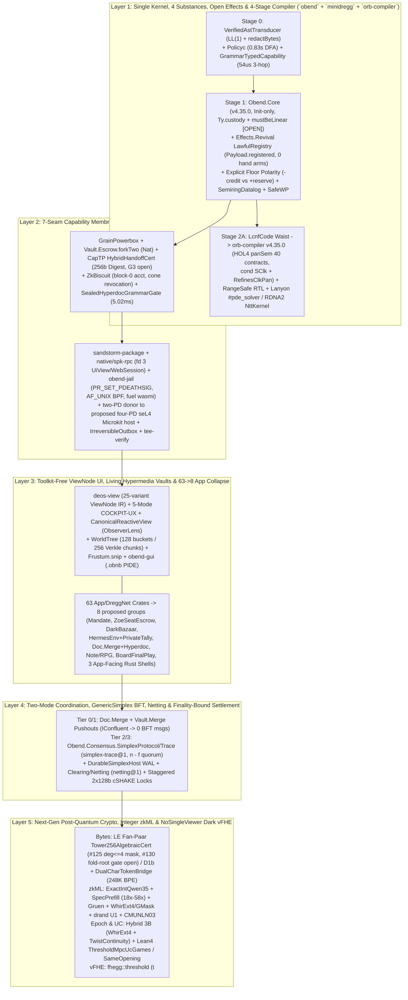

# `breadstuffs` Revival Master Alignment — Ruthless Burn/Cut Ledger, `~/dev/obend` × `Selvage` Extrapolated Architecture, Complete 232-Crate Disposition & Phased Execution Blueprint

**Date:** 2026-11-21 · **Master editor:** `@bread-xaudit-editor` · **Pass 2:** independent on-disk verification of the ledger and cross-dossier gates. · **Pass 3:** second-family re-verification of the ledger, links and tags, folding the `#130` evaluation-opening gate, the `CapTP` `requestFits` and `seL4` mapping precision, and the `discord-bot` custodial scope.
**Trees Inspected (Strictly Read-Only; `0` Edits/Builds in Companion Trees):**
- `breadstuffs` @ `93f2893d89670f96fe4074051f3ab148b9e2af44` (`232` workspace `members` = `150` `default-members` + `82` non-default, `2,479,751` summed member-directory `.rs` lines (§C.1); `19` `exclude` entries; `2,726` tracked `metatheory/` + `840` `orb/` + `55` `orb-compiler/` `.lean` files) `[SOURCE]` [Cargo.toml](file:///Users/ember/dev/breadstuffs/Cargo.toml#L54-L61) `[EXECUTED]`
- `obend` (`~/dev/obend`) @ `88d18a77cf14`..`d50cb853` in the original lanes (Pass 2 checkout `f6db518b18b5`; Pass 3 checkout `5731d70fdd15`, two commits later, with `git diff f6db518b18b5 HEAD` empty on the cited `Core/{Ty,Check}`, `Polis/{CapTP,GrainPowerbox}`, `Vault/{Escrow,FrustumMembrane}`, `Ledger/Floors`, `Lower/LCNF` and `Consensus/SimplexProtocol` files) (`leanprover/lean4:v4.35.0`, `Init`-only, `0` Mathlib deps, `285/285` `LAW-M1` apex modules, `6` Rust crates in `crates/`) `[SOURCE]` [lakefile.toml](file:///Users/ember/dev/obend/lean/lakefile.toml#L1-L27) `[EXECUTED]`
- `minidregg` (`Selvage`) @ `0ce6d9cf8e66` (+ Wave-7A working-tree overlay; `Compiler/Tower256AlgebraicCert.lean` and `prover/src/tower256_algebraic_cert.rs` are uncommitted there, read at mtimes 13:36:53 and 13:11:28 on 2026-11-21, and their line numbers below hold for that state only; `leanprover/lean4:v4.35.0`, Mathlib `56a005855ea1`, `prover/` + `native/spk-rpc`) `[SOURCE]` [lakefile.toml](file:///Users/ember/dev/minidregg/lakefile.toml#L42-L46) `[EXECUTED]`
- `zkml-research` @ `71dafc381680` (+ Wave-7A `native/qwen35audit`, `native/darkvfhe`, [docs/VERDICTS.md](file:///Users/ember/dev/zkml-research/docs/VERDICTS.md)) `[EXECUTED]`
- `plonky3-recursion` @ `fc3c6dfac2` (pinned in `breadstuffs`) / `52e1fab2` / `f17051e8` / `71449a39` / `b471aca7` `[EXECUTED]`
- **Metered Search Ledger:** `Scry: 0` · `Kagi: 0` · `eprint.iacr.org fetches: 0` (local trees + `CV_FROZEN=1 cv --frozen` only) `[EXECUTED]`.

**Claim Provenance Tags ([AGENTS.md](file:///Users/ember/dev/zkml-research/AGENTS.md)):** `[SOURCE]` (verified directly at cited `file:line`), `[DERIVED]` (mathematical or architectural consequence proved/derived from sourced code), `[EXECUTED]` (read-only census, git, or arithmetic check executed here), `[REPORTED]` (benchmark/test figure recorded in repo notes/docs, not re-run under read-only rule), `[HYPOTHESIS]`, `[OPEN]`, `[REFUTED: scope]`.

**Eight sibling dossiers and their companion notes**
1. **Wave Archaeology (`bread-cv-chronicle`):** [BREADSTUFFS_PROMPTS_AND_CLAUDE_REPLIES.md](file:///Users/ember/dev/zkml-research/research/breadstuffs_revival_2026_11_21/BREADSTUFFS_PROMPTS_AND_CLAUDE_REPLIES.md) · [CV_WAVES_INDEX.json](file:///Users/ember/dev/zkml-research/research/breadstuffs_revival_2026_11_21/CV_WAVES_INDEX.json) · [breadstuffs-cv-waves-and-vision-archaeology.md](file:///Users/ember/dev/zkml-research/notes/breadstuffs-cv-waves-and-vision-archaeology.md)
2. **Metatheory & Effects (`bread-lean-effects`):** [METATHEORY_AND_EFFECTS_AUDIT.md](file:///Users/ember/dev/zkml-research/research/breadstuffs_revival_2026_11_21/METATHEORY_AND_EFFECTS_AUDIT.md) · [breadstuffs-metatheory-and-effects-revival.md](file:///Users/ember/dev/zkml-research/notes/breadstuffs-metatheory-and-effects-revival.md)
3. **STARK, Crypto & vFHE (`bread-stark-prover`):** [STARK_AND_CRYPTO_PIPELINE_AUDIT.md](file:///Users/ember/dev/zkml-research/research/breadstuffs_revival_2026_11_21/STARK_AND_CRYPTO_PIPELINE_AUDIT.md) · [breadstuffs-stark-pipeline-replacement-plan.md](file:///Users/ember/dev/zkml-research/notes/breadstuffs-stark-pipeline-replacement-plan.md)
4. **Distributed UI & Obend (`bread-ui-obend-arch`):** [DISTRIBUTED_UI_AND_OBEND_SYNTHESIS.md](file:///Users/ember/dev/zkml-research/research/breadstuffs_revival_2026_11_21/DISTRIBUTED_UI_AND_OBEND_SYNTHESIS.md) · [breadstuffs-distributed-ui-and-obend-revival.md](file:///Users/ember/dev/zkml-research/notes/breadstuffs-distributed-ui-and-obend-revival.md)
5. **Grains, CapTP & seL4 (`bread-cap-grains-sel4`):** [GRAINS_CAPTP_AND_SANDBOX_AUDIT.md](file:///Users/ember/dev/zkml-research/research/breadstuffs_revival_2026_11_21/GRAINS_CAPTP_AND_SANDBOX_AUDIT.md) · [breadstuffs-grains-captp-and-sandbox-revival.md](file:///Users/ember/dev/zkml-research/notes/breadstuffs-grains-captp-and-sandbox-revival.md)
6. **Surface DSLs, `orb` & Specs (`bread-dsl-orb-specs`):** [SURFACE_DSLS_ORB_AND_SPECS_AUDIT.md](file:///Users/ember/dev/zkml-research/research/breadstuffs_revival_2026_11_21/SURFACE_DSLS_ORB_AND_SPECS_AUDIT.md) · [breadstuffs-dsls-orb-and-specs-revival.md](file:///Users/ember/dev/zkml-research/notes/breadstuffs-dsls-orb-and-specs-revival.md)
7. **Blocklace Consensus & Settlement (`bread-blocklace-chain`):** [CONSENSUS_BLOCKLACE_AND_SETTLEMENT_AUDIT.md](file:///Users/ember/dev/zkml-research/research/breadstuffs_revival_2026_11_21/CONSENSUS_BLOCKLACE_AND_SETTLEMENT_AUDIT.md) · [breadstuffs-blocklace-consensus-and-settlement-revival.md](file:///Users/ember/dev/zkml-research/notes/breadstuffs-blocklace-consensus-and-settlement-revival.md)
8. **Starbridge Apps, DreggNet & zkML (`bread-apps-dreggnet`):** [STARBRIDGE_APPS_DREGGNET_AND_ZKML_SYNTHESIS.md](file:///Users/ember/dev/zkml-research/research/breadstuffs_revival_2026_11_21/STARBRIDGE_APPS_DREGGNET_AND_ZKML_SYNTHESIS.md) · [breadstuffs-apps-dreggnet-and-zkml-revival.md](file:///Users/ember/dev/zkml-research/notes/breadstuffs-apps-dreggnet-and-zkml-revival.md)

---

## 0. Executive North Star & Strategic Ruling (`#114`)

### 0.1 Why `breadstuffs` Stalled — Diagnosis of the `2.48M`-LOC Slopcathedral (`[SOURCE]`, `[DERIVED]`)

The archaeology index reports 422 retained sessions, 10,093 distinct prompts and 594 distinct commits across Waves 1–8. Its human-session filter also retains some orchestrator briefs. `[SOURCE]` The following five design costs inform the cutover. `[DERIVED]`
1. **Additive Rust-vs-Lean Twins & Silent Debug Fallbacks:** A `119,865`-LOC Rust executor (`38`-arm `turn::Effect` in [action.rs](file:///Users/ember/dev/breadstuffs/turn/src/action.rs#L1081-L1787)) and a `25,421`-LOC JSON `WireState` shadow ([lean_shadow.rs](file:///Users/ember/dev/breadstuffs/exec-lean/src/lean_shadow.rs#L2003-L2016)) coexisted beside `metatheory/Dregg2` via `dregg-lean-ffi`, which silently degrades plain `cargo test` runs to `marshal-only` (`lean_available() == false` at [build.rs](file:///Users/ember/dev/breadstuffs/dregg-lean-ffi/build.rs#L2965-L2974)), carries `6` runtime gate-bypass env vars (`DREGG_ALLOW_UNVERIFIED_CONSENSUS`, `DREGG_LEAN_PRODUCER=0`, etc.), and breaks Linux `-shared`/Wasm builds via Lean `v4.30.0`'s local-exec TLS `libleanrt.a` `[SOURCE]`.
2. **The `p3` BabyBear Merkle Recursion Wall (`UDR 34.58b`, `K = 25.4×–98×`, `DREGG_PROVE_TURNS=0`):** Deployed IR-v2 (`lb=6, q=19, pow=16` at [descriptor_ir2.rs](file:///Users/ember/dev/breadstuffs/circuit/src/descriptor_ir2.rs#L7269-L7273)) delivers **34.58 bits** provable unique-decoding security (`46.3%` PoW grind) `[SOURCE]` [docs/VERDICTS.md](file:///Users/ember/dev/zkml-research/docs/VERDICTS.md#L115-L119). Wrapping a leaf proof in-circuit requires `38,168` Poseidon2 permutations (`58.25M` cells, `K = 25.4×` child cost) at 34.6b and explodes to **`133,517` permutations / `229.7M` cells (`K = 98×`)** at UD-100 `(6,86,16)` `[REPORTED]`. Proving inline under `state.write()` wedged the devnet for 5 minutes ([prove_pool.rs](file:///Users/ember/dev/breadstuffs/node/src/prove_pool.rs#L6-L14)), forcing `DREGG_PROVE_TURNS` off by default ([state.rs](file:///Users/ember/dev/breadstuffs/node/src/state.rs#L489-L491)), while pinned `plonky3-recursion@fc3c6df` lacks three upstream soundness fixes (`52e1fab2`, `f17051e8`, `71449a39`) `[SOURCE]` `[EXECUTED]`.
3. **1-Felt (`~30.9`-Bit) Commitment "Wounds" & Broken Authority Envelopes:** Production `CapLeaf` ([commitment.rs](file:///Users/ember/dev/breadstuffs/cell/src/commitment.rs#L566)), spend nullifiers ([turn_proving.rs](file:///Users/ember/dev/breadstuffs/node/src/turn_proving.rs#L1193)), DECO/zkOracle adapters ([zkoracle_leaf_adapter.rs](file:///Users/ember/dev/breadstuffs/circuit-prove/src/zkoracle_leaf_adapter.rs#L8-L58)), and `quantified_absence.rs` (`:100-125`) project 256-bit identities into 1 BabyBear felt (`~15.45`-bit birthday collision), while `credentials` ([issuance.rs](file:///Users/ember/dev/breadstuffs/credentials/src/issuance.rs#L85-L95)) serializes `issuer.root_key` inside every holder's `Credential` (`CAP-01`) `[SOURCE]`.
4. **Uncached block ordering & Unfinalized L1 Settlement:** Cordial-Miners `tauOrderFastImpl` ([BlocklaceFinality.lean](file:///Users/ember/dev/breadstuffs/metatheory/Dregg2/Distributed/BlocklaceFinality.lean#L1359-L1373)) is an unproved `@[implemented_by]` twin that drops its past/round caches before `ratifiedLeaderChain`/`tauStep` (the reported 9,169 ms at 35 blocks predates this twin, and current complexity is open), with `0` callers of `store_checkpoint` at [blocklace_sync.rs](file:///Users/ember/dev/breadstuffs/node/src/blocklace_sync.rs#L7729-L7742), while L1 settlement (`numTurns == 2` on a dev Groth16 key) verifies EffectVM steps with **no committee `FinCert` and no capability/conservation check**, enabling permissionless fork capture (`S1`) alongside a `solana-lock` cross-instruction bridge drain (`S2`) `[SOURCE]` `[DERIVED]`.
5. **Noun-Per-Crate Proliferation (`63+` App/DreggNet Crates, `0` Custom AIRs):** Enforcing *"The answer is never `Effect::FooApp`"* without a single declarative workbook language spawned `30` `starbridge-apps/*` and `33` `dreggnet-*` Rust crates (`360K` LOC, `0/63` custom AIRs), where `29/30` factory births silently drop `CellProgram::Cases` (`ChildVkStrategy::Fixed` at [apply.rs](file:///Users/ember/dev/breadstuffs/turn/src/executor/apply.rs#L3591-L3674)) `[SOURCE]`.

### 0.2 The `#114` Strategic Mandate: Extrapolate Forward onto `~/dev/obend` + `Selvage` — Burn the Museum (`[SOURCE]`, `[DERIVED]`)

> **Strategic ruling (#114).** `[REPORTED]` Preserve Breadstuffs as a read-only donor quarry. Build forward in Obend, Selvage/Minidregg and `zkml-research/native`. `[DERIVED]` The proposed ledger retires 206 of 232 workspace crates as implementation units (88.8%). Of those, 29 contribute test vectors or specifications. The other 26 members (11.2%) are candidates for selective shell extraction and hardening. Both donor tips remain relevant to extraction. The census uses local `main`. `git rev-list --left-right --count main...origin/main` returned `1 39`. `[EXECUTED]` [Archaeology note](file:///Users/ember/dev/zkml-research/notes/breadstuffs-cv-waves-and-vision-archaeology.md#L67-L73)

**Key Enabler Verified Across Trees (`[EXECUTED]`):** `breadstuffs/metatheory`, `minidregg`, and `obend/lean` **already share the exact toolchain `leanprover/lean4:v4.35.0`** (`breadstuffs/metatheory` and `minidregg` also share exact Mathlib `56a005855ea1`, while `obend/lean` and `orb-compiler` are `Init`-only with `0` Mathlib dependencies!). Only `orb`, `orb-compiler`, `dregg-serve-spec`, and the stale Aug-7 `libdregg_lean.a` seed remain on `v4.30.0` `[SOURCE]`.

---

## 1. Part A — The Ruthless Burn / Cut Ledger (Verified Defect Proofs)

Every subsystem below is **retired permanently** rather than repaired in place; its concrete source defects serve as anti-regression `#tooth` specifications (`obend/lean/Obend/Teeth/Logic/GroundTeeth.lean:49-59`) for the successor `[DERIVED]`:

| Domain | Burned / Cut `breadstuffs` (& Stale Spin-Out) Subsystems | Decisive Ground-Truth Defect Proof (`[SOURCE]` / `[DERIVED]`) |
|---|---|---|
| **A1. Execution Twins & FFI Shims** | `turn` (`119.9K` LOC), `exec-lean` (`25.4K`), `dregg-lean-ffi` (`35.0K`), `cell` (`62.4K`), `node` (`153.4K`), `sdk` (`63.5K`), `wire` (`10.8K`), `preflight`, plus **`minidregg/Theory/ObjectiveBend*`** (`39` top-level / `46` tracked files) | `turn` splits `38` `Effect` arms (`18` Lean-delegated, `4` covered/unwired, `9` host-local, `7` dead/inverted) where `Effect::invert` returns a wrong inverse for two arms (the `GrantCapability` inverse revokes the input `cap.slot`, not the slot the forward grant allocated, and the `CellUnseal` inverse re-seals under a zero reason commitment, at [reversible.rs](file:///Users/ember/dev/breadstuffs/turn/src/reversible.rs#L235-L270)), `produce_via_lean` ([lean_apply.rs](file:///Users/ember/dev/breadstuffs/exec-lean/src/lean_apply.rs#L1796-L1914)) diverges on slot writes, `Introduce` ([apply.rs](file:///Users/ember/dev/breadstuffs/turn/src/executor/apply.rs#L3269-L3284)) amplifies parent expiry & sets `allowed_effects = None` (violating [CellModel.tla](file:///Users/ember/dev/breadstuffs/spec/CellModel.tla#L574-L579)), and `ChildVkStrategy::Fixed` (`:3591`) drops `Cases`. `exec-lean` `WireState` ([lean_shadow.rs](file:///Users/ember/dev/breadstuffs/exec-lean/src/lean_shadow.rs#L2003-L2016)) drops slot caveats/delegations. `minidregg/Theory/ObjectiveBend*` drops shadowed custody in `Ty.insertCanonical` ([ObjectiveBendTypes.lean](file:///Users/ember/dev/minidregg/Theory/ObjectiveBendTypes.lean#L132)) and uses non-linear `addUses` on `ifBool` ([ObjectiveBendTyping.lean](file:///Users/ember/dev/minidregg/Theory/ObjectiveBendTyping.lean#L300)) `[SOURCE]`. |
| **A2. Legacy `p3` STARK, Recursion & Broken Crypto** | `circuit` prover (`226.3K`), `circuit-prove` (`156.9K`), `recursion-verify`, `plonky3-recursion@fc3c6df`, `constraint-lowering`, `deco-prove`, `audit`, `turn-prover`, `verifier`, `sumcheck-toy`, `fold-opening`, `crypto-{hermine,tanuki,traccoon,hashrand,xmvrf}`, `hints`, `uc-crypthol`, `vendor/{bulletproofs-*,curve25519-*,plonky3-fri-*,fhe-dregg}` | IR-v2 is `34.58b` UDR (`K = 25.4×–98×` Merkle wrap); `stark_zk.rs:90-123` uses non-CSPRNG `SmallRng` masks (`73b` Johnson); `fc3c6df` takes `num_queries` & `log_arities` from proof targets (`verifier.rs:1378-1379` in `git show fc3c6dfac2`; the local checkout sits at `52e1fab2aa`, where the same two lines are at [verifier.rs](file:///Users/ember/dev/plonky3-recursion/recursion/src/pcs/fri/verifier.rs#L1383-L1384); [targets.rs](file:///Users/ember/dev/plonky3-recursion/recursion/src/pcs/fri/targets.rs#L82-L90)) and omits 31-bit canonicality (`(2^27-1)/p_BB ≈ 6.67%` ambiguous felts, [circuit_builder.rs](file:///Users/ember/dev/plonky3-recursion/circuit/src/builder/circuit_builder.rs#L1166-L1205)); `constraint-lowering` ([lib.rs](file:///Users/ember/dev/breadstuffs/constraint-lowering/src/lib.rs#L92-L95)) accepts `0 >= 10^9` at `bits = 30` (`[REFUTED: bits=30 comparison soundness]`); `audit` `CountProof` proves `>= K` not `== K` ([proofs.rs](file:///Users/ember/dev/breadstuffs/audit/src/proofs.rs#L45-L89)); `crypto-hermine` uses SplitMix64 (`lib.rs:57`); `VRF.lean:139` `Pseudorandom` is pointwise `False`; `Dregg2_Carriers.thy:65,177` quantifies over unbounded `∀𝒜` (`collapsing_not_secure_cr` `:233`) with `fdregg_realization_under_carriers` open `[SOURCE]` `[DERIVED]`. |
| **A3. Broken Auth, Capability, Custody & seL4 Stubs** | `credentials`, `bridge::present`, `cell-crypto`, `rbg`, `dregg-sandbox`, `dregg-auth`, `webauth-core`, `grain-{turn,verify-wasm,fork,commons}`, `sandstorm-serve`, `hosted-{lease,durable}`, `attest-check`, `ProcessKernel`, `verifier-stark` | `credentials` leaks `issuer.root_key` in serialized `Credential` + unsorted `binary_search` revocation (`CAP-01`, `CAP-10`); `wire` allows `CapHello` session takeover & zero-epoch GC (`CAP-02`) while `captp` exposes `cert.swiss` (`CAP-09`); `HeaderHeldRights` trusts `x-dregg-held-rights: root` & `dregg-auth` MCP ignores destructive `args` (`CAP-11`); `webauth-core` scans holder-appended blocks for `acct`/`subject` (`CAP-12`); `grain-fork` `fork_two` over signed `i64` mints arbitrary budget via `(-N, avail+N)` (`CAP-06`); `settle_ledger.rs:266` appends onto torn JSONL EOF causing double charges (`CAP-07`); `ReadCap::attenuate` copies root `ViewKey` (`CAP-21`); `ProcessKernel` (`process_kernel.rs:994`) shares one global `(slot, 0)` CSpace across child PDs (`CAP-03`); `verifier-stark` is a 51-line zero-check stub (`CAP-30`) `[SOURCE]`. |
| **A4. Consensus `tau` & Broken L1 Settlement** | `BlocklaceFinality.lean` (`tauOrderFastImpl`), `coord` (`Stingray`), `dfa-federation`, `lightclient`, `braid-hook`, `chain` (`DreggDVN`, SP1 `DreggVault`, 2-turn dev Groth16), `solana-lock` (as-is), `poa-web` | `tauOrderFastImpl` (`BlocklaceFinality.lean:1359`) uses an uncached comparator (current complexity open) with unproved `ChainExtends` & retractable `finalLeaderAt` (`C1/C2`); `coord` Stingray (`budget.rs:386`) allocates `floor(B(f+1)/(2f+1))` per silo, allowing aggregate authorizations above `B` & uses `PrivateLegProof { stark_ok: bool }` (`C3/C6`); L1 settlement (`numTurns == 2`, 76/76 retired VK coords in `DreggGroth16VerifierUpgradeable.sol:560`) omits `FinCert` & auth (`S1`, `S5`); `solana-lock` (`processor.rs:409,740`) reuses `"dregg-solana-unlock-v1"` across `escrow_release` and `unlock` draining the pooled vault (`S2`); cross-chain locks lack `now <= deadline` on release (`S3`); `DreggDVN.sol:145` drops `leafIndex` & lacks `0x00/0x01` Merkle tags (`S4`) `[SOURCE]` `[DERIVED]`. |
| **A5. UI Forks, Unwired DSLs & 63+ App Wrappers** | `starbridge-v2` (`175.2K` GPUI fork), `starbridge-v2/web`, `deos-{js*,zed*,leptos}`, `servo-render`, `discord-bot` (`78.7K`), `dregg-dsl*` (`4` crates), `dregg-analyzer`, `orb` H2/H3/gRPC/mesh sprawl, `30` `starbridge-apps/*` + `33` `dreggnet-*` Rust crates | `starbridge-v2` forks GPUI against the toolkit-free `ViewNode` law; `deos-leptos:388` trusts body authority; `discord-bot` (`cipherclerk.rs:55-63`, `UserCipherclerk::derive`) derives the signing key of every hosted (custodial, unlinked) Discord user from the bot secret and the user's snowflake, so whoever holds the bot secret can sign as any hosted user, while an externally linked user keeps their own key and the bot only verifies a challenge signature (`commands/link_proof.rs:20-22,104-128`, `IdentityMode::ExternalVerified`); `dregg-dsl` has `0` prod callers, drops `let`s, and emits all `Match` arms unconditionally; `dregg-analyzer` emits `Finding::verified` on loader failure & 0-sig captures; `edge-mandate:517,967` permits `\n` SSH `authorized_keys` shell injection; `kvstore:235` has `Always => []`; `privacy-voting` (`tally_forgery.rs:139`) admits `10^6` tally from 1 fake ID; `do_settle` (`dreggnet-market:723`) leaks cleartext `reveal_bid`; `dregg-multiway-tug` (`fold.rs:704`) proves `pk[0]=7` turn count `N` instead of a win (`B1`) `[SOURCE]`. |

---

## 2. Part B — Proposed architecture (`~/dev/obend` × `Selvage` × `zkml-research/native`)

`[DERIVED]` The diagram shows the cutover target. Gate status and current implementation evidence are in §4.1.

### 2.1 Layer 1 — Kernel, Four Substances, Open Registered Effects & Compiler Tower (`[SOURCE]`, `[DERIVED]`, `[OPEN]`)

1. **Canonical Core4 Kernel & Deletion of the Stale Spin-Out:** Migrate consumers and retire `minidregg/Theory/ObjectiveBend*` (`39` top-level / `46` tracked files) and establish `obend/lean/Obend/Core/*` (`lean4:v4.35.0`, `Init`-only) as the **sole** Core4 kernel (`TypeGraph` equi-recursive agreement, `Ty.insertCanonical` non-shareable preservation, `ifBool` linear `joinUses` + `branchesAgree`, fuel-free `Bidirectional.checkAgainst`, `GradedSessionMetatheory`, and `RangeSafe`) `[SOURCE]` `[DERIVED]`.
2. **Mandatory Linear-Custody Gate (`G1`, `[OPEN]`):** In `obend` HEAD, `mustBeLinear` is not yet enforced in [Ty.lean](file:///Users/ember/dev/obend/lean/Obend/Core/Ty.lean#L377-L378) (`validContext`). Before widening `.perform` ([Check.lean](file:///Users/ember/dev/obend/lean/Obend/Core/Check.lean#L645-L648)) to return custody-bearing types, tighten `validContext` so every custody-bearing type requires `quantity == .linear` (`mustBeLinear`), preventing `effectCase` from binding conserved custody at `.affine` and silently dropping value, and align `Obend.Lower.CPS` continuation grades (`Reuse.once`) `[DERIVED]` `[OPEN]`.
3. **Standing Authority vs Intra-Turn Linear Custody (Zero-Contradiction Substance Split):**
   - **Standing Authority (`Cap` Substance):** Lives in [GrainPowerbox.lean](file:///Users/ember/dev/obend/lean/Obend/Polis/GrainPowerbox.lean#L977-L1178) + [GrammarTypedCapability.lean](file:///Users/ember/dev/minidregg/Theory/GrammarTypedCapability.lean#L1241-L1410) + [TypedAuthorization.lean](file:///Users/ember/dev/minidregg/Theory/TypedAuthorization.lean): constructive, re-exhibitable across turns, monotone under attenuation (`CellModel.tla:574-579` clamping child expiry & facet masks), and checked at the tip against lineage/channel revocation (`thaw_never_resurrects_revoked_cap`, `Accepted.rejects_descendant`). **No `Obend.Core.Ty.custody` variable ever denotes a standing credential** `[DERIVED]`.
   - **Value and escrow in flight (G1–G2).** The proposed design uses `Ty.custody` (`mustBeLinear` remains open under G1) + `Obend.Vault.Escrow` (`forkTwo` over `Nat` at [Escrow.lean](file:///Users/ember/dev/obend/lean/Obend/Vault/Escrow.lean#L2673-L2735)), and represents book limits with a tagged floor policy (`CreditLimit(Nat)` permitting debit down to `-floor` as in [CanonicalResourceKernel.lean](file:///Users/ember/dev/minidregg/Theory/CanonicalResourceKernel.lean#L108-L129) vs `MinReserve(Nat)` enforcing `+floor` for non-issuers as in [Floors.lean](file:///Users/ember/dev/obend/lean/Obend/Ledger/Floors.lean#L414-L430) — never copying raw `Nat` across trees!) `[SOURCE]` `[DERIVED]`.
   - **Open Registered Effect Waist:** Port `minidregg`'s open `LawfulRegistry` (`Payload.registered` in [ResourceTransaction.lean](file:///Users/ember/dev/minidregg/Kernel/ResourceTransaction.lean#L74-L83) + `Effects/Revival.lean`, `0` hand-dispatched arms) into `obend` so `Obend.Vault.Replay.Turn` (`29` closed constructors today) opens cleanly to domain laws without ever recreating `turn::Effect`'s 38-arm monolith `[DERIVED]` `[OPEN]`.
4. **Four-Stage Verified Compiler & Hardware/PDE Tower:**
   - **Stage 0 (Ingestion & Policy):** `VerifiedAstTransducer` (`ll1Parse` + `redactBytes` at `301–532 MB/s`) + `Policyc.lean` (`0.83 s` certified 129-state byte-DFA) + `GrammarTypedCapability` (`54 µs` native 3-hop product-DFA decider `#118`) `[SOURCE]` `[REPORTED]`.
   - **Stage 1 (Typed Core & Datalog):** `Obend.Core` (`Core4` + `MultiTurnHoare.SafeWP` lifted over `HoareSep`) paired with `4 × 16-bit` `u64` limb predicates (`Obend.Core.RangeSafe` + `beforePolyConstraint_iff_lt` at `CompileToPiopCore.lean:548`) and 3-valued `Obend.Reasons` + `Obend.SymbolicZk.SemiringDatalog` `[SOURCE]` `[DERIVED]`.
   - **Stage 2A (G6, verified imperative `Pancake` & Silicon/PDE Lowering):** Bump `orb-compiler` (`25,451` LOC, `0` Mathlib deps, `40` HOL4 `panSem` row contracts + `PanSemAgree.evaluate_agree`) from `v4.30.0` to `v4.35.0` as `Obend.Lower.Pancake` behind `Obend.Lower.LCNF.LcnfCode` (`compileLcnfToCore4` at [LCNF.lean](file:///Users/ember/dev/obend/lean/Obend/Lower/LCNF.lean#L584) supplies the Core4 spec; add conditional `cond` to `SClk` and replace vacuous universal `∀ s` `WF` hypotheses with entry-precondition `RefinesClkPan` `[OPEN]`). Scalar/hardware/scientific workloads lower via `RangeSafe` (`compileTerm_evaluates_sound` `:1046`), `Lanyon` (`obend/LANYON.md` 6-rung `#pde_solver` `EndToEndPdeCert`), RDNA2 `NttKernel.lean:3989` (`584 µs` @ `2^20` Goldilocks DFT), and `SystolicDataflowThroughput` (`285/285` `LAW-M1` apex @ `obend@d50cb853`) `[SOURCE]` `[DERIVED]`.

### 2.2 Layer 2 — Syntactic/Linear Capability Membrane, Sandstorm Grains & Mathlib-Free `seL4` (`[SOURCE]`, `[DERIVED]`, `[OPEN]`)

1. **Hybrid-PQ CapTP & ZkBiscuit Widening (`G3`, `[OPEN]`):** Adopt [CapTP.lean](file:///Users/ember/dev/obend/lean/Obend/Polis/CapTP.lean#L335-L578)'s Swiss-free `HybridHandoffCert` (closing `CAP-09` `cert.swiss` leakage and enforcing both Ed25519 & ML-DSA-65) and `guardedHole_resolve_at_most_once` (currently over a `UInt64` pending ID). The transport must bind that ID to an authenticated vat and epoch and reject epoch zero. `[SOURCE]` Request containment needs no new enforcement: `verifyHybridHandoff` (`:357-364`) already conjoins `requestFits c.request held` (`:353-355`: rights, quota, cells and expiry within the held mandate), and `acceptHandoff` (`:366-370`) grants only when it passes. `verifyHybridHandoff_sound` (`:372-388`) concludes `attenuates (c.request.granted held) held` from `delegate_child_attenuates`, because `granted` is built by `held.delegate` (`:318-320`); `verifyHybridHandoff_complete` (`:390-402`) takes `requestFits` as a hypothesis. `[OPEN]` G3 is therefore a width and epoch gate: **widen `SwissNum` (`:191`), `handoffNonce` (`:338`), the `SortedU64Set` replay set (`:157`) and `PendingId` (`:424`) from `UInt64` to 256-bit `Digest`**, and add the epoch binding with `msg_epoch == 0` rejected. `[EXECUTED]` `grep -c epoch` on `CapTP.lean` at `5731d70fdd15` returns `0`, so the port introduces that field. Keep `requestFits` in the widened verifier; restating it in the conclusion of `verifyHybridHandoff_sound` is optional. Read `acct`/`subject` exclusively from issuer block `0` and revoke by ancestor cone (`ZkBiscuit.lean:710`) `[SOURCE]` `[DERIVED]`.
2. **Sealed Hyperdocument & Per-Slot ML-KEM Confinement (`G7`, `[OPEN]`):** Wave-7A `#118` ([grammar_capability.rs](file:///Users/ember/dev/minidregg/prover/src/grammar_capability.rs#L2226-L2244)) implements `CiphertextSealMismatch` when the witness supplies the cell blinding key. The 4 KiB full-gate benchmark reports 5.02 ms `[REPORTED]`. [Benchmark](file:///Users/ember/dev/zkml-research/notes/grammar-typed-capabilities-and-hyperdoc-gate.md#L45-L49) Remaining welds: distribute only per-slot `X25519MLKEM768`-wrapped keys `{slot_secret(i) | i ∈ granted}` (closing `CAP-21`), bind keyless public `ciphertext` to `saltedPatchRoot` (`F4`), and switch public guard dispatch from sampled `checkPrivate` to `Tower256AlgebraicCert` (`F6`, which waits on the `#130` gate in G8) `[SOURCE]` `[OPEN]`.
3. **Physical Confinement (`spk-rpc` + `obend-jail` + four-PD `seL4` Chokepoint + `tee-verify`):**
   - Pair quarried `sandstorm-package` (`SHA-512` + `verify_strict` Ed25519 `.spk`, fixing `manifest.rs:287` role extraction) with `minidregg/native/spk-rpc` (`fd 3` Cap'n Proto `UiView`/`WebSession`), backed by `GrainCustodyHost` (`double_charge_impossible_during_wal_recovery` `:266`, Ariadne ingress `:554`) + `Theory.Retained` (`reachable_eq_recompute` `:235`) `[SOURCE]` `[DERIVED]`.
   - Quarry `sel4/dregg-firmament/src/sandbox.rs` + `grain-jail::LineChannel` into `obend-jail` (replacing [bwrap.rs](file:///Users/ember/dev/obend/crates/obend-sandbox/src/bwrap.rs#L391-L402)'s permissive Seatbelt profile and fixing `CAP-17` with `PR_SET_PDEATHSIG(SIGKILL)`, `AF_UNIX` seccomp filtering, checked `ADDFD`, clean env allowlists, and fuel-metered `wasmi`) `[SOURCE]` `[DERIVED]`.
   - Compile mathlib-free `obend` `Core4` + `GrammarTypedCapability` + `IrreversibleOutbox` (`<10 MiB` target ELF, using the two-PD `sel4/chokepoint.system` recipe) into stock `seL4` Microkit 2.2.0 (`ingress-pd -> commit-pd -> persist-pd [digest ack] -> tx-egress-pd`), adding `return false;` at `commit-pd:125` (`CAP-28`) and returning `-ENOSYS` on `GETRANDOM`/`/dev/urandom` unless backed by hardware TRNG (`CAP-29`), paired with hardened `tee-verify` (`CAP-24..26`: RFC 5280 `is_ca`/`KeyUsage`, RIM `FWID` pin, mandatory SNP CRLs, TDX service-TD policy, Blackwell `B200`) `[SOURCE]` `[DERIVED]`.
   - **What the 7.75 MiB figure measures.** `[SOURCE]` `sel4/chokepoint.system` declares two protection domains, `commit` and `persist`. Its saved boot log (QEMU `aarch64`, Microkit 2.2.0, Lean 4.30.0) has the loader report the root server at physical `0x60246000..0x60a05000` (`sel4/chokepoint-boot-evidence.log:14`). `[EXECUTED]` That span is 8,122,368 bytes, about 7.75 MiB. It is the root-server mapping of the booted two-PD image, not the size of one ELF: the saved `commit-pd` ELF is 15,911,024 bytes on disk. `[EXECUTED]` `grep -rl` for `ingress-pd` and `tx-egress` across the `.system`, `.toml` and `.md` files under `sel4/` returns nothing. `[HYPOTHESIS]` The four-PD `ingress -> commit -> persist -> tx-egress` split and its `<10 MiB` budget extrapolate that two-PD measurement forward. No four-PD image has been built, and the two-PD image links the Lean 4.30.0 runtime rather than the `v4.35.0` `obend` core.

### 2.3 Layer 3 — Toolkit-Free `ViewNode` UI, Living Hypermedia Vaults & 63-Crate Collapse (`[SOURCE]`, `[DERIVED]`)

1. **One Portable `ViewNode` Projection Waist:** Quarry `deos-view`'s 25-variant toolkit-free `ViewNode` IR (`19,963` LOC) over `Obend.Vault.{WorldTree,ChunkedWorld,FrustumMembrane,Affordance,Projection}` (`128` buckets / `256` Verkle chunks; `Frustum`, `Frustum.snip`, `Disposition` `sever/attenuate/interpose/tether` at [FrustumMembrane.lean](file:///Users/ember/dev/obend/lean/Obend/Vault/FrustumMembrane.lean#L661-L665), `regraftFrustum_atomic_conserving` `:1169` — `[REFUTED: hallucinated identifier FrustumSlice]`; `fog_of_war_noninterference`; `synthesizeRepairBadge`), `minidregg` `CanonicalReactiveView` (`ObserverLens`), 5-mode `COCKPIT-UX` (`Inhabit/Author/Dev/Inspect/Operate`), and `obend/crates/obend-gui` (`3,530` LOC headless SVG/VCD/STL/NGC cards & `.obnb` PIDE notebooks) `[SOURCE]` `[DERIVED]`.
2. **Bijective Collapse of `63` App/DreggNet Crates (`30` `starbridge-apps/*` + `33` `dreggnet-*` $\to$ 7 domain groups + 1 shell group):** As mapped in [STARBRIDGE_APPS_DREGGNET_AND_ZKML_SYNTHESIS.md](file:///Users/ember/dev/zkml-research/research/breadstuffs_revival_2026_11_21/STARBRIDGE_APPS_DREGGNET_AND_ZKML_SYNTHESIS.md) §7.1, each of the 63 packages has one proposed destination. The port still needs to express eight groups of Rust-only checks as judged laws. The destinations are (1) `GrainPowerbox` + `Vault.Mandate` + `Vault.Form` (`lineSafe` killing SSH `\n` injection) + `GrammarTypedCapability`, (2) `Vault.Escrow` + `ZoeSeatSettlement` + `ProviderExecutionLease`, (3) `Crypto.DarkBazaar` + `Judge.{Clearing,Netting}`, (4) `Polis.HermesEnv` + encrypted `{0,1}` tally, (5) `Doc.Merge` + `Vault.Retention` + `Hyperdocument`, (6) declarative `.obend` `Note`/RPG workbooks with `SeatCustody::Remote`, (7) real-cell `board_final` match/replay verification, and (8) three app-facing Rust shells (`obend-surfaces`, `obend-prove-worker`, `obend-oracles-e2ee`). Phase 1 also proposes `obend-jail`, `obend-net` and `obend-lightclients` for the wider cutover `[DERIVED]`.

### 2.4 Layer 4 — Two-Mode Coordination, `GenericSimplex` BFT, Netting & Finality-Bound Settlement (`[SOURCE]`, `[DERIVED]`, `[OPEN]`)

1. **Distinct Typed Finality Ladders (`[REFUTED: single 4-enum collapse]`):** Keep policy requirements (`minidregg` `Theory/Finality.lean` `Tier`), consensus evidence (`obend/lean/Obend/Consensus/Finality.lean` `FinalityTier`), and archive/constitutional proofs distinct:
   - *Tier 0/1 (`LocalOptimistic` / `EquivocationBounded`):* Relax `Obend.Consensus.Finality.turnCommitTier` (`:234`) **exclusively** for operations proved `IConfluent` (`Obend.Doc.Merge` `merge_isPushout`, `Vault.Merge`, `Pred.CoordinationDial.dial_sound` — `0` BFT messages, retaining `CreatorTips::Pair` fork exhibits), and govern bounded local leases via `Obend.Slot.Budget` (burning Stingray's `/ n`-omitting counter) `[SOURCE]` `[DERIVED]`.
   - *Tier 2/3 (`Byzantine` / `Cryptographic`):* Standardize on `Obend.Consensus.{SimplexProtocol,SimplexTrace,SimplexLiveness,Epistemic}` (`@[csimp] checkTraceExec_eq_checkTrace` at `SimplexTrace.lean:848`, `simplex-trace@1` FFI-tested), **generalizing under G5 `SimplexProtocol.lean:149-152` from `n = 3f + 1` (`quorum = 2f + 1`) to `minidregg`'s `n >= 3f + 1` with VOTE/COMMIT quorum `n - f`** ([GenericSimplexQuorum.lean](file:///Users/ember/dev/minidregg/Kernel/GenericSimplexQuorum.lean#L62-L88) `thresholds_standard`, closing the 5-node `f=1` `two_f_plus_one_quorum_unsafe_above_legacy` split!), backed by journal-before-wire `DurableSimplexHost` (`UnifiedDeos.lean:500`), copy-before-verify `IrreversibleOutbox` (`IrreversibleOutbox.lean:63-178`), and `MultiTurnHoare.SafeWP` (`guardedRetry_loop_safeWP`) `[SOURCE]` `[DERIVED]`.
2. **Multilateral Netting & Hardened Cross-Chain Settlement (`S1–S7` remediation proposed, G12 open):** Compress gross obligations via `Obend.Judge.{Clearing,Netting}` (`settleNetting_agrees_with_gross` at `Netting.lean:453`, `netting@1`) + `Obend.Apps.SovereignDrex`. The proposed destination L1 contracts (EVM, CosmWasm, Solana) would verify **2×128-bit lossless `cSHAKE256` state/effect roots + committee `Simplex` `FinCert` + `IrreversibleOutbox` `effectsRoot` + full-turn conservation**, enforce domain-separated instruction tags (`"dregg-solana-pool-unlock-v2"` vs `"dregg-solana-escrow-release-v2"` + `(chain_id, program_id, clearing_root)` + Token-2022 + upgrade-authority `init`), enforce staggered/abort-certified escrow windows (`now <= T_release` vs `now > T_release + Δ_finality`), and use `0x00/0x01` domain-separated `Obend.Receipt.Merkle` proofs, paired with quarried `eth-lightclient` and `cosmos-lightclient` `[SOURCE]` `[DERIVED]`.

### 2.5 Layer 5 — Next-Generation Post-Quantum Crypto, Integer `zkML` & `NoSingleViewer` Dark vFHE (`[SOURCE]`, `[DERIVED]`, `[OPEN]`)

1. **Canonical Wire & Byte/Policy/BPE Spine:**
   - **32-Byte Little-Endian Fan–Paar `Tower256` Wire (`G4`):** Standardize receipt/FFI `GF(2^256)` serialization on `minidregg`'s **32B Little-Endian Fan–Paar** codec (`Theory/BinaryTowerFanPaarCodec.lean:256`, `bpe_bridge.rs:345`) and test byte reversal against asymmetric vectors. Prove coordinate and field-operation agreement with `obend/lean/Obend/Crypto/BinaryTower256.lean:339` (currently big-endian) `[SOURCE]` `[OPEN]`.
   - **Byte PCS (G9) and algebraic absence (G8).** `[SOURCE]` The BPE and U1 paths use different padding and masking profiles (`pad≥512, zk(3)` and `pad≥2048, zk(2)`). `[OPEN]` Use one salted byte commitment or prove equality across commitments. `[REPORTED]` The 51.4 ms, 4 KiB result measures the sampled `Tower256PrivateContentCert` with eight step queries. `[OPEN]` Transfer the ArkLib bound to coherent paths before using 148 queries for raw admission. [FRI accounting](file:///Users/ember/dev/zkml-research/notes/breadstuffs-stark-pipeline-replacement-plan.md#L17-L21)
   - **Sumcheck mask for standalone algebraic absence (#125).** `[SOURCE]` The working-tree `Tower256AlgebraicCert` carries a four-column mask body `yMlin + p1Full·yU1 + z2·yU2 + z3·yU3`, where `z2` accumulates `zeta_pows[j]·(x_j² + x_j)` and `z3` accumulates `zeta_pows[j]·(x_j³ + x_j²)` (`z2_pt`/`z3_pt` at `tower256_algebraic_cert.rs:1951-1952` for middle rounds and `:2030-2031` for round `d`). Every round polynomial is a `PolyDeg4` interpolated from five points. Both checkers enforce `2*fq + 1 <= 2^d` (`:2314`; Lean `:3032`). [Mask body](file:///Users/ember/dev/minidregg/Compiler/Tower256AlgebraicCert.lean#L2686-L2750) `[REPORTED]` The #125 thread worded the mask as `(x0²+x0)·y_ua·y_ub·y_uc` with `y_uc` constant along `x0`, plus `(xd²+xd)·y_ud·y_ue` for the final round, to hide the middle-round `[X^3] p_j(X)` coefficient. The working tree holds the sum form above, not that product form. `[OPEN]` The Lean file proves `zero_position_disclosure_hiding` (`:746`) for the terminal half-cube evaluations. It states no theorem that the middle-round or final-round polynomials are hidden.
   - **Evaluation-opening soundness gate (#130, blocking).** `[SOURCE]` The prover fixes `r_full` from the sumcheck transcript (`tower256_algebraic_cert.rs:1939-2053`), computes `col_evals_at_r` (`:2055-2060`), squeezes `eta` and `rho` from `alg_batch_transcript(r3, sc_polys, col_evals_at_r)` (`:2063-2065`), and only then builds and commits the `d` fold words `w_1..w_d` using `alpha_j = piv_j·r_full[j]` (`:2098-2119`). `eval_fold_roots` enter the transcript once, in `alg_full_fri_stmt_bytes` (`:2132`), which seeds the FRI challenges and query positions. The verifier follows the same order (`:2379-2443`). `verify_coset_fri_receipt` proximity-tests `fri_word0`, the `rho` batch welded at level 0 (`:2531-2538`). The fold words get pair openings and a per-query fold equation (`:2543-2589`) and no proximity test. The Lean checker has the same shape (`runSumcheckVerifier` `:2840-2855`, `algFriPins batchBytes r.evalFoldRoots` `:3062`, `checkSingleQueryWeld` `:2945-3006`). [Prover fold loop](file:///Users/ember/dev/minidregg/prover/src/tower256_algebraic_cert.rs#L2098-L2132) · [Lean checker](file:///Users/ember/dev/minidregg/Compiler/Tower256AlgebraicCert.lean#L3018-L3069) `[DERIVED]` A prover that knows every `r_j` before committing can keep honest columns, claim a false `col_evals_at_r` that satisfies the terminal identity, alter one entry of each pair of `w_d` so the pair folds to the false `v_batch`, and repair that entry's ancestry with one altered entry per level down to `w_1`. Each `w_d` pair is fed by `2^d` level-0 positions and exactly one of them then fails its fold equation, so a query detects the forgery with probability `2^{-d}` and the receipt is accepted with probability `(1 - 2^{-d})^{fq}`. `[EXECUTED]` `(1 - 2^-10)^148 = 0.8654`; at the largest count the cap admits for `d = 10`, `fq = 511`, it is still `0.607`. `[SOURCE]` `checkAlgebraic_sound_or_collision` remains a true statement because this case is its third named escape disjunct, `PcsEvalFoldEscape` (`:3237-3239, 3268-3276`). `algebraic_escape_prob_lt_two_pow_neg_230` (`:3296`) is an inequality over the Schwartz–Zippel and `LogUp256` counts and does not bound that disjunct. `[OPEN]` Bind `w_1..w_d` inside a `(d+1)`-round BaseFold (ZCF23, eprint 2023/1705) evaluation-opening sumcheck over fresh challenges `s_0..s_d`, committing `eval_fold_root[j]` before squeezing `s_{j+1}`, and bound `PcsEvalFoldEscape` in Lean. The algebraic certificate is not an admission proof until then.
2. **100%-Integer `zkML`, `SpecPrefill`, `WhirExt4`/`GMask` & `CMUNLN03` Continual Memory:**
   - `[DERIVED]` Combine `ExactIntQwen35Engine`, `SpeculativePrefillAudit`, `DualCharTokenBridge`, BabyBear Ext4 sumcheck, `WhirExt4` and `GMask`. `[REPORTED]` The speculative prefill lane reports 18×–58× rollout speedup. `[SOURCE]` For four 16-ary rounds at `m=20`, with 22 queries per round, `whir_beats_ligero_zkml_scales` gives **1,424 WHIR versus 66,560 Ligero opened field elements**. At `m=24`, five rounds give **1,776 versus 266,240**. Both Ligero counts use 64 column queries. Serialized receipt size and security depend on the concrete backend and schedule. [Theorem statement](file:///Users/ember/dev/minidregg/Selvage/WhirMultiRoundSoundness.lean#L669-L673)
   - `[SOURCE]` `WhirExt4` uses cSHAKE256 Merkle hashing and `WhirPcs61` uses SHA-256. The `CMUNLN03` verifier binds the prior and resulting state roots and the forget request under bounded fixed-point checks. `[OPEN]` Connect that verifier to `Obend.Vault.Retention` and bind U1 selection to a post-countersignature `drand` beacon (G9). [Unlearning verifier `verify_zk_unlearning_certificate`](file:///Users/ember/dev/zkml-research/native/qwen35audit/src/continual_memory.rs#L5245-L5266) (line numbers at file mtime 13:48:03 on 2026-11-21; the file is under active edit, so locate by symbol)
3. **Hybrid 3B Epoch Aggregation & Single-Kernel Lean 4 UC:**
   - **Build Hybrid 3B Now:** Verify private client/grain leaf proofs prior to `Simplex` vote/ack, and batch replayable turns off-lock into one end-of-epoch `WhirExt4` + `TwistContinuity` proof (`0` per-turn in-circuit hashes; `3A` `AccRbrFold` at `q=2^64-257` remains gated R&D). Replace `uc-crypthol` with `obend`'s 0-axiom single-kernel `Obend.Crypto.{ThresholdMpcUcGames,SameOpening,ThresholdFheAndLatticeVrf}` + `Selvage.AuditSampling` `[SOURCE]` `[DERIVED]`.
4. **`NoSingleViewer` Dark vFHE (`fhegg::threshold` × `darkvfhe` × `PqThresholdCustody`):**
   - Marry `fhegg-fhe::threshold`'s multi-process hybrid-PQ $t<n$ committee (`LiveCommittee`) + `Obend.Polis.PqThresholdCustody.stepEpochLatch` to `darkvfhe`'s `HoistedB61` (`N=8192, log Q=183`, Blum `t = 4,355,803,843`, separating `DirectCt3` from `WithRlk` pending `244b` RLK estimator pin) + `WhirPcs61` (`DVFHEWH1`, `expected_persistent_a_root` & `(mr,mc,blow)` bounds enforced per `#117`).
   - **Mandatory Privacy Gates (`G10`, `#119`, `#122`):** Place `verify_hoisted_whir_bundle` + persisted `C8` `OpeningAuthorization` **strictly ahead of `partial_decrypt`** (`ReleaseGateRouting.BindingGate`), **quarantine raw `PdSuccinctProof` (`dark_gdn.rs:274,759`) until shifted key/noise evaluations are blinded inside `GMask61`/`WhirPcs61`**, and enforce `R_refresh = 1` for the >40-bit privacy profile. In #122, the constructor rejects a cadence above the correctness limit and records `tvd_40b_strict_mode` as a flag. `[SOURCE]` `[OPEN]` The reported 2,758.5 ms state update and 46.53–47.94 s three-custodian block both used `R_refresh = 3`. `[REPORTED]` [Timing rows](file:///Users/ember/dev/zkml-research/notes/darkvfhe-homomorphic-state-and-hybrid-block.md#L63-L67)

---

## 3. Part C — Complete 232-Crate + 19-Exclude + Standalone Accountability Matrix

### C.1 Quantitative Summary of the 232 Workspace Members (`[SOURCE: breadstuffs/Cargo.toml:54-61]`, `[DERIVED]`)

| `#114` Disposition | Workspace Crates (`#` / `%`) | Summed directory `.rs` LOC (`LOC` / `%`) | Operational Meaning |
|---|---:|---:|---|
| **`BURN`** | `147` (`63.4%`) | `1,469,951` (`59.3%`) | Omit the implementation from the successor |
| **`SUPERSEDED`** | `30` (`12.9%`) | `241,347` (`9.7%`) | Retire crate; capability/concept already cleanly realized in `obend` / `minidregg` / `zkml-research` |
| **`QUARRY_VECTORS`** | `29` (`12.5%`) | `468,463` (`18.9%`) | Retain vectors or a Law-1 specification for the successor |
| **`QUARRY_SHELL`** | `26` (`11.2%`) | `299,990` (`12.1%`) | Quarry & harden narrow Rust shell/primitive into `obend` / `Selvage` companion leaf |
| **Total (`Cargo.toml` `members`)** | **`232` (`100.0%`)** | **`2,479,751` (`100.0%`)** | `150` `default-members` + `82` non-default members; `0` omissions, `0` duplicates |

`[EXECUTED]` Python `tomllib` matched the C.2 paths in manifest order, the 232 package names and all default flags, and the 19 C.3 paths in exclude order. For each member, count newline bytes in tracked `.rs` files beneath its directory using `git ls-files`, skipping `vendor/` components. All 232 row counts reproduce. Summing them gives **2,479,751**. Counting each path once gives **2,471,380**. The 8,371-line difference comes from four nested `demo/` members (7,396 lines) and `starbridge-v2/web` (975 lines), each counted in its parent row as well. The 19 exclude rows are tabulated separately. Their Rust and Lean counts match `git ls-files` and newline counts beneath each exclude root under the same nested-`vendor/` skip. The skip changes one row: `deos-homeserver` is 506 first-party lines, or 13,474 with its tracked `vendor/askama_derive` copy (20 `.rs` files).

### C.2 Complete 232-Crate Accountability Ledger (Indexed `1..232` in `breadstuffs/Cargo.toml` Order)

| `#` | Member Path (`Package`) | Def? | `.rs` LOC | Lane | Disposition | Verified Ground-Truth Rationale & `obend` × `Selvage` Target (`[SOURCE]` / `[DERIVED]`) |
|---:|---|---:|---:|---|---|---|
| 1 | `macaroon` (`dregg-macaroon`) | D | `4,435` | `bread-cap-grains-sel4` | **`QUARRY_SHELL`** | Clean `4.4K`-LOC SHA-256 parent-tail-bound macaroon library (`551fc897f`); retain as classical edge compatibility leaf alongside `Obend.Polis.ZkBiscuit`. |
| 2 | `secrets` (`dregg-secrets`) | D | `1,079` | `bread-cap-grains-sel4` | **`QUARRY_SHELL`** | Quarry encrypted secret store (`1.1K` LOC), fixing `encrypted.rs:62-68,87` to bind canonical slot path in AEAD AAD. |
| 3 | `token` (`dregg-token`) | D | `8,740` | `bread-stark-prover` | **`QUARRY_VECTORS`** | Extract Macaroon/Biscuit attenuation vectors (`format.rs:6-20`); retire 3-way token split in favor of `Obend.Polis.ZkBiscuit` + `GrammarTypedCapability`. |
| 4 | `tokenizer` (`dregg-tokenizer`) | D | `1,636` | `bread-stark-prover` | **`QUARRY_SHELL`** | Quarry X25519+ChaCha20-Poly1305 guest secret-isolation envelope (`encrypt.rs:83-98`, upgraded to hybrid `X25519MLKEM768`) into `obend-sandbox`. |
| 5 | `hints` (`dregg-hints`) | D | `3,824` | `bread-stark-prover` | **`BURN`** | 3.8K-LOC classical pairing/KZG weighted threshold hints requiring trusted setup; outside PQ hash/lattice spine (`docs/VERDICTS.md`). |
| 6 | `commit` (`dregg-commit`) | D | `7,389` | `bread-stark-prover` | **`SUPERSEDED`** | 7.4K-LOC Poseidon2/BLAKE3 commitment helpers; superseded by `cSHAKE256` (`Obend.Digest.Cshake256`) + `WhirExt4`/`WhirPcs61`. |
| 7 | `trace` (`dregg-trace`) | D | `3,946` | `bread-stark-prover` | **`QUARRY_VECTORS`** | Extract request-bound Datalog fixtures (`verify.rs:31-62`) for `Policyc`/`SemiringDatalog`, then burn crate. |
| 8 | `demo` (`dregg-demo`) | D | `14,763` | `bread-apps-dreggnet` | **`BURN`** | Legacy demo/vertical wrapper crate (`demo`, `14763` LOC) coupled to `cell`/`turn`; re-express as declarative `obend` grain or retire. |
| 9 | `demo-agent` (`dregg-demo-agent`) | D | `20,113` | `bread-apps-dreggnet` | **`BURN`** | Legacy demo/vertical wrapper crate (`demo-agent`, `20113` LOC) coupled to `cell`/`turn`; re-express as declarative `obend` grain or retire. |
| 10 | `demo/sdk-consensus` (`dregg-sdk-consensus-demo`) | D | `594` | `bread-apps-dreggnet` | **`BURN`** | Legacy demo/vertical wrapper crate (`demo/sdk-consensus`, `594` LOC) coupled to `cell`/`turn`; re-express as declarative `obend` grain or retire. |
| 11 | `demo/dungeon-service` | D | `3,768` | `bread-apps-dreggnet` | **`BURN`** | Legacy demo/vertical wrapper crate (`demo/dungeon-service`, `3768` LOC) coupled to `cell`/`turn`; re-express as declarative `obend` grain or retire. |
| 12 | `demo/real-dungeon-service` | D | `2,025` | `bread-apps-dreggnet` | **`BURN`** | Legacy demo/vertical wrapper crate (`demo/real-dungeon-service`, `2025` LOC) coupled to `cell`/`turn`; re-express as declarative `obend` grain or retire. |
| 13 | `federation` (`dregg-federation`) | D | `18,656` | `bread-blocklace-chain` | **`QUARRY_SHELL`** | Quarry hybrid Ed25519+ML-DSA-65 FROST/QC primitives into `obend-pq-mpc` + `Obend.Polis.PqThresholdCustody`; burn classical `ReceiptQc::Votes` downgrade (`receipt.rs:370`) & `epoch.rs:304` pre-`Err` mutation. |
| 14 | `dregg-codec` | D | `1,102` | `bread-lean-effects` | **`QUARRY_VECTORS`** | Extract canonical wire framing vectors; adopt `minidregg` `StreamCodec` + LE Fan-Paar `Tower256` wire in `obend-ffi`. |
| 15 | `circuit` (`dregg-circuit`) | D | `226,298` | `bread-stark-prover` | **`QUARRY_VECTORS`** | Retire 226.3K-LOC BabyBear `p3` AIR prover (`UDR 34.58b`, `R_P=13`, 1-felt `xmss.rs:81`); keep only IR-v2 `PROVENANCE` discipline & regression teeth. |
| 16 | `circuit-prove` (`dregg-circuit-prove`) | D | `156,923` | `bread-stark-prover` | **`BURN`** | 156.9K-LOC 4-layer `p3` Merkle recursion tower (`38,168` perms, `K=25.4x-98x`, `1,560` Law-1 sites, red `rotation_*_smoke`); replaced by Hybrid 3B `WhirExt4` + `TwistContinuity`. |
| 17 | `recursion-verify` (`dregg-recursion-verify`) | D | `2,245` | `bread-stark-prover` | **`BURN`** | Pinned to `plonky3-recursion@fc3c6df` with 3 unpinned FRI/canonicality bugs (`52e1fab2`, `f17051e8`, `71449a39`); retire with `p3`. |
| 18 | `deco-prove` (`dregg-deco-prove`) | D | `2,316` | `bread-stark-prover` | **`BURN`** | Unsound stub (`prover.rs:137-160`): 1-felt (~31b) hash of caller facts with zero TLS/notary or FRI verification; use `calltree/verify` TLSNotary instead. |
| 19 | `audit` (`dregg-audit`) | D | `2,415` | `bread-stark-prover` | **`BURN`** | Broken (`proofs.rs:45-89,222-300`): `CountProof` proves `>= K` not `== K` and `ConsistencyProof` checks only `1..=12` depth; superseded by `audit-flashprove`. |
| 20 | `bridge` (`dregg-bridge`) | D | `48,345` | `bread-blocklace-chain` | **`BURN`** | 48.3K-LOC monolith mixing broken `present.rs` (`CAP-01`), fake `stripe_deco.rs` (1-felt, 0 TLS/FRI), RPC-trusting `ethereum_relayer.rs`, & 5/27-leg `mina*.rs`; quarry only Mina opening verifiers. |
| 21 | `wire` (`dregg-wire`) | D | `10,810` | `bread-lean-effects` | **`BURN`** | Monolithic RPC/CapTP server (`CAP-02` `CapHello` takeover, zero-epoch GC, classical `validate_handoff` `:3066`); replace with typed `Obend.Polis.CapTP` + `Channel` frames. |
| 22 | `persist` (`dregg-persist`) | D | `50,295` | `bread-lean-effects` | **`SUPERSEDED`** | Legacy RocksDB/redb cell store tied to `cell`/`turn`; superseded by `Obend.Polis.GrainCustodyHost` + `Obend.Vault.WorldTree` (`128` buckets / `256` Verkle chunks). |
| 23 | `cell` (`dregg-cell`) | D | `62,416` | `bread-lean-effects` | **`BURN`** | 62.4K-LOC Rust cell twin (`1`-felt `CapLeaf` fold `:566`, dead `has_revoked_ancestor`, post-state `PublicRoot` swap `eval.rs:832`); superseded by `Obend.Core` + `GrainPowerbox` + `WorldTree`. |
| 24 | `cell-crypto` (`dregg-cell-crypto`) | D | `12,303` | `bread-cap-grains-sel4` | **`BURN`** | Shor-broken Curve25519/Ristretto Bulletproofs/OT/stealth, root-leaking `ReadCap::attenuate` (`CAP-21`), provenance-zeroing `SealedBox` (`CAP-22`), unpinned `peer_exchange`; replace with hybrid ML-KEM per-slot keys + `SameOpening`. |
| 25 | `turn` (`dregg-turn`) | D | `119,865` | `bread-lean-effects` | **`BURN`** | 119.9K-LOC 38-arm `Effect` twin (`action.rs:1081-1787`; `Effect::invert` wrong-slot `GrantCapability` inverse at `reversible.rs:249-270`, `Introduce` amplification `apply.rs:3269-3284`, `ChildVkStrategy::Fixed` `Cases` drop `:3591`, `Finality::default()==Final`); replaced by `Obend.Slot.Core4` + `Effects.Revival`. |
| 26 | `turn-prover` (`dregg-turn-prover`) | D | `7,737` | `bread-stark-prover` | **`BURN`** | Couples `AggregatedBundle` DTOs to `circuit-prove`; replaced by prover-free `Selvage` receipt types. |
| 27 | `exec-lean` (`dregg-exec-lean`) | D | `25,421` | `bread-lean-effects` | **`BURN`** | Lossy JSON `WireState` adapter (`lean_shadow.rs:2003` drops slot caveats & delegation snapshots); replaced by `obend/crates/obend-ffi` binary plans. |
| 28 | `coord` (`dregg-coord`) | D | `10,507` | `bread-blocklace-chain` | **`BURN`** | 10.5K-LOC 2PC/Stingray crate (`C3` aggregate local authorizations can exceed the budget, `C6` height outside vote preimage & mock `PrivateLegProof { stark_ok: bool }`); replaced by `Obend.Slot.Budget` + `JointCoReceipt`. |
| 29 | `tests` (`dregg-tests`) | D | `23,274` | `infra-cli-test-unassigned` | **`QUARRY_VECTORS`** | 23.3K-LOC workspace integration suite (`9` dark `__legacy_tests`/`__wip_tests` modules, `heap_value_mod_p_alias_at_the_commitment.rs`); extract bug-repro teeth into `obend` `#tooth` suite, burn crate. |
| 30 | `types` (`dregg-types`) | D | `2,411` | `bread-lean-effects` | **`SUPERSEDED`** | Legacy BabyBear/32B ID types; superseded by `Obend.Core.Data` + `Obend.Digest.Cshake256` 256-bit `Digest`. |
| 31 | `sdk` (`dregg-sdk`) | D | `63,503` | `bread-lean-effects` | **`BURN`** | 63.5K-LOC client SDK coupled to 38-arm `turn::Effect` & legacy `wire`; replace with thin `obend` plan/vault client. |
| 32 | `dregg-sdk-net` | D | `14,799` | `bread-blocklace-chain` | **`QUARRY_VECTORS`** | Quarry thin `dregg-client-sign` patterns (requiring `Simplex` `FinCert` / `opens256`); burn `TestNode` twin & legacy `wire` client. |
| 33 | `node` (`dregg-node`) | D | `153,440` | `bread-lean-effects` | **`BURN`** | 153.4K-LOC monolith (`0` `store_checkpoint` callers `:7729`, unjournaled `FinalizationVote` `:2067`, write-lock proving `:11010`, 1-felt nullifier `:1193`); replaced by `Obend.Vault.UnifiedDeos` + `GrainCustodyHost`. |
| 34 | `intent` (`dregg-intent`) | D | `27,679` | `bread-lean-effects` | **`SUPERSEDED`** | Rust intent solver/matcher; superseded by `Obend.Judge.{Clearing,Netting}` + `Obend.Crypto.SameOpening` (`privateConvexSameOpeningJudge`). |
| 35 | `net` (`dregg-net`) | D | `9,011` | `bread-blocklace-chain` | **`QUARRY_SHELL`** | Quarry QUIC `PeerNode` + Plumtree/anti-entropy `GossipNetwork` (`9.0K` LOC) into `obend-net`, hardening with hybrid PQ CapTP auth, domain/epoch nonces, & TLS-key binding (`C11`). |
| 36 | `discharge-gateway` (`dregg-discharge-gateway`) | D | `894` | `bread-cap-grains-sel4` | **`QUARRY_VECTORS`** | Extract 3rd-party caveat discharge flow vectors (`551fc897f`) into `Obend.Polis.ZkBiscuit` / `CapTP`. |
| 37 | `teasting` (`dregg-teasting`) | D | `21,126` | `infra-cli-test-unassigned` | **`QUARRY_VECTORS`** | 21.1K-LOC property/differential harness; port cross-layer state/conservation fuzzers onto `obend-ffi`, burn crate. |
| 38 | `app-framework` (`dregg-app-framework`) | D | `21,851` | `bread-ui-obend-arch` | **`BURN`** | 21.9K-LOC HTTP app shell whose default `HeaderHeldRights` trusts client `x-dregg-held-rights: root` (`CAP-11`); superseded by `Obend.Vault.Affordance`. |
| 39 | `dregg-payable` | D | `768` | `bread-apps-dreggnet` | **`BURN`** | 0.8K-LOC payment trait wrapper for legacy `turn`; superseded by `Obend.Core.Ty.custody`. |
| 40 | `dregg-dsl` | D | `2,685` | `bread-dsl-orb-specs` | **`BURN`** | `0` prod callers, drops `let`s, `*balance = *other - amount` bug, `gen_rust` `Ok(())` stubs, unconditional `Match` across 4 backends; superseded by `Obend.Core` + `Pred`. |
| 41 | `dregg-dsl-runtime` | D | `1,545` | `bread-dsl-orb-specs` | **`BURN`** | 31-bit BLAKE3 tag (`composition.rs:766`) & fail-open column skip (`:212`); retire with `dregg-dsl`. |
| 42 | `dregg-dsl-tests` | D | `822` | `bread-dsl-orb-specs` | **`BURN`** | Unit tests over dead `dregg-dsl` with commented-out handwritten verifiers; retire with `dregg-dsl`. |
| 43 | `dregg-dsl-differential` | D | `3,258` | `bread-dsl-orb-specs` | **`QUARRY_VECTORS`** | Quarry the 15 mutation-pinned `4x16-bit` `u64-le` comparison vectors (`comparison_wrap_soundness.rs:86-605`) into `Obend.Core.RangeSafe` / `Pred`; burn crate. |
| 44 | `blocklace` (`dregg-blocklace`) | D | `20,142` | `bread-blocklace-chain` | **`SUPERSEDED`** | Burn Cordial-Miners `tau` (uncached `tauOrderFastImpl` comparator, unproved `ChainExtends`, `OPEN-CM-XSORT`) & `constitution`; extrapolate `CreatorTips::Pair` fork exhibits onto `Obend.Doc.Merge` + `SimplexProtocol` (`n - f` quorum). |
| 45 | `captp` (`dregg-captp`) | D | `17,688` | `bread-cap-grains-sel4` | **`QUARRY_VECTORS`** | Retire leaky `cert.swiss` handoff (`CAP-09`) & zero-epoch GC (`CAP-02`); adopt `Obend.Polis.CapTP` (`HybridHandoffCert` widened from `UInt64` to 256-bit `Digest`). |
| 46 | `cli` (`dregg-cli`) | D | `8,257` | `infra-cli-test-unassigned` | **`BURN`** | 8.3K-LOC legacy `dregg` CLI (`dist = true`) coupled to `node`/`sdk`/`turn`; replace with lean `obend` CLI. |
| 47 | `verifier` (`dregg-verifier`) | D | `5,093` | `bread-stark-prover` | **`BURN`** | Links full recursion prover transitively (`Cargo.toml:49-58`); replaced by compiled mathlib-free Lean byte checkers. |
| 48 | `protocol-tests` (`dregg-protocol-tests`) | D | `3,595` | `infra-cli-test-unassigned` | **`QUARRY_VECTORS`** | 3.6K-LOC multi-peer protocol conformance vectors; port CapTP/Simplex adversarial schedules to `obend`, burn crate. |
| 49 | `observability` (`dregg-observability`) | D | `2,374` | `infra-cli-test-unassigned` | **`BURN`** | 2.4K-LOC tracing/metrics wrapper with inverted dependency on `turn`; use clean leaf `tracing` in `obend` Rust shells. |
| 50 | `storage` (`dregg-storage`) | D | `17,204` | `bread-lean-effects` | **`SUPERSEDED`** | Content-addressed blob store; superseded by `Obend.Vault.{WorldTree,ChunkedWorld}` + `Theory.Retained`. |
| 51 | `starbridge-apps/nameservice` (`starbridge-nameservice`) | D | `5,956` | `bread-apps-dreggnet` | **`BURN`** | Noun-per-crate Rust app wrapper (`nameservice`, `5956` LOC) over legacy `cell`/`turn`; express as declarative `Obend.Core` (`Core4`) + `Obend.Vault` grain (`0` bespoke Rust crates). |
| 52 | `dfa` (`dregg-dfa`) | D | `4,347` | `bread-blocklace-chain` | **`QUARRY_SHELL`** | Quarry ACI regex derivatives (`derivative.rs:322`), Moore `minimize` (`compiler.rs:147`), & `policyc` adapter into `Obend.Judge.SymbolicRegexBisim` + `GrammarTypedCapability`. |
| 53 | `dfa-federation` (`dregg-dfa-federation`) | D | `262` | `bread-blocklace-chain` | **`BURN`** | 262-LOC BLS `ThresholdQC` wrapper omitting router ID & epoch binding (`lib.rs:59-114`). |
| 54 | `rbg` (`dregg-rbg`) | D | `2,141` | `bread-cap-grains-sel4` | **`BURN`** | 2.1K-LOC remnants after VFS deletion (`bdc1cd5b3`), with unpinned `ScopedIntentPool` (`CAP-20`); superseded by `GrainPowerbox`. |
| 55 | `credentials` (`dregg-credentials`) | D | `3,684` | `bread-cap-grains-sel4` | **`BURN`** | CRITICAL `CAP-01`/`CAP-10`: serializes `issuer.root_key` inside holder `Credential`, `wide_issuer_path -> None`, unsorted `binary_search` revocation bypass; replace with `Obend.Polis.ZkBiscuit` + `Tower256`. |
| 56 | `directory` (`dregg-directory`) | D | `2,768` | `bread-cap-grains-sel4` | **`SUPERSEDED`** | 2.8K-LOC petname/directory service; superseded by `Obend.Polis.GrainPowerbox` petname tables + `Obend.Vault.WorldTree`. |
| 57 | `starbridge-apps/identity` (`starbridge-identity`) | D | `4,531` | `bread-apps-dreggnet` | **`BURN`** | HIGH `lib.rs:212` + `eval.rs:832` evaluates `PublicRoot` against unfrozen post-state slot 5; express in `Obend.Polis.{GrainPowerbox,ZkBiscuit}`. |
| 58 | `starbridge-apps/subscription` (`starbridge-subscription`) | D | `5,754` | `bread-apps-dreggnet` | **`BURN`** | Noun-per-crate Rust app wrapper (`subscription`, `5754` LOC) over legacy `cell`/`turn`; express as declarative `Obend.Core` (`Core4`) + `Obend.Vault` grain (`0` bespoke Rust crates). |
| 59 | `starbridge-apps/governed-namespace` (`starbridge-governed-namespace`) | D | `7,591` | `bread-apps-dreggnet` | **`BURN`** | Noun-per-crate Rust app wrapper (`governed-namespace`, `7591` LOC) over legacy `cell`/`turn`; express as declarative `Obend.Core` (`Core4`) + `Obend.Vault` grain (`0` bespoke Rust crates). |
| 60 | `starbridge-apps/compartment-workflow-mandate` (`starbridge-compartment-workflow-mandate`) | D | `4,476` | `bread-apps-dreggnet` | **`BURN`** | Noun-per-crate Rust app wrapper (`compartment-workflow-mandate`, `4476` LOC) over legacy `cell`/`turn`; express as declarative `Obend.Core` (`Core4`) + `Obend.Vault` grain (`0` bespoke Rust crates). |
| 61 | `starbridge-apps/storage-gateway-mandate` (`starbridge-storage-gateway-mandate`) | D | `3,097` | `bread-apps-dreggnet` | **`BURN`** | Noun-per-crate Rust app wrapper (`storage-gateway-mandate`, `3097` LOC) over legacy `cell`/`turn`; express as declarative `Obend.Core` (`Core4`) + `Obend.Vault` grain (`0` bespoke Rust crates). |
| 62 | `starbridge-apps/privacy-voting` (`starbridge-privacy-voting`) | D | `3,877` | `bread-apps-dreggnet` | **`BURN`** | CRITICAL cleartext `1/2/3` votes & `CountGe(1)` allows 1 fabricated ID to post `1,000,000` tally (`tally_forgery.rs:139`); replace with `Obend.Polis.HermesEnv` + `HoistedB61` `{0,1}` encrypted ballots. |
| 63 | `starbridge-apps/bounty-board` (`starbridge-bounty-board`) | D | `3,646` | `bread-apps-dreggnet` | **`BURN`** | Noun-per-crate Rust app wrapper (`bounty-board`, `3646` LOC) over legacy `cell`/`turn`; express as declarative `Obend.Core` (`Core4`) + `Obend.Vault` grain (`0` bespoke Rust crates). |
| 64 | `starbridge-apps/agent-provenance` (`starbridge-agent-provenance`) | D | `3,049` | `bread-apps-dreggnet` | **`BURN`** | Noun-per-crate Rust app wrapper (`agent-provenance`, `3049` LOC) over legacy `cell`/`turn`; express as declarative `Obend.Core` (`Core4`) + `Obend.Vault` grain (`0` bespoke Rust crates). |
| 65 | `starbridge-apps/tool-access-delegation` (`starbridge-tool-access-delegation`) | D | `3,638` | `bread-apps-dreggnet` | **`BURN`** | Noun-per-crate Rust app wrapper (`tool-access-delegation`, `3638` LOC) over legacy `cell`/`turn`; express as declarative `Obend.Core` (`Core4`) + `Obend.Vault` grain (`0` bespoke Rust crates). |
| 66 | `starbridge-apps/sealed-auction` (`starbridge-sealed-auction`) | D | `4,202` | `bread-apps-dreggnet` | **`BURN`** | Noun-per-crate Rust app wrapper (`sealed-auction`, `4202` LOC) over legacy `cell`/`turn`; express as declarative `Obend.Core` (`Core4`) + `Obend.Vault` grain (`0` bespoke Rust crates). |
| 67 | `starbridge-apps/polis` (`starbridge-polis`) | D | `6,847` | `bread-apps-dreggnet` | **`BURN`** | Noun-per-crate Rust app wrapper (`polis`, `6847` LOC) over legacy `cell`/`turn`; express as declarative `Obend.Core` (`Core4`) + `Obend.Vault` grain (`0` bespoke Rust crates). |
| 68 | `starbridge-apps/escrow-market` (`starbridge-escrow-market`) | D | `4,464` | `bread-apps-dreggnet` | **`BURN`** | Noun-per-crate Rust app wrapper (`escrow-market`, `4464` LOC) over legacy `cell`/`turn`; express as declarative `Obend.Core` (`Core4`) + `Obend.Vault` grain (`0` bespoke Rust crates). |
| 69 | `starbridge-apps/first-room` (`starbridge-first-room`) | D | `1,721` | `bread-apps-dreggnet` | **`BURN`** | Noun-per-crate Rust app wrapper (`first-room`, `1721` LOC) over legacy `cell`/`turn`; express as declarative `Obend.Core` (`Core4`) + `Obend.Vault` grain (`0` bespoke Rust crates). |
| 70 | `starbridge-apps/compute-exchange` (`starbridge-compute-exchange`) | D | `4,222` | `bread-apps-dreggnet` | **`BURN`** | Noun-per-crate Rust app wrapper (`compute-exchange`, `4222` LOC) over legacy `cell`/`turn`; express as declarative `Obend.Core` (`Core4`) + `Obend.Vault` grain (`0` bespoke Rust crates). |
| 71 | `starbridge-apps/gallery` (`starbridge-gallery`) | D | `3,197` | `bread-apps-dreggnet` | **`BURN`** | Noun-per-crate Rust app wrapper (`gallery`, `3197` LOC) over legacy `cell`/`turn`; express as declarative `Obend.Core` (`Core4`) + `Obend.Vault` grain (`0` bespoke Rust crates). |
| 72 | `starbridge-apps/swarm-orchestration` (`starbridge-swarm-orchestration`) | D | `4,440` | `bread-apps-dreggnet` | **`BURN`** | Noun-per-crate Rust app wrapper (`swarm-orchestration`, `4440` LOC) over legacy `cell`/`turn`; express as declarative `Obend.Core` (`Core4`) + `Obend.Vault` grain (`0` bespoke Rust crates). |
| 73 | `starbridge-apps/supply-chain-provenance` (`starbridge-supply-chain-provenance`) | D | `3,821` | `bread-apps-dreggnet` | **`BURN`** | Noun-per-crate Rust app wrapper (`supply-chain-provenance`, `3821` LOC) over legacy `cell`/`turn`; express as declarative `Obend.Core` (`Core4`) + `Obend.Vault` grain (`0` bespoke Rust crates). |
| 74 | `starbridge-apps/agent-orchestration` (`starbridge-agent-orchestration`) | D | `5,692` | `bread-apps-dreggnet` | **`BURN`** | Noun-per-crate Rust app wrapper (`agent-orchestration`, `5692` LOC) over legacy `cell`/`turn`; express as declarative `Obend.Core` (`Core4`) + `Obend.Vault` grain (`0` bespoke Rust crates). |
| 75 | `starbridge-apps/tussle` (`starbridge-tussle`) | D | `3,723` | `bread-apps-dreggnet` | **`BURN`** | Noun-per-crate Rust app wrapper (`tussle`, `3723` LOC) over legacy `cell`/`turn`; express as declarative `Obend.Core` (`Core4`) + `Obend.Vault` grain (`0` bespoke Rust crates). |
| 76 | `starbridge-apps/kvstore` (`starbridge-kvstore`) | D | `1,886` | `bread-apps-dreggnet` | **`BURN`** | HIGH `lib.rs:228-238` `get` & catch-all `Always` have `constraints: vec![]`, bypassing `COUNT<=12` & `Monotonic(VERSION)`; express in `Obend.Doc.Merge` / `WorldTree`. |
| 77 | `starbridge-apps/branch-stitch-multiplayer` (`starbridge-branch-stitch-multiplayer`) | D | `324` | `bread-apps-dreggnet` | **`BURN`** | Noun-per-crate Rust app wrapper (`branch-stitch-multiplayer`, `324` LOC) over legacy `cell`/`turn`; express as declarative `Obend.Core` (`Core4`) + `Obend.Vault` grain (`0` bespoke Rust crates). |
| 78 | `starbridge-apps/execution-lease` (`starbridge-execution-lease`) | D | `2,091` | `bread-apps-dreggnet` | **`BURN`** | Noun-per-crate Rust app wrapper (`execution-lease`, `2091` LOC) over legacy `cell`/`turn`; express as declarative `Obend.Core` (`Core4`) + `Obend.Vault` grain (`0` bespoke Rust crates). |
| 79 | `starbridge-apps/org` (`starbridge-org`) | D | `2,980` | `bread-apps-dreggnet` | **`BURN`** | Noun-per-crate Rust app wrapper (`org`, `2980` LOC) over legacy `cell`/`turn`; express as declarative `Obend.Core` (`Core4`) + `Obend.Vault` grain (`0` bespoke Rust crates). |
| 80 | `starbridge-apps/vat` (`starbridge-vat`) | D | `914` | `bread-apps-dreggnet` | **`BURN`** | Noun-per-crate Rust app wrapper (`vat`, `914` LOC) over legacy `cell`/`turn`; express as declarative `Obend.Core` (`Core4`) + `Obend.Vault` grain (`0` bespoke Rust crates). |
| 81 | `starbridge-apps/billing` (`starbridge-billing`) | D | `3,689` | `bread-apps-dreggnet` | **`BURN`** | Noun-per-crate Rust app wrapper (`billing`, `3689` LOC) over legacy `cell`/`turn`; express as declarative `Obend.Core` (`Core4`) + `Obend.Vault` grain (`0` bespoke Rust crates). |
| 82 | `dregg-sandbox` | D | `1,131` | `bread-cap-grains-sel4` | **`BURN`** | Refuses 4/5 tiers and runs `wasmi` with zero fuel/memory/timeout limits (`CAP-23`); replace with fuel-metered Wasm in `obend-sandbox`. |
| 83 | `starbridge-apps/guard` (`starbridge-guard`) | D | `2,687` | `bread-apps-dreggnet` | **`BURN`** | Noun-per-crate Rust app wrapper (`guard`, `2687` LOC) over legacy `cell`/`turn`; express as declarative `Obend.Core` (`Core4`) + `Obend.Vault` grain (`0` bespoke Rust crates). |
| 84 | `starbridge-apps/domains` (`starbridge-domains`) | D | `4,532` | `bread-apps-dreggnet` | **`BURN`** | Noun-per-crate Rust app wrapper (`domains`, `4532` LOC) over legacy `cell`/`turn`; express as declarative `Obend.Core` (`Core4`) + `Obend.Vault` grain (`0` bespoke Rust crates). |
| 85 | `starbridge-apps/edge-mandate` (`starbridge-edge-mandate`) | D | `2,160` | `bread-apps-dreggnet` | **`BURN`** | CRITICAL `lib.rs:517,967` `split_whitespace()` allows interior `\n` SSH `authorized_keys` raw-shell injection; express in `Obend.Vault.{Mandate,Form}` (`lineSafe`) + `GrammarTypedCapability`. |
| 86 | `dregg-umem` | D | `1,088` | `bread-lean-effects` | **`BURN`** | 1.1K-LOC legacy unified-memory wrapper; unneeded in `obend`. |
| 87 | `dregg-storage-templates` | D | `7,267` | `bread-lean-effects` | **`BURN`** | 7.3K-LOC schema templates coupled to `dregg-cell` 16-slot layout; superseded by `Obend.Vault` forms. |
| 88 | `preflight` (`dregg-preflight`) | D | `7,085` | `bread-lean-effects` | **`BURN`** | 7.1K-LOC dry-run wrapper over `turn` executor; superseded by `Core4` `typed_iff_preparable_within_work` (`Core4.lean:83`). |
| 89 | `dregg-lean-ffi` | D | `34,954` | `bread-lean-effects` | **`BURN`** | 35.0K-LOC FFI bridge with silent debug `marshal-only` fallback (`build.rs:2965`) + 6 bypass env vars + `libleanrt` TLS collision; replaced by `obend/crates/obend-ffi`. |
| 90 | `lightclient` (`dregg-lightclient`) | D | `3,734` | `bread-blocklace-chain` | **`BURN`** | 3.7K-LOC `p3` history fold omitting finality/auth/conservation (`S1` permissionless fork capture `lib.rs:183-202`); replaced by `Selvage` + `Simplex` `FinCert` verifier. |
| 91 | `redteam` (`dregg-redteam`) | D | `4,766` | `infra-cli-test-unassigned` | **`QUARRY_VECTORS`** | 4.8K-LOC adversarial exploit regression suite; port exploit scenarios directly into `obend/lean/Obend/Teeth` & `obend-sandbox` tests, burn crate. |
| 92 | `perf` (`dregg-perf`) | D | `3,531` | `infra-cli-test-unassigned` | **`BURN`** | 3.5K-LOC stale benchmark runner pulling `starbridge-v2` and referencing deleted `prove_effect_vm_p3`. |
| 93 | `dregg-auth` | D | `5,550` | `bread-cap-grains-sel4` | **`BURN`** | Action-only MCP gate (`CAP-11` ignores destructive `args`) + holder-appended `subject` spoofing (`CAP-12`); replace with `GrammarTypedCapability` + `PolicyAstTransducerEmit`. |
| 94 | `dregg-query` | D | `4,152` | `bread-dsl-orb-specs` | **`SUPERSEDED`** | Has `Q-1` unbound `effects`, `Q-2` unhashed `Peak.height`, `Q-3` `hi+1` wrap; extrapolate CALM + `StreamCheck` onto `Obend.SymbolicZk.SemiringDatalog` + height/body-pinned `Selvage` MMR. |
| 95 | `audit-flashprove` | N | `2,545` | `bread-stark-prover` | **`QUARRY_SHELL`** | Crown-jewel `drand` commit-countersign-before-beacon random-audit harness (`27,635` `cp_verify` calls); wire into `qwen35audit` `U1` layer sampling. |
| 96 | `dregg-merge` | D | `1,229` | `bread-blocklace-chain` | **`SUPERSEDED`** | 1.2K-LOC CvRDT prototype (`GrowSet::join` `debug_assert_eq!` bug `state.rs:136`); superseded by `Obend.Doc.Merge` (`merge_isPushout`) + `Obend.Vault.Merge`. |
| 97 | `dregg-userspace-verify` | D | `3,194` | `bread-lean-effects` | **`SUPERSEDED`** | 3.2K-LOC userspace wrapper around legacy receipts; superseded by standalone `Selvage` byte-stream verifiers. |
| 98 | `dregg-deploy` | D | `6,698` | `bread-blocklace-chain` | **`BURN`** | 6.7K-LOC legacy node deployment CLI; superseded by `obend` grain/chokepoint deployment tooling. |
| 99 | `dregg-analyzer` | D | `2,522` | `bread-dsl-orb-specs` | **`BURN`** | `0` capture emitters; emits false `Finding::verified` on loader failure & 0-signature captures (`blocklace.rs:161`, `receipts.rs:384`). |
| 100 | `dregg-mirror` | D | `3,289` | `bread-blocklace-chain` | **`SUPERSEDED`** | 3.3K-LOC read mirror (`C7` unbound `receipt_hash <-> content_addr` & attestation-chosen `att.threshold`); superseded by `Obend.Vault.TransclusionAndMirror`. |
| 101 | `dregg-epoch` | D | `503` | `bread-blocklace-chain` | **`SUPERSEDED`** | 0.5K-LOC unwired `EpochManifest`; superseded by `Obend.Receipt.Negotiation` (`selectMinCostCommonJudge_minimal`) + `Judge.Genealogy`. |
| 102 | `dregg-genesis-snapshot` | D | `491` | `bread-blocklace-chain` | **`BURN`** | 0.5K-LOC operator carry-forward lacking duplicate `CellId` check (`lib.rs:192`); superseded by `Obend.Vault.Escrow.HomeArchive`. |
| 103 | `deos-reflect` | D | `1,420` | `bread-ui-obend-arch` | **`SUPERSEDED`** | 1.4K-LOC schema reflection; superseded by `Obend.Vault.Form` + `Obend.Core` reflection. |
| 104 | `starbridge-v2` | N | `175,166` | `bread-ui-obend-arch` | **`BURN`** | 175.2K-LOC GPUI desktop monolith fork violating toolkit-free `ViewNode` law; superseded by `deos-view` IR + `obend/crates/obend-gui`. |
| 105 | `starbridge-v2/web` (`starbridge-web`) | N | `975` | `bread-ui-obend-arch` | **`BURN`** | 1.0K-LOC companion web shim for `starbridge-v2`; retire with GPUI fork. |
| 106 | `deos-js-core` | N | `263` | `bread-ui-obend-arch` | **`BURN`** | 0.3K-LOC JS value types for partial QuickJS/Boa experiment; superseded by `Core4` / Wasm grains. |
| 107 | `deos-js` | N | `17,377` | `bread-ui-obend-arch` | **`BURN`** | 17.4K-LOC JS runtime surface lacking capability-safe membrane isolation; retire in favor of `Core4` + `spk-rpc` / fuel-metered Wasm. |
| 108 | `deos-js-runtime` | N | `3,886` | `bread-ui-obend-arch` | **`BURN`** | 3.9K-LOC host binding layer for `deos-js`; retire with `deos-js`. |
| 109 | `deos-view` | N | `19,963` | `bread-ui-obend-arch` | **`QUARRY_SHELL`** | Quarry toolkit-free 25-variant `ViewNode` IR (`19,963` LOC) as the portable renderer contract over `Obend.Vault.{Projection,Affordance}` + `CanonicalReactiveView`. |
| 110 | `deos-zed` | N | `6,672` | `bread-ui-obend-arch` | **`BURN`** | 6.7K-LOC partial Zed integration bridge; superseded by `obend-gui` `.obnb` PIDE notebooks + `Hyperdocument`. |
| 111 | `deos-matrix` | N | `7,706` | `bread-ui-obend-arch` | **`QUARRY_VECTORS`** | Extract Matrix room-to-cell event mapping patterns if needed; burn standalone bridge crate. |
| 112 | `deos-hermes` | N | `24,012` | `bread-ui-obend-arch` | **`QUARRY_SHELL`** | Quarry ACP agent-tool interceptor shell, replacing name-only gates with `minidregg` `GrammarTypedCapability` + `PolicyAstTransducerEmit`. |
| 113 | `deos-terminal` | N | `3,309` | `bread-ui-obend-arch` | **`QUARRY_VECTORS`** | Extract PTY/structured-card projection patterns for `obend-gui` `Inspect`/`Dev` cockpit modes; burn standalone crate. |
| 114 | `servo-render` | N | `6,109` | `bread-ui-obend-arch` | **`BURN`** | 6.1K-LOC heavy browser-engine embedding prototype; outside `ViewNode` + `obend-gui` SVG/canvas card architecture. |
| 115 | `deos-web-cells` | N | `4,667` | `bread-ui-obend-arch` | **`SUPERSEDED`** | 4.7K-LOC reactive web cell bindings; superseded by `minidregg` `CanonicalReactiveView` (`ObserverLens`) + `Obend.Vault.Projection`. |
| 116 | `starbridge-web-surface` | N | `17,030` | `bread-ui-obend-arch` | **`SUPERSEDED`** | 17.0K-LOC SSR/DOM web surface coupled to legacy `cell`/`turn`; superseded by `ViewNode` web renderer over `Obend.Vault`. |
| 117 | `deos-leptos` | N | `4,108` | `bread-ui-obend-arch` | **`BURN`** | 4.1K-LOC framework-coupled Leptos experiment; violates single toolkit-free `ViewNode` projection law. |
| 118 | `android-cell` | N | `11,066` | `bread-ui-obend-arch` | **`QUARRY_VECTORS`** | Extract mobile touch/viewport `ViewNode` host bindings when targeting mobile; retire legacy `cell`-coupled crate. |
| 119 | `mobile/deos-core-smoke` | N | `139` | `bread-ui-obend-arch` | **`BURN`** | 139-LOC mobile smoke stub. |
| 120 | `dregg-agent` | D | `18,397` | `bread-apps-dreggnet` | **`QUARRY_VECTORS`** | 18.4K-LOC agent runtime (`CAP-04` R0 signer-pin bypass, `V2` `host_of` RFC 3986 `userinfo` egress bypass `agent.rs:219`); superseded by `VAGENT01` + `GrammarTypedCapability`. |
| 121 | `grain-turn` | N | `1,862` | `bread-cap-grains-sel4` | **`BURN`** | 5-leg `setFieldVmDescriptor2` R3 mismatch (`nonce+5T`, frozen balance) + `p3` recursion; replace with single-tick `Core4` + `Selvage` receipts. |
| 122 | `hosted-lease` | D | `538` | `bread-cap-grains-sel4` | **`BURN`** | 0.5K-LOC lease stub; superseded by `Obend.Polis.GrainCustodyHost`. |
| 123 | `grain-verify` | D | `2,934` | `bread-cap-grains-sel4` | **`QUARRY_VECTORS`** | Has `CAP-04` outer `report.signer != receipts[0].signer` bypass & `CAP-15` unchecked `genesis_root`; extract regression tests into `Selvage` grain verifier. |
| 124 | `grain-session` | N | `1,607` | `bread-cap-grains-sel4` | **`QUARRY_VECTORS`** | 8-felt `HISTORY_ROOT_SLOT` join (`507f6a5b6`), but omits `executor_pubkey`/`model_nonce` from `signing_bytes` (`CAP-15`); fold spec into `GrainCustodyHost`. |
| 125 | `grain-verify-wasm` | N | `795` | `bread-cap-grains-sel4` | **`BURN`** | Stops at R2 (`lib.rs:268-276`) and triggers `libleanrt` ELF TLS conflict; replace with pure-Rust/Lean `Selvage` Wasm verifier (`<1 ms`). |
| 126 | `grain-fork` | N | `2,002` | `bread-cap-grains-sel4` | **`BURN`** | CRITICAL `CAP-06` negative `i64` `fork_two` budget minting & zero parent debit; superseded by `Obend.Vault.Escrow.forkTwo` over `Nat` (`Escrow.lean:2673`). |
| 127 | `sandstorm-package` | N | `2,248` | `bread-cap-grains-sel4` | **`QUARRY_SHELL`** | Quarry real `xz` + `SHA-512` + `verify_strict` Ed25519 `.spk` verifier (`spk.rs`), fixing `manifest.rs:287` `bridge_config_from_argv`, paired with `minidregg/native/spk-rpc` (`fd 3`). |
| 128 | `sandstorm-bridge` | D | `6,019` | `bread-cap-grains-sel4` | **`SUPERSEDED`** | In-process `GrainWorkload` trait (no `fd 3` RPC) + `CAP-05` `witnessed_authentic` missing `data_root == new_data_root` join; superseded by `minidregg/native/spk-rpc` + `GrainCustodyHost`. |
| 129 | `sandstorm-serve` | D | `2,126` | `bread-cap-grains-sel4` | **`BURN`** | Never execs `.spk` binaries and omits `CustodyAnchor` persistence (`CAP-19` reopen brick after `>=2` writes); superseded by `obend-sandbox` (`cloud_custody.rs`). |
| 130 | `hosted-durable` | D | `2,257` | `bread-cap-grains-sel4` | **`BURN`** | `CAP-07` torn-tail JSONL corruption (double charge on restart), `pg_outbox` unlocked `MAX(running_total)`, `CAP-08` unpaid `Replay`; superseded by `GrainCustodyHost.lean:266` + `cloud_custody.rs`. |
| 131 | `grain-commons` | D | `1,897` | `bread-cap-grains-sel4` | **`BURN`** | Zero publish/update/review authorization (`CAP-18`); superseded by capability-gated `Obend.Vault.WorldTree` package catalog. |
| 132 | `http-serve` | D | `1,138` | `bread-ui-obend-arch` | **`SUPERSEDED`** | 1.1K-LOC thin HTTP wrapper; superseded by `orb` lean HTTP/1.1 + `Arena` edge proxy. |
| 133 | `agent-platform` | D | `6,601` | `bread-lean-effects` | **`BURN`** | 6.6K-LOC legacy agent server (`V1` `serve.rs:786` `?subject=` operator auth spoofing across all routes, open `R3` rung); superseded by `VAGENT01` + `Obend.Polis.GrainPowerbox`. |
| 134 | `webauth-core` | D | `7,654` | `bread-cap-grains-sel4` | **`BURN`** | `CAP-12`/`CAP-13` holder-appended `acct` privilege spoofing, void `tail_hex` revocation, missing `/login` CSRF; replace with block-0-pinned `ZkBiscuit` + ancestor cone revocation. |
| 135 | `agent-host` | D | `1,281` | `bread-lean-effects` | **`BURN`** | 1.3K-LOC host runner (`isolation.rs` `bwrap` `JailSpec` has `0` prod callers); superseded by `obend/crates/obend-sandbox`. |
| 136 | `dregg-ipfs` | D | `3,796` | `bread-blocklace-chain` | **`QUARRY_SHELL`** | 3.8K-LOC content-addressed IPFS/CAR fetch/pin adapter; optional external blob transport behind `cSHAKE256`-verified `ChunkedWorld`. |
| 137 | `grain-jail` | D | `1,803` | `bread-cap-grains-sel4` | **`QUARRY_SHELL`** | Quarry `LineChannel` + `sel4/dregg-firmament/src/sandbox.rs` into `obend-jail` (fixing `CAP-17`: `PR_SET_PDEATHSIG`, `AF_UNIX` BPF filter, checked `ADDFD`, clean env), replacing `bwrap.rs` permissive Seatbelt. |
| 138 | `zkoracle-prove` (`dregg-zkoracle-prove`) | D | `5,765` | `bread-apps-dreggnet` | **`BURN`** | 5.8K-LOC lexeme-erasing JSON CFG + raw-offset `FieldSpan` (`zkoracle_leaf_adapter.rs` 1-felt `15.45b` hash divergence); superseded by `VerifiedAstTransducer` + `Tower256AlgebraicCert`. |
| 139 | `zkoracle-live` (`dregg-zkoracle-live`) | N | `3,662` | `bread-apps-dreggnet` | **`QUARRY_SHELL`** | Quarry real TLSNotary MPC-TLS 2PC (`tlsn_live.rs:689`) into `obend-oracles-e2ee`, fixing `V4` unpinned `TlsnLeg` (`:557`) & `'X'` redaction-placeholder body injection (`:866`). |
| 140 | `node-target` (`dregg-node-target`) | D | `735` | `bread-blocklace-chain` | **`BURN`** | 0.7K-LOC turn-routing sink for legacy `node`. |
| 141 | `commons-arbiter` | N | `1,412` | `bread-apps-dreggnet` | **`BURN`** | Legacy demo/vertical wrapper crate (`commons-arbiter`, `1412` LOC) coupled to `cell`/`turn`; re-express as declarative `obend` grain or retire. |
| 142 | `confined-swarm` | N | `1,521` | `bread-apps-dreggnet` | **`BURN`** | Legacy demo/vertical wrapper crate (`confined-swarm`, `1521` LOC) coupled to `cell`/`turn`; re-express as declarative `obend` grain or retire. |
| 143 | `auditable-fund` | N | `1,730` | `bread-stark-prover` | **`SUPERSEDED`** | 1.7K-LOC fund accounting demo over `audit`; superseded by `Obend.Ledger.{Book,Floors}` + `Selvage`. |
| 144 | `spween-dregg` | N | `8,183` | `bread-dsl-orb-specs` | **`QUARRY_VECTORS`** | Retire `SPILL_EXT_BASE` host-only plane & net-delta clamp bypass (`compiler.rs:701` vs `world.rs:972`); extrapolate narrative choice lowering as explicit clamped steps in `Core4`/`Hyperdocument`. |
| 145 | `dregg-schema` | N | `1,877` | `bread-dsl-orb-specs` | **`SUPERSEDED`** | Extrapolate 5 ECS archetypes (`Stat`, `Resource`, `Identity`, `Invariant`, `Collection`) onto `Obend.Core` row types + `RangeSafe`. |
| 146 | `dungeon-on-dregg` | N | `39,620` | `bread-apps-dreggnet` | **`BURN`** | Legacy demo/vertical wrapper crate (`dungeon-on-dregg`, `39620` LOC) coupled to `cell`/`turn`; re-express as declarative `obend` grain or retire. |
| 147 | `collective-choice` | N | `1,764` | `bread-apps-dreggnet` | **`BURN`** | Legacy demo/vertical wrapper crate (`collective-choice`, `1764` LOC) coupled to `cell`/`turn`; re-express as declarative `obend` grain or retire. |
| 148 | `mud-dregg` | N | `668` | `bread-apps-dreggnet` | **`BURN`** | Legacy demo/vertical wrapper crate (`mud-dregg`, `668` LOC) coupled to `cell`/`turn`; re-express as declarative `obend` grain or retire. |
| 149 | `attested-dm` | N | `18,315` | `bread-apps-dreggnet` | **`QUARRY_VECTORS`** | Quarry certified Handlebars `PromptBinding` + `slot_confinement` into `VAGENT01` + `SpeculativePrefillAudit` (`Spine 1`); burn `RecordedDm`/`FixtureNotary`/bare `ServerVrf` (`V6`). |
| 150 | `dregg-governance` | N | `5,633` | `bread-apps-dreggnet` | **`BURN`** | Legacy demo/vertical wrapper crate (`dregg-governance`, `5633` LOC) coupled to `cell`/`turn`; re-express as declarative `obend` grain or retire. |
| 151 | `interactive-fiction-demo` | N | `395` | `bread-apps-dreggnet` | **`BURN`** | Legacy demo/vertical wrapper crate (`interactive-fiction-demo`, `395` LOC) coupled to `cell`/`turn`; re-express as declarative `obend` grain or retire. |
| 152 | `dregg-pq` | N | `4,732` | `bread-stark-prover` | **`QUARRY_SHELL`** | Production ML-DSA-65 + `X25519MLKEM768` crate with Lean-extracted core injection & `process::abort()` fallback guard (`audit.rs:28-52`); carry into `obend`. |
| 153 | `dregg-pq-testkit` | N | `229` | `bread-stark-prover` | **`QUARRY_VECTORS`** | Extract PQ readiness test helpers (`lib.rs:91-149`, adding per-op ML-KEM check) into `obend-pq-mpc` tests. |
| 154 | `narrator` (`dregg-narrator`) | N | `2,783` | `bread-apps-dreggnet` | **`BURN`** | Legacy demo/vertical wrapper crate (`narrator`, `2783` LOC) coupled to `cell`/`turn`; re-express as declarative `obend` grain or retire. |
| 155 | `dice` (`dregg-dice`) | N | `3,558` | `bread-apps-dreggnet` | **`QUARRY_SHELL`** | Quarry `dice::Hybrid` (`pqvrf` LB-VRF + `drand` quicknet BLS12-381) into `obend-oracles-e2ee`; burn grindable bare `ServerVrf` (`V6` `source.rs:448`). |
| 156 | `pqvrf` | N | `917` | `bread-blocklace-chain` | **`QUARRY_SHELL`** | Quarry Set-I Lattice VRF (`Module-SIS/MLWE`, `lib.rs:32-313`) core into `Obend.Crypto.ThresholdFheAndLatticeVrf` (`lavVerify`) + durable host epoch latch. |
| 157 | `shared-draft` | D | `478` | `bread-ui-obend-arch` | **`SUPERSEDED`** | 0.5K-LOC draft buffer; superseded by `Obend.Doc.Merge` pushouts + `SealedHyperdocGrammarGate`. |
| 158 | `game-turn-slice` | D | `2,769` | `bread-apps-dreggnet` | **`BURN`** | Legacy demo/vertical wrapper crate (`game-turn-slice`, `2769` LOC) coupled to `cell`/`turn`; re-express as declarative `obend` grain or retire. |
| 159 | `dregg-automatafl` | D | `13,796` | `bread-apps-dreggnet` | **`BURN`** | 13.8K-LOC Hnefatafl game (`game-board:428` move columns unbound to player keys); re-express as declarative `.obend` game workbook. |
| 160 | `param-compose` (`dregg-param-compose`) | D | `4,664` | `bread-dsl-orb-specs` | **`QUARRY_VECTORS`** | Law-#1 exemplar (`ParamComposeEmit.lean` JSON, `0` Rust AIR); carry Law-#1 pattern forward while migrating bilinear knots to `GruenEinSumcheck`. |
| 161 | `entity-compose` (`dregg-entity-compose`) | D | `1,344` | `bread-dsl-orb-specs` | **`QUARRY_VECTORS`** | Quarry `AppRootBinding` public-input-to-cell-state weld specification (`lib.rs:314-328`) into `Core4` leaf-proof welds; burn `p3` crate. |
| 162 | `braid-hook` (`dregg-braid-hook`) | D | `588` | `bread-blocklace-chain` | **`BURN`** | 0.6K-LOC `p3` BabyBear recursion hook; superseded by `Selvage.HeteroComposition`. |
| 163 | `procgen-dregg` | D | `4,339` | `bread-apps-dreggnet` | **`BURN`** | Legacy demo/vertical wrapper crate (`procgen-dregg`, `4339` LOC) coupled to `cell`/`turn`; re-express as declarative `obend` grain or retire. |
| 164 | `ugc-dregg` | D | `3,427` | `bread-apps-dreggnet` | **`BURN`** | Legacy demo/vertical wrapper crate (`ugc-dregg`, `3427` LOC) coupled to `cell`/`turn`; re-express as declarative `obend` grain or retire. |
| 165 | `dregg-pay` | D | `12,134` | `bread-apps-dreggnet` | **`SUPERSEDED`** | 12.1K-LOC payment workflows; superseded by `Obend.Ledger.{Book,Floors}` + `Obend.Judge.Netting` + `GrainCustodyHost`. |
| 166 | `tee-verify` (`dregg-tee-verify`) | N | `7,910` | `bread-cap-grains-sel4` | **`QUARRY_SHELL`** | Quarry Nitro, SEV-SNP, TDX (`dcap-qvl`), & NVIDIA Hopper (+ Blackwell) verifier (`7.9K` LOC), hardened for `CAP-24..26` (`BasicConstraints`/`is_ca`, RIM `FWID`, mandatory SNP CRLs, TDX service-TD policy). |
| 167 | `tee-produce` (`dregg-tee-produce`) | N | `572` | `bread-cap-grains-sel4` | **`QUARRY_SHELL`** | Quarry hardware quote producer (`Nitro` `/dev/nsm`, SNP, TDX, GPU SPDM) paired with hardened `tee-verify`. |
| 168 | `attest-check` (`dregg-attest-check`) | N | `1,595` | `bread-cap-grains-sel4` | **`BURN`** | `CAP-27` Check 4 validates sidecar commitment against fields in the same untrusted sidecar; fold real root-bound check into `tee-verify`. |
| 169 | `dregg-chutes-e2ee` | D | `4,126` | `bread-apps-dreggnet` | **`QUARRY_SHELL`** | Quarry ML-KEM-768 + TDX DCAP + NVIDIA GPU SPDM/OCSP client (`4.1K` LOC) into `obend-oracles-e2ee`, rewiring onto `dregg-pq` `X25519MLKEM768`, mandatory GPU gate, & AEAD AAD. |
| 170 | `dreggnet-offerings` | N | `33,049` | `bread-apps-dreggnet` | **`QUARRY_SHELL`** | Quarry `trait Offering` + `FileResumeStore` + `PORTABLE_VERSION = 3` multi-surface UX seam into `obend-surfaces`; burn legacy `turn` harnesses. |
| 171 | `dreggnet-market` | N | `45,027` | `bread-apps-dreggnet` | **`QUARRY_VECTORS`** | 45.0K-LOC market crate (`do_settle` `lib.rs:723` leaks cleartext `reveal_bid` on private path & `next_nonce = 1`); superseded by `Obend.Crypto.DarkBazaar` + `Obend.Judge.{Clearing,Netting}` + `HoistedB61`. |
| 172 | `dreggnet-compute` | N | `1,094` | `bread-apps-dreggnet` | **`BURN`** | DreggNet vertical noun-wrapper crate (`dreggnet-compute`, `1094` LOC) over legacy `cell`/`turn`; express as data-driven `Core4` + `Hyperdocument` grain. |
| 173 | `dreggnet-telegram` | N | `16,346` | `bread-apps-dreggnet` | **`BURN`** | DreggNet vertical noun-wrapper crate (`dreggnet-telegram`, `16346` LOC) over legacy `cell`/`turn`; express as data-driven `Core4` + `Hyperdocument` grain. |
| 174 | `dreggnet-wechat` | N | `2,714` | `bread-apps-dreggnet` | **`BURN`** | DreggNet vertical noun-wrapper crate (`dreggnet-wechat`, `2714` LOC) over legacy `cell`/`turn`; express as data-driven `Core4` + `Hyperdocument` grain. |
| 175 | `dreggnet-web` | N | `67,208` | `bread-apps-dreggnet` | **`BURN`** | 67.2K-LOC monolithic Axum/SQLite app (`crown_ingest.rs:39` unbound `player` replay); replace with `obend-surfaces` + `deos-view` `ViewNode`. |
| 176 | `dreggnet-discord-identity` | N | `122` | `bread-apps-dreggnet` | **`BURN`** | DreggNet vertical noun-wrapper crate (`dreggnet-discord-identity`, `122` LOC) over legacy `cell`/`turn`; express as data-driven `Core4` + `Hyperdocument` grain. |
| 177 | `dreggnet-hermes` | N | `1,481` | `bread-apps-dreggnet` | **`BURN`** | DreggNet vertical noun-wrapper crate (`dreggnet-hermes`, `1481` LOC) over legacy `cell`/`turn`; express as data-driven `Core4` + `Hyperdocument` grain. |
| 178 | `dreggnet-grain` | N | `666` | `bread-apps-dreggnet` | **`BURN`** | DreggNet vertical noun-wrapper crate (`dreggnet-grain`, `666` LOC) over legacy `cell`/`turn`; express as data-driven `Core4` + `Hyperdocument` grain. |
| 179 | `dreggnet-council` | N | `1,713` | `bread-apps-dreggnet` | **`BURN`** | DreggNet vertical noun-wrapper crate (`dreggnet-council`, `1713` LOC) over legacy `cell`/`turn`; express as data-driven `Core4` + `Hyperdocument` grain. |
| 180 | `dreggnet-doc` | N | `2,048` | `bread-apps-dreggnet` | **`BURN`** | 2.0K-LOC doc offering hardcoding public `RECEIPT_SIGNING_SEED = [0x5c; 32]` (`lib.rs:115`); superseded by `Obend.Doc.Merge` + `SealedHyperdocGrammarGate`. |
| 181 | `dreggnet-names` | N | `1,187` | `bread-apps-dreggnet` | **`BURN`** | DreggNet vertical noun-wrapper crate (`dreggnet-names`, `1187` LOC) over legacy `cell`/`turn`; express as data-driven `Core4` + `Hyperdocument` grain. |
| 182 | `dreggnet-tournament` | N | `860` | `bread-apps-dreggnet` | **`BURN`** | DreggNet vertical noun-wrapper crate (`dreggnet-tournament`, `860` LOC) over legacy `cell`/`turn`; express as data-driven `Core4` + `Hyperdocument` grain. |
| 183 | `dreggnet-asset` | D | `2,064` | `bread-apps-dreggnet` | **`BURN`** | DreggNet vertical noun-wrapper crate (`dreggnet-asset`, `2064` LOC) over legacy `cell`/`turn`; express as data-driven `Core4` + `Hyperdocument` grain. |
| 184 | `dreggnet-sprite` | D | `949` | `bread-apps-dreggnet` | **`BURN`** | DreggNet vertical noun-wrapper crate (`dreggnet-sprite`, `949` LOC) over legacy `cell`/`turn`; express as data-driven `Core4` + `Hyperdocument` grain. |
| 185 | `dreggnet-party` | D | `8,344` | `bread-apps-dreggnet` | **`QUARRY_VECTORS`** | Quarry `SeatCustody::Remote` (`lib.rs:309`) non-custodial multi-party signing pattern into `.obend` workbooks; burn crate. |
| 186 | `dreggnet-trade` | D | `1,564` | `bread-apps-dreggnet` | **`BURN`** | DreggNet vertical noun-wrapper crate (`dreggnet-trade`, `1564` LOC) over legacy `cell`/`turn`; express as data-driven `Core4` + `Hyperdocument` grain. |
| 187 | `dregg-season` | D | `1,016` | `bread-apps-dreggnet` | **`BURN`** | DreggNet vertical noun-wrapper crate (`dregg-season`, `1016` LOC) over legacy `cell`/`turn`; express as data-driven `Core4` + `Hyperdocument` grain. |
| 188 | `dreggnet-cheevo` | D | `2,110` | `bread-apps-dreggnet` | **`BURN`** | DreggNet vertical noun-wrapper crate (`dreggnet-cheevo`, `2110` LOC) over legacy `cell`/`turn`; express as data-driven `Core4` + `Hyperdocument` grain. |
| 189 | `dregg-multiway-tug` | D | `12,090` | `bread-apps-dreggnet` | **`BURN`** | 12.1K-LOC game fold (`B1` `fold.rs:704` chains over `pk[0]=7` fixture cell so `win_root` checks turn count `N` instead of a win); re-express over real-cell `board_final` in `.obend`. |
| 190 | `dreggnet-craft` | D | `2,445` | `bread-apps-dreggnet` | **`BURN`** | DreggNet vertical noun-wrapper crate (`dreggnet-craft`, `2445` LOC) over legacy `cell`/`turn`; express as data-driven `Core4` + `Hyperdocument` grain. |
| 191 | `dreggnet-tavern` | N | `1,022` | `bread-apps-dreggnet` | **`BURN`** | DreggNet vertical noun-wrapper crate (`dreggnet-tavern`, `1022` LOC) over legacy `cell`/`turn`; express as data-driven `Core4` + `Hyperdocument` grain. |
| 192 | `dreggnet-faction` | N | `2,144` | `bread-apps-dreggnet` | **`BURN`** | DreggNet vertical noun-wrapper crate (`dreggnet-faction`, `2144` LOC) over legacy `cell`/`turn`; express as data-driven `Core4` + `Hyperdocument` grain. |
| 193 | `dreggnet-quest` | D | `1,779` | `bread-apps-dreggnet` | **`BURN`** | DreggNet vertical noun-wrapper crate (`dreggnet-quest`, `1779` LOC) over legacy `cell`/`turn`; express as data-driven `Core4` + `Hyperdocument` grain. |
| 194 | `dreggnet-guild` | N | `1,230` | `bread-apps-dreggnet` | **`BURN`** | DreggNet vertical noun-wrapper crate (`dreggnet-guild`, `1230` LOC) over legacy `cell`/`turn`; express as data-driven `Core4` + `Hyperdocument` grain. |
| 195 | `dreggnet-saga` | D | `1,228` | `bread-apps-dreggnet` | **`BURN`** | DreggNet vertical noun-wrapper crate (`dreggnet-saga`, `1228` LOC) over legacy `cell`/`turn`; express as data-driven `Core4` + `Hyperdocument` grain. |
| 196 | `dreggnet-companion` | D | `3,075` | `bread-apps-dreggnet` | **`QUARRY_VECTORS`** | 3.1K-LOC companion wing (constant `RUN_DRIVER_SEED` `:579`); port `AppRootBinding` state weld to `Core4` grains, burn crate. |
| 197 | `dreggnet-gear` | N | `3,477` | `bread-apps-dreggnet` | **`BURN`** | DreggNet vertical noun-wrapper crate (`dreggnet-gear`, `3477` LOC) over legacy `cell`/`turn`; express as data-driven `Core4` + `Hyperdocument` grain. |
| 198 | `dreggnet-adventure` | D | `1,930` | `bread-apps-dreggnet` | **`BURN`** | DreggNet vertical noun-wrapper crate (`dreggnet-adventure`, `1930` LOC) over legacy `cell`/`turn`; express as data-driven `Core4` + `Hyperdocument` grain. |
| 199 | `dreggnet-verified-completion` | N | `112` | `bread-apps-dreggnet` | **`BURN`** | DreggNet vertical noun-wrapper crate (`dreggnet-verified-completion`, `112` LOC) over legacy `cell`/`turn`; express as data-driven `Core4` + `Hyperdocument` grain. |
| 200 | `dreggnet-surfaces` | D | `11,684` | `bread-apps-dreggnet` | **`BURN`** | DreggNet vertical noun-wrapper crate (`dreggnet-surfaces`, `11684` LOC) over legacy `cell`/`turn`; express as data-driven `Core4` + `Hyperdocument` grain. |
| 201 | `dreggnet-catalog` | N | `18,147` | `bread-apps-dreggnet` | **`BURN`** | DreggNet vertical noun-wrapper crate (`dreggnet-catalog`, `18147` LOC) over legacy `cell`/`turn`; express as data-driven `Core4` + `Hyperdocument` grain. |
| 202 | `dreggnet-game-board` | D | `6,682` | `bread-apps-dreggnet` | **`BURN`** | DreggNet vertical noun-wrapper crate (`dreggnet-game-board`, `6682` LOC) over legacy `cell`/`turn`; express as data-driven `Core4` + `Hyperdocument` grain. |
| 203 | `dreggnet-prove-service` | D | `961` | `bread-apps-dreggnet` | **`QUARRY_SHELL`** | Quarry bounded-queue `ProveService<I,O>` (`lib.rs:131`, adding `Done` pruning) into `obend-prove-worker`; burn `prove_tug_match` `win_leaf` `20-15-5=0` mannequin (`B2`). |
| 204 | `dreggnet-audit` | N | `2,518` | `bread-apps-dreggnet` | **`BURN`** | DreggNet vertical noun-wrapper crate (`dreggnet-audit`, `2518` LOC) over legacy `cell`/`turn`; express as data-driven `Core4` + `Hyperdocument` grain. |
| 205 | `host-gateway` | N | `5,062` | `bread-ui-obend-arch` | **`SUPERSEDED`** | 5.1K-LOC HTTP host gateway; superseded by `Obend.Polis.GrainCustodyHost` + Ariadne ingress. |
| 206 | `starbridge-apps/site-host` (`starbridge-site-host`) | N | `3,877` | `bread-ui-obend-arch` | **`SUPERSEDED`** | 3.9K-LOC static/grain site host; superseded by `Obend.Vault.WorldTree` attested static/hyperdoc serving. |
| 207 | `chain` (`dregg-chain`) | N | `2,080` | `bread-blocklace-chain` | **`BURN`** | 2-turn dev-key BN254 Groth16 (`S5` 76/76 stale `_epoch0VK`, `S1` missing committee `FinCert`/auth fold, `S4` `DreggDVN`/`DreggProofISM` Merkle format clash & missing leaf/node tags, `S6` orphaned SP1-calling `DreggVault`); rebuild L1 verifiers on `Selvage` + `FinCert` + 2x128b `cSHAKE`. |
| 208 | `eth-lightclient` | N | `11,157` | `bread-blocklace-chain` | **`QUARRY_SHELL`** | Premier `11.2K`-LOC Electra BLS sync-committee (`397/512`) + EIP-1186 + Base Cannon `FaultDisputeGame` verifier with Lean gate; bind `chain_id`, `signature_slot`, & staleness clock (`S11`). |
| 209 | `cosmos-lightclient` | N | `3,115` | `bread-blocklace-chain` | **`QUARRY_SHELL`** | Premier `3.1K`-LOC `cosmoshub-4` CometBFT + Lean `LightClientTendermintSkip` + 2-level ICS-23 verifier; add bisection driver & sealed holding output. |
| 210 | `sel4/dregg-firmament` | D | `14,007` | `bread-cap-grains-sel4` | **`QUARRY_SHELL`** | BURN `ProcessKernel` (`CAP-03` global CSpace confused deputy) & `EmulatedKernel`; QUARRY only `src/sandbox.rs` OS jail primitives into `obend-jail`. |
| 211 | `dregg-doc` | D | `22,166` | `bread-ui-obend-arch` | **`SUPERSEDED`** | 22.2K-LOC Rust CRDT/document layer; superseded by proved `Obend.Doc.Merge` + `minidregg` `Hyperdocument` (`SealedHyperdocGrammarGate`). |
| 212 | `tools/deployer-gate` (`dregg-deployer-gate`) | N | `1,416` | `bread-blocklace-chain` | **`QUARRY_VECTORS`** | 1.4K-LOC macaroon issuance & authorization gate; fold policy checks into `Obend.Polis.ZkBiscuit`, burn crate. |
| 213 | `crypto-hermine` | D | `3,876` | `bread-stark-prover` | **`BURN`** | Uses SplitMix64 + toy hash (`lib.rs:57-100`, 'must never be wired') yet wired default-off in `federation/src/frost.rs:68,773`. |
| 214 | `crypto-tanuki` | N | `1,720` | `bread-stark-prover` | **`BURN`** | Experimental lattice signature prototype (`0` reverse-deps); use `dregg-pq` ML-DSA-65 + `Obend.Crypto.PqHashSignatures`. |
| 215 | `crypto-traccoon` | N | `1,597` | `bread-stark-prover` | **`BURN`** | Experimental threshold Raccoon prototype (`0` reverse-deps); use `obend-pq-mpc` (`10,098` LOC) + `ThresholdMpcUcGames.lean`. |
| 216 | `crypto-hashrand` | N | `803` | `bread-blocklace-chain` | **`BURN`** | 0.8K-LOC orphan sync commit-reveal (`0` callers, `zip` truncation `ceremony.rs:125`, abort bias). |
| 217 | `crypto-xmvrf` | N | `1,091` | `bread-blocklace-chain` | **`BURN`** | 1.1K-LOC orphan WOTS-VRF (`0` callers, `1u64 << height` overflow `merkle.rs:96`, vacuous `VRF.lean` `Pseudorandom`). |
| 218 | `constraint-lowering` | D | `738` | `bread-dsl-orb-specs` | **`BURN`** | UNSOUND at `bits = 30` (`emit_ge(0, 10^9, 30)` accepts `0 >= 10^9` mod BabyBear) & omits operand limb range checks; replaced by `Obend.Core.RangeSafe` + `CompileToPiop`. |
| 219 | `fhegg-solver` | N | `12,853` | `bread-stark-prover` | **`SUPERSEDED`** | 12.9K-LOC legacy GPU/CPU solver over `(N=4096, log Q=109)`; superseded by `Obend.Crypto.SameOpening` + `zkml-research/native/darkvfhe`. |
| 220 | `git-deploy` | D | `3,081` | `bread-blocklace-chain` | **`SUPERSEDED`** | 3.1K-LOC git push-to-grain helper; express as capability-gated `obend` grain workflow. |
| 221 | `deploy/gateway-ask` (`dregg-gateway-ask`) | D | `802` | `bread-blocklace-chain` | **`BURN`** | 0.8K-LOC legacy TLS ask-endpoint helper; superseded by `orb` edge proxy. |
| 222 | `fhir` | N | `7,082` | `bread-apps-dreggnet` | **`QUARRY_SHELL`** | `fhIR-0` is a plaintext financial optimization DSL. Quarry its `FHQPB001` exact SDD-to-PSD and KKT certificate checks ([crate contract](file:///Users/ember/dev/breadstuffs/fhir/src/lib.rs#L39-L61), `[REFUTED: HL7 healthcare FHIR]`) into `obend-oracles-e2ee` / `Obend.Judge.Clearing`. |
| 223 | `dregg-oracle` | N | `759` | `bread-apps-dreggnet` | **`BURN`** | 0.8K-LOC wrapper (`V3` `lib.rs:168,277` trusts `notary_key_hex` inside untrusted envelope & attaches unexecuted `'CFG certificate'` labels). |
| 224 | `dregg-interchain-gov` | N | `1,902` | `bread-blocklace-chain` | **`SUPERSEDED`** | 1.9K-LOC (`0` callers; `S8` caller-supplied `eip155_chain_id` & public `consensus_proven: bool`); extrapolate onto `Obend.Polis.DecentralizedRulesMesh`. |
| 225 | `fhegg-core` | N | `2,352` | `bread-stark-prover` | **`QUARRY_VECTORS`** | Retire classical `N=4096, log Q=109` params (`0` `ct*ct` proofs); quarry `metatheory/Bfv/{ScaleLiftRefinement,Smudging}.lean` into `HoistedB61`. |
| 226 | `fhegg-fhe` | N | `111,611` | `bread-stark-prover` | **`QUARRY_SHELL`** | Quarry `threshold/` (`quorum.rs`, `distributed.rs`, `distributed_relin.rs`: real multi-process hybrid-PQ `t<n` DKG & relin) + `SharedGpu`, adding `C8` `OpeningAuthorization` onto `darkvfhe`; burn `yoloproofs`/Bulletproofs slices. |
| 227 | `dregg-stream-ingest` | D | `645` | `bread-blocklace-chain` | **`SUPERSEDED`** | 0.6K-LOC event ingest shim; superseded by `GrainCustodyHost` Ariadne ingress (`ariadneCommitTurn`). |
| 228 | `realm-model` | D | `2,737` | `bread-lean-effects` | **`SUPERSEDED`** | 2.7K-LOC multi-realm state wrapper (`world.rs:550` gates `SetField` outside kernel); superseded by `Obend.Vault.{WorldTree,FrustumMembrane}`. |
| 229 | `dregg-drive` | N | `2,276` | `bread-ui-obend-arch` | **`SUPERSEDED`** | 2.3K-LOC file/drive wrapper over `storage`; superseded by `Obend.Vault.{WorldTree,ChunkedWorld}`. |
| 230 | `sumcheck-toy` | N | `668` | `bread-stark-prover` | **`BURN`** | 0.7K-LOC toy sumcheck with uncommitted terminal claims; superseded by `minidregg` `GruenEinSumcheck`. |
| 231 | `fold-opening` | N | `1,596` | `bread-stark-prover` | **`BURN`** | 1.6K-LOC `B=4` prover-only opening experiment; superseded by `WhirExt4` / `WhirPcs61`. |
| 232 | `demo/absence-receipt` | N | `1,009` | `bread-apps-dreggnet` | **`QUARRY_VECTORS`** | 1.0K-LOC `policyc` 2 KiB cleartext BabyBear demo (`12,371 ms` prove); keep benchmark baseline (separate 4 KiB sampled `Tower256PrivateContentCert` benchmark, 51.4 ms), burn crate. |

### C.3 Complete 19-Entry `workspace.exclude` Ledger (`[SOURCE: breadstuffs/Cargo.toml:136]`)

| Excluded Path | `.rs` LOC | `.lean` LOC | Disposition | Verified Ground-Truth Rationale & Target (`[SOURCE]` / `[DERIVED]`) |
|---|---:|---:|---|---|
| `solana-lock` | `3,737` | `0` | **`BURN`** | 3.7K-LOC classical Solana lock program; outside initial L1 settlement scope (quarry pattern only if Solana bridge scheduled). |
| `solana-settlement` | `2,509` | `0` | **`BURN`** | 2.5K-LOC classical BN254 Groth16 Solana settlement verifier (`processor.rs:277`); superseded by edge-isolated 2x128b `cSHAKE` settlement spec. |
| `wasm` | `22,548` | `0` | **`BURN`** | 22.5K-LOC legacy browser Wasm bundle excluded due to `libleanrt` TLS conflict; replaced by prover-free `Selvage` + `deos-view` Wasm leaves. |
| `sdk-py` | `3,951` | `0` | **`BURN`** | 4.0K-LOC PyO3 wrapper around legacy `sdk`/`turn`. |
| `pg-dregg` | `20,387` | `0` | **`BURN`** | 20.4K-LOC Postgres extension over legacy `cell`/`turn`; superseded by `Obend.Vault.WorldTree` + `SemiringDatalog`. |
| `poa-curator` | `10,544` | `0` | **`BURN`** | 10.5K-LOC PoA curator (`authority_export.rs:343` fails to bind `pq_signer` to player identity). |
| `poa-solana-gate` | `2,274` | `0` | **`BURN`** | 2.3K-LOC Solana PoA gate companion to `poa-curator`. |
| `deos-zed-full` | `4,774` | `0` | **`BURN`** | 4.8K-LOC excluded Zed fork bridge; superseded by `obend-gui` `.obnb` PIDE. |
| `discord-bot` | `78,651` | `0` | **`BURN`** | 78.7K-LOC monolithic Discord bot. `UserCipherclerk::derive` (`cipherclerk.rs:55-63`) derives each hosted user's Ed25519 seed from the bot secret and the Discord user id, which makes every unlinked identity custodial (`IdentityMode::Hosted`). An externally linked identity (`ExternalVerified`) keeps its own key, and the bot cannot sign for it (`commands/link_proof.rs:20-22`). Re-express external chat ingress as a capability-confined `obend-sandbox` grain with no hosted-key derivation. |
| `dregg-tui` | `1,132` | `0` | **`QUARRY_VECTORS`** | 1.1K-LOC terminal UI sketch; fold cockpit keybindings into `deos-view` TUI renderer. |
| `deos-homeserver` | `506` | `0` | **`SUPERSEDED`** | 0.5K-LOC homeserver stub; superseded by `Obend.Polis.GrainCustodyHost`. |
| `durable-workflow` | `3,196` | `0` | **`SUPERSEDED`** | 3.2K-LOC host workflow runner; superseded by `Core4` single-shot continuations + `GrainCustodyHost` WAL. |
| `forge-ci-runner` | `1,670` | `0` | **`BURN`** | 1.7K-LOC CI runner (`confined.rs:128` leaks parent env vars into child jobs `CAP-17`); run CI inside `obend-sandbox` grains. |
| `orb` | `38,447` | `261,305` | **`QUARRY_SHELL`** | 261.3K Lean LOC + 38.4K Rust LOC (10 workspace members, 14 Cargo packages overall): QUARRY `Arena`, `StageAlgebra`, `BraidCalculus`, `Parse.lean`, HTTP/1.1 & 8 Loom twins (applying `config-publish-twin` 1-atomic fix); BURN unwired H2/H3/gRPC/mesh sprawl. |
| `vendor/bulletproofs-r1cs-wgpu` | `9,902` | `0` | **`BURN`** | 9.9K-LOC Shor-broken Ristretto Bulletproofs GPU fork; retired (`docs/VERDICTS.md`). |
| `vendor/curve25519-dalek-dregg` | `32,670` | `0` | **`BURN`** | 32.7K-LOC Curve25519 fork backing classical `cell-crypto`; retired (`docs/VERDICTS.md`). |
| `vendor/plonky3-fri-82cfad73` | `4,074` | `0` | **`BURN`** | 4.1K-LOC `p3-fri` patch (PR #1982 already upstream in `f67b0ea2`); retired with `p3`. |
| `vendor/plonky3-challenger-82cfad73` | `3,328` | `0` | **`QUARRY_SHELL`** | 3.3K-LOC `p3-challenger` patch: port `windowed_find_map_first` (`c=1/4`, `10.6x` parallel grind speedup) into `WhirExt4`/`WhirPcs61`, then delete fork. |
| `vendor/fhe-dregg` | `9,830` | `0` | **`BURN`** | 9.8K-LOC classical `fhe.rs` (`N=4096`) vendor fork; superseded by `zkml-research/native/darkvfhe` (`HoistedB61`). |

### C.4 Standalone Non-Workspace Directories Inside `breadstuffs/` (`[SOURCE]`)

| Directory / Surface | Footprint | Disposition | Verified Ground-Truth Rationale & Target (`[SOURCE]` / `[DERIVED]`) |
|---|---|---|---|
| `metatheory/` | 2,726 tracked `.lean` files (1,386,560 lines) | **`QUARRY_SHELL`** | Quarry `Policyc.lean` (`0.83 s` certified byte-DFA) + `Bfv/{ScaleLiftRefinement,Smudging}.lean` + `StreamCheck.lean`; retire BabyBear `Dregg2/Circuit/Emit` & `FFI.lean` JSON `WireState`. |
| `orb-compiler/` | 55 `.lean` (`25,451` LOC, `v4.30.0` `Init`-only) | **`QUARRY_SHELL`** | Upgrade to `lean4:v4.35.0` as `Obend.Lower.Pancake` behind `LcnfCode` waist (HOL4 `panSem` 40-contract export + `PanSemAgree`; add conditional `SClk` & `RefinesClkPan` to fix `forall s` vacuity). |
| `dregg-serve-spec/` | Lean `v4.30.0` HTTP spec precursor | **`QUARRY_SHELL`** | Port the shared serve spec alongside `orb-compiler` to v4.35.0. `orb` depends on it, while `orb-compiler` carries a separate `ServeSpec`. Reconcile their representations under G6. |
| `calltree/ + calltree/verify/` | Nov-2026 standalone Rust + `calltree-check` Lean exe | **`QUARRY_SHELL`** | Real verifier-side TLSNotary + Lean policy checker (`verify/src/main.rs:54-73`); carry forward to replace broken `deco-prove` & `zkoracle-*`. |
| `cosmos-lock/ + cosmos-settlement/` | Standalone CosmWasm Rust crates | **`QUARRY_VECTORS`** | Quarry IBC/CosmWasm lock-and-settle message schemas alongside `cosmos-lightclient`; replace BN254/mock verification with 2x128b `cSHAKE` epoch settlement. |
| `sel4/dregg-pd/* + chokepoint.system` | Microkit 2.2.0, two declared PDs (`commit`, `persist`). Saved commit ELF 15,911,024 bytes (`wc -c`). The ≈7.75 MiB figure (8,122,368 bytes) is the loader's root-server mapping for the booted two-PD image (`sel4/chokepoint-boot-evidence.log:14`) | **`QUARRY_SHELL`** | Quarry the mathlib-free two-PD `commit-pd` recipe and extend it to the proposed four-PD split (`ingress-pd -> commit-pd -> persist-pd [digest ack] -> tx-egress-pd`; `ingress-pd` and `tx-egress-pd` do not exist yet, and the `<10 MiB` four-PD budget extrapolates the two-PD mapping, §2.2.3), fixing `commit-pd:125` `halted` return & `-ENOSYS` on `GETRANDOM`; burn `verifier-stark` 51-line stub. |
| `fhegg-rtl/` | Lean golden models + SpinalHDL hardware | **`QUARRY_VECTORS`** | Quarry test vectors into `obend/lean/Obend/Hardware` (`RangeSafe` RTL & `NttKernel`); cosimulation equivalence remains `[OPEN]`. |
| `uc-crypthol/ + OTPoC.lean` | 3 `.thy` (`766` L) + `1,377`-L OpenTheory replayer | **`SUPERSEDED`** | Retire two-kernel classical Pedersen UC (`Dregg2_Carriers` unbounded `forall A` flaw & open `reduction`) for 0-axiom Lean 4 `Obend.Crypto.{ThresholdMpcUcGames,SameOpening}`; retain `OTPoC.lean` + HOL4 `export2leanScript.sml`. |
| `spec/CellModel.tla` | 3 TLA+/TLC files (`1,354` L) | **`QUARRY_SHELL`** | Keep as model-checked protocol oracle (widening `CellModel.cfg` from 2 to 3 cells; caught `apply.rs:3269-3284` `Introduce` amplification). |
| `dreggscript/ + .spw/ + paper*/` | Design notes, `.spw` (`63` tracked + `_workbench`), Typst papers | **`SUPERSEDED`** | `dreggscript` realized by `Core4`+`orb-compiler`; `.spw` valence concepts optional vault metadata; `paper*` calibrated by `docs/VERDICTS.md` (`UDR 34.58b`, `11 < 15` symmetric FHE mults). |
| `headver/` | Nested snapshot mirror inside `breadstuffs/` | **`BURN`** | Duplicate `Cargo.toml` snapshot tree causing naive `find` to count ~329 manifests instead of `232` workspace members; omit completely. |

---

## 4. Part D — Cross-Tree Gate Ledger (`G1–G12`) & Phased Execution Plan

### 4.1 Hard Pre-Cutover Soundness & Seam Gates (`[SOURCE]`, `[DERIVED]`, `[OPEN]`)

| Gate | Exact Seam (`Source A` $\leftrightarrow$ `Source B`) | Required Proof / Code Weld Before Production Cutover |
|---|---|---|
| **`G1`** | `obend/lean/Obend/Core/Ty.lean:377-378` $\leftrightarrow$ `Check.lean:645-648` | Add `mustBeLinear` (`quantity == .linear` on custody-bearing types) to `validContext` and enforce it when `effectCase` binds a response (`Check.lean:395`) before widening `.perform` (`[OPEN]`). |
| **`G2`** | `minidregg/Theory/CanonicalResourceKernel.lean:108` (`-floor`) $\leftrightarrow$ `obend/lean/Obend/Ledger/Floors.lean:414` (`+floor`) | Distinguish `-creditLimit` from the non-issuer `+minReserve` at the Value carrier seam. Preserve the asset’s own issuer-well cases (`-cap` or unbounded) (`[OPEN]`). |
| **`G3`** | `obend/lean/Obend/Polis/CapTP.lean:157,191,338,424` (`UInt64`) $\leftrightarrow$ 256b `Digest` | Widen `SwissNum`, `handoffNonce`, the `SortedU64Set` replay set, `PendingId` & gift nullifiers to 256-bit `Digest`, and add an authenticated epoch with `msg_epoch == 0` rejected (`[OPEN]`). `verifyHybridHandoff` already enforces `requestFits` (`:353-364`), so the gate adds no containment check; carry that conjunct through the widening (`[SOURCE]`). |
| **`G4`** | `obend/lean/Obend/Crypto/BinaryTower256.lean:339` (BE) $\leftrightarrow$ `minidregg/Theory/BinaryTowerFanPaarCodec.lean:256` (LE) | Standardize wire on **32B Little-Endian Fan–Paar**; check asymmetric golden vectors and prove that the proposed 32B reversal preserves coordinates and field operations (`[OPEN]`). |
| **`G5`** | `obend/lean/Obend/Consensus/SimplexProtocol.lean:149` (`3f+1`, `2f+1`) $\leftrightarrow$ `minidregg/Kernel/GenericSimplexQuorum.lean:62` (`n-f`) | Generalize `SimplexProtocol` committee size to `3f + 1 <= n` with VOTE/COMMIT quorum `n - f`. Mini retains `2f + 1` for the two READY-related thresholds. Prove the Obend host persists votes before sending (`[OPEN]`). |
| **`G6`** | `orb-compiler` (`v4.30.0`, vacuous `∀ s` `WF`) $\leftrightarrow$ `obend/lean/Obend/Lower/LCNF.lean:584` (`v4.35.0`) | Port `orb-compiler` and shared `dregg-serve-spec` to `v4.35.0`, pin `351` `#print axioms` with `#guard_msgs`, add path-sensitive branching to `SClk`, replace `∀ s` `WF` with `RefinesClkPan`, & prove `LcnfCode -> PStmt` on an explicit first-order fragment against `compileLcnfToCore4` (`[OPEN]`). |
| **`G7`** | `SealedHyperdocGrammarGate.lean:169` $\leftrightarrow$ `grammar_capability.rs:2606` (`#118`) | The keyed witness re-seal check landed. Distribute keys per granted slot, prove the public ciphertext opens to `saltedPatchRoot` (F4), and qualify the algebraic public guard (F6) (`[OPEN]`). |
| **`G8`** | [mask body](file:///Users/ember/dev/minidregg/Compiler/Tower256AlgebraicCert.lean#L2686-L2750), [checker](file:///Users/ember/dev/minidregg/Compiler/Tower256AlgebraicCert.lean#L3018-L3069), [fold-root commit](file:///Users/ember/dev/minidregg/prover/src/tower256_algebraic_cert.rs#L2098-L2132) and `AdditiveFriQuery.lean:781` (#125, #130) | `[SOURCE]` The checker pins the shape, enforces `2*fq + 1 <= 2^d` and checks authenticated query openings. These working-tree checks postdate the pinned snapshot described in the app dossier. `[OPEN]` **#130, blocking:** `r_full`, `col_evals_at_r` and `eta` are fixed before `eval_fold_roots` are committed, and only `fri_word0` is proximity-tested. `[DERIVED]` A false evaluation is accepted with probability `(1 - 2^{-d})^{fq}`, 86.5% at `d=10, fq=148` (§2.5.1). `[OPEN]` Bind `w_1..w_d` inside a `(d+1)`-round BaseFold (ZCF23) evaluation-opening sumcheck that commits `eval_fold_root[j]` before squeezing `s_{j+1}`, and bound the `PcsEvalFoldEscape` disjunct in Lean. `[REPORTED]` #125 supersedes the earlier #112 mask proposal. `[OPEN]` **#125:** prove middle- and final-round hiding for the four-column degree-≤4 mask now in the working tree. `[DERIVED]` At rate 1/4, `ell=14` and ten folds, the current ideal bound needs 2,738 queries for 100 query bits; the `2*fq + 1 <= 2^d` cap admits that count only at `d >= 13` (`2·2,738 + 1 = 5,477 > 2^12`). `[OPEN]` The 148-query estimate requires a coherent-path ArkLib transfer and a receipt-level error budget, and it prices the proximity of `fri_word0` only. |
| **`G9`** | `bpe_bridge.rs:2644`, `u1_audit.rs:119,307,334`, `agent_runner.rs:4783-4799,5628-5635`, `whir_ext4.rs:4624,4721` and `continual_memory.rs:101` plus `verify_zk_unlearning_certificate` (`:5245-5266` at mtime 13:48:03) (#112/#115/#117) | `[SOURCE]` The current paths include a cleartext MLE check against the byte PCS, a pinned weight-root verifier, algebraic QSA Top-K checks and bounded fixed-point `CMUNLN03` registration/unlearning. `[OPEN]` Connect those checks to the consumer and retention policy. Unify salted byte PCS parameters or prove cross-commitment equality, bind U1 selection to a post-countersignature beacon, repair the U1 DFA stride and idle-byte range, and establish a WY operand bound for `UW`. |
| **`G10`** | `dark_gdn.rs:274,759`, `whir_pcs.rs:5228-5243,5545-5563` and `dark_block.rs:912-918` (#119/#122) | `[SOURCE]` The WHIR verifier checks shape bounds and requires an expected root for unopened persistent A. The block records the privacy-cadence flag. `[OPEN]` Blind the disclosed partial-decryption evaluations inside `GMask61`/`WhirPcs61`, enforce `R_refresh = 1` for the strict profile at these parameters, and require persisted C8 `OpeningAuthorization` before each multi-process share release. |
| **`G11`** | `obend-sandbox/src/bwrap.rs:391` & `sel4/dregg-pd/chokepoint/commit-pd:125,431` | Replace permissive Seatbelt with hardened `obend-jail` (`PR_SET_PDEATHSIG`, `AF_UNIX` BPF, fuel `wasmi`), fix `commit-pd:125` `return false;` & `-ENOSYS` on `GETRANDOM`, and patch `tee-verify` `CAP-24..26` (`[OPEN]`). Build the four-PD image and measure it: the only boot evidence is the two-PD image with a ≈7.75 MiB root-server mapping (`[HYPOTHESIS]` for the `<10 MiB` four-PD budget). |
| **`G12`** | Destination L1 Bridges (`DreggSettlement`, `solana-lock`, `cosmos-lock`) (`S1–S7`) | Bind `2×128b` `cSHAKE` roots + `FinCert` + `effectsRoot`, domain-separate Solana `unlock` vs `escrow_release` + Token-2022 + auth `init`, enforce staggered/abort-certified windows, & use `0x00/0x01` `Receipt.Merkle` (`[OPEN]`). |

### 4.2 Five-Phase Execution Plan (`~/dev/obend` + `minidregg` + `zkml-research/native`)

1. **Phase 0 — Freeze Donor Quarry & Purge Active Footguns (Week 1):**
   - Freeze `/Users/ember/dev/breadstuffs` as a read-only reference quarry (never adding new features to the 232-crate workspace); migrate consumers and retire stale `minidregg/Theory/ObjectiveBend*` (`46` tracked files); land `G1` (`mustBeLinear` in `obend/lean/Obend/Core/Ty.lean:377-378`), `G2` (explicit `FloorPolicy`), `G3` (256-bit `CapTP` `Digest`), and `G4` (32B LE Fan–Paar `Tower256` coordinate proof) `[DERIVED]`.
2. **Phase 1 — Narrow Rust Shells, Hardened Confinement & Open Registered Waist (Weeks 2–3):**
   - Extract the 6 narrow Rust companion crates under `obend/crates/`: `obend-jail` (`sandbox.rs` + `sandstorm-package` + `spk-rpc` `fd 3` + `secrets` with slot-path AAD + `tokenizer` hybrid ML-KEM), `obend-net` (hardened QUIC + Plumtree + hybrid PQ CapTP), `obend-lightclients` (`eth-lightclient` + `cosmos-lightclient` with `chain_id`/`signature_slot` pins), `obend-oracles-e2ee` (pinned `zkoracle-live`/`calltree` TLSNotary + `dregg-chutes-e2ee` + `tee-verify` `CAP-24..26` + `dice::Hybrid` + `fhIR-0`), `obend-surfaces` (`deos-view` 25-variant `ViewNode` IR + `Offering`/`FileResumeStore`), and `obend-prove-worker` (`ProveService<I,O>` + `windowed_find_map_first`) `[DERIVED]`.
   - Port `Effects.Revival` `LawfulRegistry` (`Payload.registered`) into `obend` and wire enrolled hybrid Ed25519+ML-DSA-65 `CustodyAuthenticator` (`dregg-pq`) into `cloud_custody.rs` `[DERIVED]`.
3. **Phase 2 — Compiler Waist (`orb-compiler` `v4.35.0`), Grammar Membrane & `GenericSimplex` Host (Weeks 4–5):**
   - Bump `orb-compiler` to `lean4:v4.35.0` behind `Obend.Lower.LCNF.LcnfCode` (`G6`, plus `orb`'s 1-atomic `config-publish-twin` fix & HTTP/1.1 `Arena` edge proxy); close `G7` (`SealedHyperdocGrammarGate` keyless ML-KEM binding + `Policyc` -> `GrammarTypedCapability` ACP/MCP tool gate); and land `G5` (`n - f` `SimplexProtocol` + `DurableSimplexHost` WAL + `IConfluent` pushout relaxation on `turnCommitTier`) `[DERIVED]`.
4. **Phase 3 — Wave-7 Proof Spine Cutover & First Declarative `.obend` Verticals (Weeks 6–8):**
   - Close `G8` (`Tower256AlgebraicCert`: first the `#130` BaseFold-bound `eval_fold_roots`, then `#125` mask hiding and the ArkLib coherent-path UD-100 transfer), `G9` (`qwen35audit` unified byte root + `drand`-bound `U1` / `SpeculativePrefillAudit` + `CMUNLN03`), and `G10` (`fhegg::threshold` + `PqThresholdCustody` + `HoistedB61`/`WhirPcs61` + pre-share `C8` + `GMask61`-blinded `R_PD` + `R_refresh = 1` `dark_block.rs`) `[DERIVED]`.
   - Ship the first three `.obend` flagship verticals replacing 63+ legacy crates: (i) **Fog-of-War Verifiable Agent/Narrator** (`PromptBinding` + `DualCharTokenBridge` + `SpeculativePrefillAudit`), (ii) **Payable Verifiable Compute** (`Obend.Vault.Escrow` + `ProviderExecutionLease` gated by `QW35WHR1`), and (iii) **`NoSingleViewer = 2` `DarkBazaar` & Private Voting** (`Obend.Crypto.DarkBazaar` + `Judge.{Clearing,Netting}` + `HoistedB61` `{0,1}` ballots) `[DERIVED]`.
5. **Phase 4 — Mathlib-Free `seL4` four-PD Chokepoint, Hybrid 3B Epoch Proofs & L1 Settlement (Weeks 9–10):**
   - Compile mathlib-free `obend` `Core4` + `GrammarTypedCapability` + `IrreversibleOutbox` (`<10 MiB` target extrapolated from the booted two-PD image's ≈7.75 MiB root-server mapping, `G11`) into `seL4` Microkit 2.2.0 (`ingress -> commit -> persist [digest ack] -> tx-egress`), enable off-lock Hybrid 3B (`WhirExt4` + `TwistContinuity`) epoch aggregation, and deploy rebuilt `G12` L1 settlement contracts (`2×128b` `cSHAKE` limbs + `FinCert` + staggered custody windows) `[DERIVED]`.

---

## 5. Part E — Consolidated `docs/VERDICTS.md` Folds & Executive Decision Checklist for Ember

### 5.1 Proposed Maintainer Folds into `docs/VERDICTS.md` (Unmodified Here per `AGENTS.md`)

1. **§2 (`plonky3-recursion` & On-Chain Settlement):** Record (a) the 3 unpinned verifier defects in `breadstuffs`'s `fc3c6df` (`52e1fab2` `num_queries`, `f17051e8` `log_arities`, `71449a39` `(2^27-1)/p_BB ≈ 6.67%` non-canonical 31b decomposition) and exact `b471aca7` wrap ancestry (`58.25M -> 40.55M` cells); (b) `stark_zk.rs:90-123` `SmallRng` witness-hiding masks (`73b` Johnson); and (c) `numTurns == 2` lock-in, `76/76` retired `_epoch0VK` coordinates in `DreggGroth16VerifierUpgradeable.sol`, and permissionless unfinalized fork capture (`S1`).
2. **Proposed dated §9 entry (Breadstuffs soundness, consensus and custody):** Record (a) `constraint-lowering/src/lib.rs:92-95,306` `bits = 30` BabyBear wraparound (`0 >= 10^9` accepted; difference ceiling `bits <= 29`); (b) `credentials` `CAP-01`/`CAP-10` root-key serialization & unsorted `binary_search` revocation, `CAP-02`/`CAP-09` CapTP takeover & `cert.swiss` leak, `CAP-03` `ProcessKernel` global CSpace, `CAP-06` `grain-fork` negative `i64` budget mint, `CAP-07` `settle_ledger` torn-tail double charge, and `apply.rs:3269-3284` `Introduce` amplification; (c) `tauOrderFastImpl` uncached comparator (current complexity open) + `0`-caller `store_checkpoint`, `coord` Stingray missing `/ n`, `solana-lock` `escrow_release <-> unlock` bridge drain (`S2`), cross-chain post-deadline lock race (`S3`), `DreggDVN` 64B Merkle second-preimage (`S4`), `dregg-query` `Q-1..Q-3`, and `VRF.lean` `Pseudorandom` vacuity; and (d) app/oracle breaks (`edge-mandate` `\n` SSH injection, `dregg-agent` RFC 3986 `userinfo` bypass, `agent-platform` `?subject=`, `do_settle` cleartext `reveal_bid`, `pk[0]=7` turn-count `win_root`, `fhIR-0` identity).
3. **§5 (`Selvage`, `Tower256` & `darkvfhe`):** Record (a) `whir_beats_ligero_zkml_scales` (`WhirMultiRoundSoundness.lean:669-673`) exact counts (`1,424` vs `66,560` at `m=20`; `1,776` vs `266,240` at `m=24`); (b) `AdditiveFriQuery.lean:781` `2,738` queries vs conditional `148` pending ArkLib coherent-path MCA transfer, plus the open `#125` middle-round `[X^3] p_j(X)` and final-round hiding obligations, and the `#130` evaluation-opening gate on `Tower256AlgebraicCert` (`tower256_algebraic_cert.rs:2063-2132,2425-2443`; `Tower256AlgebraicCert.lean:3018-3069`): `r_full`, `col_evals_at_r` and `eta` are fixed before `eval_fold_roots` (`w_1..w_d`) are committed, `verify_coset_fri_receipt` proximity-tests `fri_word0` only, the case sits in the unbounded `PcsEvalFoldEscape` disjunct (`:3237-3239`), and a false evaluation is accepted with probability `(1 - 2^{-d})^{fq}` (86.5% at `d=10, fq=148`) until the fold roots are bound inside a `(d+1)`-round BaseFold (ZCF23) evaluation-opening sumcheck that commits `eval_fold_root[j]` before squeezing `s_{j+1}`; and (c) `PdSuccinctProof` linear evaluation disclosure (`[REFUTED: zero disclosure at dark_gdn.rs:263]`, quarantined pending `GMask61` `R_PD` blinding) + `#122` `dark_block.rs` (`R_refresh = 1` for `>40b` TVD vs `R_refresh = 3` correctness).

### 5.2 Ten Crisp Architectural Decisions (`D1–D10`) for Ember (`[OPEN]`)

1. **`D1` — Confirm proposed `206/232` crate retirement within the quarry ruling (`#114`):** Under the read-only donor ruling, confirm the proposed dispositions, migrating consumers before retiring `minidregg/Theory/ObjectiveBend*`, and executing all forward work in `~/dev/obend` + `minidregg` (`Selvage`) + `zkml-research/native` (+ the `6` narrow `obend-*` Rust companion crates).
2. **`D2` — Open Registered Turn Waist (`Effects.Revival` into `obend`):** Approve porting `minidregg`'s open `LawfulRegistry` (`Payload.registered`) into `Obend.Vault.Replay.Turn` alongside `G1` (`mustBeLinear` on `Ty.custody` in `obend/lean/Obend/Core/Ty.lean:377-378`) and `G2` (explicit `-creditLimit` vs `+minReserve` `FloorPolicy`)?
3. **`D3` — `orb-compiler` (`v4.35.0`) Behind the `LcnfCode` Waist:** Approve bumping `orb-compiler` (`0` Mathlib deps, HOL4 `panSem` 40-contract export) from `v4.30.0` to `v4.35.0` as `Obend.Lower.Pancake` behind `Obend.Lower.LCNF.LcnfCode` (with conditional `SClk` + `RefinesClkPan` fixing `∀ s` vacuity) and quarrying a lean HTTP/1.1 + `Arena` + Loom-twin `orb` edge proxy?
4. **`D4` — Arithmetic/Datalog Field Unification (Goldilocks `CompileToPiop` vs BabyBear `Ext4`):** Keep **both** Goldilocks (`Obend.SymbolicZk.CompileToPiop` + RDNA2 `NttKernel` `584 µs`) for general symbolic/step PIOPs and BabyBear `Ext4` (`WhirExt4` + `ExactIntQwen35Engine`) for `zkML` leaves under `Selvage.HeteroComposition`, or converge step predicates onto one prime field?
5. **`D5` — Two-Mode Coordination & `n - f` `Simplex` Generalization:** Confirm retiring Cordial-Miners `tau` completely in favor of (a) `IConfluent` local pushout commits (`Obend.Doc.Merge` / `Vault.Merge` relaxing `turnCommitTier:234` for confluent pages) and (b) `Obend.Consensus.SimplexProtocol`/`SimplexTrace` generalized to `n >= 3f + 1` with quorum `n - f` (`G5`)?
6. **`D6` — Destination L1 Settlement Architecture:** For EVM/CosmWasm/Solana settlement (`2×128b` `cSHAKE` limbs + `FinCert` + `effectsRoot`), prioritize **(a) native on-chain `Simplex` hybrid-threshold QCs + optimistic/sampled `WhirExt4` validity/fraud proofs** first, or **(b) a fresh multi-party ceremony outer Groth16/Plonk wrap** over `Selvage`? And for cross-chain `SovereignDrex` locks (`S3`), use strict staggered time windows or `Simplex` abort certificates?
7. **`D7` — Sandstorm `.spk` Compatibility Scope in `obend-sandbox`:** Support **both** `fd 3` Cap'n Proto `UiView`/`WebSession` (`native/spk-rpc`, for unmodified upstream `.spk` packages via `/sandstorm-http-bridge`) and native `Core4`/`ViewNode` grains, or treat `.spk` purely as a signed read-only rootfs container?
8. **`D8` — Selective-Disclosure Credentials Replacement (`CAP-01`):** With `breadstuffs/credentials` burned, standardize selective disclosure on **issuer-signed hybrid ML-DSA-65 `ZkBiscuit` chains + `Tower256AlgebraicCert` `cSHAKE256` openings** (100% hash/lattice PQ, zero elliptic curves), starting with single-issuer blinded attribute commitments before multi-show ring unlinkability?
9. **`D9` — First Physical Hardware Targets (`seL4` Chokepoint & GPU TEE):** Target **ARM64 (`qemu-virt-aarch64` $\to$ RK3588 / Ampere)** or **x86_64 SEV-SNP** first for the mathlib-free `seL4` Microkit four-PD chokepoint (`ingress -> commit -> persist -> tx-egress`), and prioritize **NVIDIA Blackwell (`B200`/`GB200`)** RIM/FWID SPDM support alongside TDX (`Chutes`) in `tee-verify`?
10. **`D10` — Dark vFHE Refresh Cadence (`R_refresh = 1` vs `3`) & First 3 `.obend` Verticals:** Enforce `R_refresh = 1` (`>40b` TVD smudging privacy, three times as many scheduled refreshes as cadence 3) as the mandatory default for multi-party `Dark-GDN` / `EncryptedQwenHybridBlock` custody (reserving `R_refresh = 3` for single-tenant correctness tests), and approve cutting over **(1) Fog-of-War `attested-dm`, (2) Payable `SpeculativePrefill` Compute, and (3) `NoSingleViewer` `DarkBazaar` + Private Voting** as the first three `.obend` flagship verticals?
