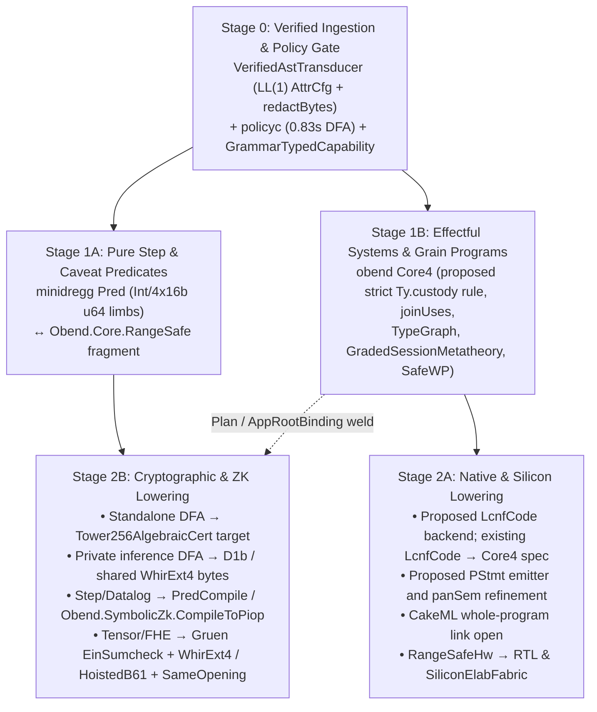

# `breadstuffs` Surface DSLs, `orb` / `Pancake`, CryptHOL & Formal Specs Autopsy and `~/dev/obend` × `Selvage` Compiler Revival Blueprint

**Date:** 2026-11-21 · **Lane:** `bread-dsl-orb-specs` (`breadstuffs_revival_2026_11_21`) · **Companion Note:** [breadstuffs-dsls-orb-and-specs-revival.md](file:///Users/ember/dev/zkml-research/notes/breadstuffs-dsls-orb-and-specs-revival.md)  
**Method:** `[REPORTED]` The original lane paired Codex and Claude source reviews. The findings distinguish inspected declarations, arithmetic checks and proposed integrations.
**Trees Inspected (Strictly Read-Only):**
- `breadstuffs` @ `93f2893d89` (`232` root Cargo workspace members; `orb/` & `orb-compiler/` on `leanprover/lean4:v4.30.0`, `metatheory/` on `v4.35.0`; `.spw/_workbench` mounted @ `06eb8a595e`) `[EXECUTED]` (`git rev-parse`) · [Cargo.toml](file:///Users/ember/dev/breadstuffs/Cargo.toml#L54-L61) · [orb/lean-toolchain](file:///Users/ember/dev/breadstuffs/orb/lean-toolchain#L1)
- `obend` @ `88d18a77cf` (original inventory), cross-checked at `d50cb853c0`. `[EXECUTED]` `git diff 88d18a77cf --` on `lean/Obend/{Lower/LCNF.lean,Core/RangeSafe.lean,Core/GradedSessionMetatheory.lean,SymbolicZk,Logic,Crypto/SameOpening.lean,Crypto/ThresholdMpcUcGames.lean}` returned no differences. The package pins Lean `v4.35.0`. [Lake manifest](file:///Users/ember/dev/obend/lean/lakefile.toml#L1-L27)
- `minidregg` @ `0ce6d9cf8e` (+ Wave-7 working-tree overlay; `leanprover/lean4:v4.35.0`, Mathlib `56a005855ea1`) `[EXECUTED]` (`git rev-parse`) · [lakefile.toml](file:///Users/ember/dev/minidregg/lakefile.toml#L42-L46)
- `zkml-research` @ `71dafc3816` ([docs/VERDICTS.md](file:///Users/ember/dev/zkml-research/docs/VERDICTS.md), [CV_WAVES_INDEX.json](file:///Users/ember/dev/zkml-research/research/breadstuffs_revival_2026_11_21/CV_WAVES_INDEX.json)) `[EXECUTED]` (`git rev-parse`)
- **Metered Search Ledger:** `Scry: 0` · `Kagi: 0` · `eprint.iacr.org fetches: 0`.

**Claim Provenance Tags ([AGENTS.md](file:///Users/ember/dev/zkml-research/AGENTS.md)):** `[SOURCE]` (inspected directly at cited `file:line`), `[EXECUTED]` (read-only command/census run in this audit), `[DERIVED]` (mathematical or architectural consequence of sourced code), `[REPORTED]` (recorded figure in repo docs/commits/json captures, not re-run), `[REFUTED: scope]` `[HYPOTHESIS]` `[OPEN]`.

---

## 0. Executive Verdict: Eight Ground-Truth Findings Governing the `#114` Extrapolation

Per Ember's strategic alignment (`#114`), **`~/dev/obend` + `minidregg` (`Selvage`) + `zkml-research/native` are the forward evolutionary center of gravity**, and `breadstuffs` is a **donor quarry** — never a 232-crate museum to restore `[DERIVED]`. Across the surface DSLs, `orb`/`orb-compiler`, `uc-crypthol`, `spec/`, and `paper*`, our dual-family + Carbon audit established eight decisive ground-truth findings:

1. **`dregg-dsl` & `constraint-lowering` Are Unsound Unwired Scaffolds — Burn the Proc-Macro Slopcathedral, Keep Only the `u64-le` Limb Teeth (`[SOURCE]` `[DERIVED]` `[REFUTED: bits=30 soundness]`):**
   - `dregg-dsl` (`9` files, `2,685` LOC) has **zero production callers** (`#[dregg_caveat]`/`#[dregg_effect]` appear only in its two test crates; `circuit/Cargo.toml:37-40` cites the deleted `#[dregg_circuit]`) `[SOURCE]` [lib.rs](file:///Users/ember/dev/breadstuffs/dregg-dsl/src/lib.rs#L56-L66). Its `gen_air` emits `AirConstraintSet` with **no converter to `CircuitDescriptor`**, starts aux column indices at `0` aliasing parameter col `0` ([gen_air.rs](file:///Users/ember/dev/breadstuffs/dregg-dsl/src/gen_air.rs#L53-L55), [:90-L92](file:///Users/ember/dev/breadstuffs/dregg-dsl/src/gen_air.rs#L90-L92)), and hardcodes `"merkle_at_position (stub)"` / `"poseidon2_hash (stub)"` ([:143-L161](file:///Users/ember/dev/breadstuffs/dregg-dsl/src/gen_air.rs#L143-L161)); even the runtime oracle `gen_rust` emits empty `Ok(())` no-ops for `MerkleAtPosition` and `Poseidon2Hash` ([gen_rust.rs](file:///Users/ember/dev/breadstuffs/dregg-dsl/src/gen_rust.rs#L118-L135)) `[SOURCE]`.
   - `Match` arms are emitted **unconditionally without selector gating** across `gen_air` ([gen_air.rs](file:///Users/ember/dev/breadstuffs/dregg-dsl/src/gen_air.rs#L207-L213)), `gen_kimchi` ([gen_kimchi.rs](file:///Users/ember/dev/breadstuffs/dregg-dsl/src/gen_kimchi.rs#L241-L247)), `gen_midnight` ([gen_midnight.rs](file:///Users/ember/dev/breadstuffs/dregg-dsl/src/gen_midnight.rs#L188-L216), contradicting its own `CondSelect` comment), and `gen_datalog` ([gen_datalog.rs](file:///Users/ember/dev/breadstuffs/dregg-dsl/src/gen_datalog.rs#L98-L108), conjoining incompatible `variant(D, …)` atoms into one empty Horn rule) `[SOURCE]` `[DERIVED]`.
   - **`constraint-lowering` `bits = 30` BabyBear wraparound bug (`[REFUTED: emit_ge/le/lt/gt soundness at bits=30]`):** `emit_nonneg` ([lib.rs](file:///Users/ember/dev/breadstuffs/constraint-lowering/src/lib.rs#L92-L95)) and `emit_ge_multilimb_ops` ([:306](file:///Users/ember/dev/breadstuffs/constraint-lowering/src/lib.rs#L306)) assert `(1..31).contains(&bits)` claiming soundness whenever `bits < 31` ([:21-L24](file:///Users/ember/dev/breadstuffs/constraint-lowering/src/lib.rs#L21-L24)). Because BabyBear $p = 2{,}013{,}265{,}921 < 2^{31} = 2{,}147{,}483{,}648$, for honest 30-bit inputs $a = 0, b = 10^9 \in [0, 2^{30})$, $(a - b) \bmod p = 1{,}013{,}265{,}921 < 2^{30} = 1{,}073{,}741{,}824$, admitting a valid 30-bit binary decomposition so the constraints emitted by `emit_ge` admit a false comparison on those column values `[DERIVED]` `[EXECUTED]` (§2.1). For range-checked inputs, all four scalar comparisons require `bits ≤ 29` on BabyBear (§2.1). `emit_ge_multilimb_ops` ([:298-L372](file:///Users/ember/dev/breadstuffs/constraint-lowering/src/lib.rs#L298-L372)) range-checks result limbs and relies on the caller to bound both input limb sequences `[SOURCE]`. Conversely, `dregg-dsl-differential`'s 208-column `4 × 16-bit` `u64-le` gadget ([plonky3_runner.rs](file:///Users/ember/dev/breadstuffs/dregg-dsl-differential/src/plonky3_runner.rs#L303-L454), [comparison_wrap_soundness.rs](file:///Users/ember/dev/breadstuffs/dregg-dsl-differential/tests/comparison_wrap_soundness.rs#L315-L605)) is genuinely sound and mutation-pinned, while `neq-u64` leaves its `ConditionalNonzero` selector unconstrained and `eq-u64`/`neq-u64` bind zero PIs and fall back to the native oracle at $\ge 2^{30}$ ([plonky3_runner.rs](file:///Users/ember/dev/breadstuffs/dregg-dsl-differential/src/plonky3_runner.rs#L580-L686)) `[SOURCE]` `[DERIVED]`.

2. **`dregg-query` & `dregg-analyzer` Have Severe Authentication & False-Verified Holes (`[SOURCE]` `[DERIVED]`):**
   - **Unbound semantic facts (`Q-1`):** `AttestedSlice::verify` ([attested.rs](file:///Users/ember/dev/breadstuffs/dregg-query/src/attested.rs#L139-L159)) opens `r.receipt_hash_bytes()` against the MMR root, while `AttestedAnswer::verify` ([:269-L273](file:///Users/ember/dev/breadstuffs/dregg-query/src/attested.rs#L269-L273)) extracts queryable facts from separate `r.effects` and `r.height` fields ([receipt.rs](file:///Users/ember/dev/breadstuffs/dregg-query/src/receipt.rs#L120-L169)) **without recomputing `receipt_hash` from the record body** — allowing a server to pair genuine MMR-opened hashes with forged or stripped `effects` `[SOURCE]` `[DERIVED]`.
   - **Unhashed MMR peak heights & `hi = u64::MAX` wraparound (`Q-2`, `Q-3`):** `bag_peaks` ([mmr.rs](file:///Users/ember/dev/breadstuffs/dregg-query/src/mmr.rs#L267-L273)) folds only `p.hash` and omits `p.height` (contradicting [:21-L22](file:///Users/ember/dev/breadstuffs/dregg-query/src/mmr.rs#L21-L22)): a 5-leaf log `[(2, P), (0, Q)]` forged as `[(1, P), (0, Q)]` bags to the identical root while shifting leaf 4 to position 2 or proving `[3, 4]` empty `[DERIVED]`. Furthermore, `range_count` ([mmr.rs](file:///Users/ember/dev/breadstuffs/dregg-query/src/mmr.rs#L149-L151)) computes `(hi + 1).min(len)` unguarded (`hi = u64::MAX` wraps to `0` in release, passing `WholeLog` on an empty slice) `[SOURCE]` `[DERIVED]`.
   - **False `Finding::verified` badges in `dregg-analyzer`:** When both strict and trusted blocklace loaders fail, `equivocators` defaults to empty and [blocklace.rs](file:///Users/ember/dev/breadstuffs/dregg-analyzer/src/blocklace.rs#L161-L173) emits `Finding::verified(..., "blocklace.no_equivocation")`; when all receipts lack signatures (`verified == 0, bad == 0`), [receipts.rs](file:///Users/ember/dev/breadstuffs/dregg-analyzer/src/receipts.rs#L384-L395) emits `Finding::verified(..., "receipts.executor_sigs_ok")` `[SOURCE]`.

3. **`spween-dregg` Has a Real Narrative-to-Cell Lowering (With a Net-Delta Clamp Bypass), While `.spw` Is a Separate Meta-Topography (`[SOURCE]` `[DERIVED]`):**
   - `spween-dregg` (`8,183` LOC) compiles external `spween::Scene` passages/choices into `dregg_cell::CellProgram` cases with `GENESIS_DONE_EXT_KEY` one-shot guards and `$var` `FieldLteOther` teeth ([compiler.rs](file:///Users/ember/dev/breadstuffs/spween-dregg/src/compiler.rs#L82-L110), [:417-L562](file:///Users/ember/dev/breadstuffs/spween-dregg/src/compiler.rs#L417-L562)), but shifts post-state gates by the *net* effect delta ([:701-L711](file:///Users/ember/dev/breadstuffs/spween-dregg/src/compiler.rs#L701-L711)) while `world.rs` clamps each intermediate effect at `0` ([world.rs](file:///Users/ember/dev/breadstuffs/spween-dregg/src/world.rs#L972-L978)) — so `-50` then `+50` turns `gold = 10` into `50` and bypasses `gold >= 20`, and spilled `SPILL_EXT_BASE` (`2^34`) keys have host-only (zero-AIR) evaluation ([compiler.rs](file:///Users/ember/dev/breadstuffs/spween-dregg/src/compiler.rs#L43-L54)) `[SOURCE]` `[DERIVED]`.
   - `.spw/` (`63` tracked files) + gitignored `.spw/_workbench` (`spw-seed`/`spw-runtime`/`spw-lsp`/`spw-cli` @ `06eb8a595e`, ~55k TS LOC) is an unrelated architectural notation (`boon`/`bane`/`bone`/`bonk`/`honk` pentad in [valence.spw](file:///Users/ember/dev/breadstuffs/.spw/topography/valence.spw#L10-L25)) carrying zero circuit/Lean semantics ([notation.spw](file:///Users/ember/dev/breadstuffs/.spw/system/notation.spw#L6-L9)) `[SOURCE]`.

4. **`orb-compiler` implements part of the Lean-to-Pancake design in `dreggscript` `[SOURCE]` `[DERIVED]`.**
   - Git archaeology back through `pyanascript/` (`c676fe394` $\to$ `8a2e15d3b`, `cv` `130628b0` msgs `3663–3679`) confirms `dreggscript/` (`2` `.md` files, `439` LOC) never contained code, only the architectural choice of strict **CakeML / Pancake** or **Lean 4** over lazy PureCake (`~/dev/pure`) `[SOURCE]` `[EXECUTED]`.
   - Independently, `orb-compiler/` (`55` Lean files, `25,451` LOC, `0` `sorry`, `0` `axiom`, `0` `@[extern]`) contains the semantic bridge. `DreggNet`'s `export2leanScript.sml` (`1,204` lines, HOL `a9846ebe2`, CakeML `ed31510b3`) mechanically exports `panSem$evaluate` (14 clauses, 24 types / 92 ctors, 73 HOL eqns, 42 `EVAL` vectors, and **40 HOL4-proved row contracts** in [Contracts.lean](file:///Users/ember/dev/breadstuffs/orb-compiler/PanSem/Contracts.lean#L19-L274)), bridged via `evaluate_agree` ([PanSemAgree.lean](file:///Users/ember/dev/breadstuffs/orb-compiler/Pancake/PanSemAgree.lean#L491-L500), which honestly proves two `Sem.lean` transcription bugs: `sem_lean_assign_unscoped_disagrees` [:150](file:///Users/ember/dev/breadstuffs/orb-compiler/Pancake/PanSemAgree.lean#L150) and `sem_lean_write_unmapped_disagrees` [:377](file:///Users/ember/dev/breadstuffs/orb-compiler/Pancake/PanSemAgree.lean#L377)) to byte-level GET/405 theorems `serveExport_serves_{get,405}_real_panSem` ([LadderPanSem.lean](file:///Users/ember/dev/breadstuffs/orb-compiler/Pancake/LadderPanSem.lean#L354-L391)) `[SOURCE]`.

5. **Wider Rung-`[2]` Uninhabited-`WF` Vacuity & Production `orb` Wiring/Concurrency Gaps (`[SOURCE]` `[DERIVED]`):**
   - `[DERIVED]` For any inhabited `σ`, an empty-locals state with no mapped addresses disproves the all-state input contracts for word stores and four data-dependent decision stages. The closed assignment demo and the concrete 405 witness still compute. The preconditioned bridge is a route to certifying a local-reading stage. See the declaration-by-declaration check in §3.2. [Empty state](file:///Users/ember/dev/breadstuffs/orb-compiler/Pancake/PanSemAgree.lean#L128-L130) · [Inhabited witnesses](file:///Users/ember/dev/breadstuffs/orb-compiler/Pancake/LadderPanSem.lean#L417-L423)
   - In `orb/` (`840` Lean files / `261,305` LOC, `28` axioms in [AXIOMS.txt](file:///Users/ember/dev/breadstuffs/orb/AXIOMS.txt#L7-L34), `14` Cargo packages / `38,447` Rust LOC = `10` `orb/Cargo.toml` workspace members + `2` standalone `crates/*` + `2` `conformance/` tools, ledger in §1): what runs by default is `leanc` `libdrorb.a` (`drorb_serve`), not CakeML; `orb-compiler/Dsl/EmitPancake.lean` has **zero imports** from `orb/`; `config-publish-twin` ([lib.rs](file:///Users/ember/dev/breadstuffs/orb/crates/config-publish-twin/src/lib.rs#L46-L60), [:154](file:///Users/ember/dev/breadstuffs/orb/crates/config-publish-twin/src/lib.rs#L154)) proves a 2-atomic `(rate, window)` publish tears, yet shipping [config.rs](file:///Users/ember/dev/breadstuffs/orb/crates/dataplane/src/config.rs#L239-L245) ([:280-L306](file:///Users/ember/dev/breadstuffs/orb/crates/dataplane/src/config.rs#L280-L306), [:404-L405](file:///Users/ember/dev/breadstuffs/orb/crates/dataplane/src/config.rs#L404-L405)) **still uses two independent `Relaxed` `AtomicU64`s**; RFC 9111 conformance (`results_rfc9111.json`) fails `H1-authorized-not-stored` (replaying an authorized response to an unauthenticated client); and `reachability-audit.py` undercounts the `libdrorb.a` module closure (`264` vs `313` in `dataplane-closure.py`) `[SOURCE]`.

6. **`spec/CellModel.tla` Exposed a Live `Introduce` Capability-Amplification Discrepancy in Rust `turn/src/executor/apply.rs` (`[SOURCE]` `[DERIVED]`):**
   - `CellModel.tla` (`1,094` lines) specifies `Introduce` ([CellModel.tla](file:///Users/ember/dev/breadstuffs/spec/CellModel.tla#L565-L580), `DelegationAttenuated` [:963](file:///Users/ember/dev/breadstuffs/spec/CellModel.tla#L963)) with mandatory parent facet-mask attenuation (`IsFacetAttenuation(parent.mask, newMask)`) and child expiry $\le$ parent expiry (`expiresAt <= parent.expiresAt`), though `CellModel.cfg` (`PublicKeys = {pk1, pk2}`, `TokenIds = {tA}`, [:20-L21](file:///Users/ember/dev/breadstuffs/spec/CellModel.cfg#L20-L21); its own header [:3](file:///Users/ember/dev/breadstuffs/spec/CellModel.cfg#L3) says "up to 2 derivable CellIds") has only 2 cell IDs and thus never model-checked a 3-distinct-cell `Alice -> Bob -> Carol` introduction `[SOURCE]` `[DERIVED]`.
   - Comparing TLA+ against Rust [apply.rs](file:///Users/ember/dev/breadstuffs/turn/src/executor/apply.rs#L3225-L3285) uncovered a real bug: `Introduce` checks the held cap only for liveness (`self.block_height <= held_cap.expires_at`, [:3225-L3237](file:///Users/ember/dev/breadstuffs/turn/src/executor/apply.rs#L3225-L3237)) and for permission attenuation (`is_attenuation(&held_cap.permissions, permissions)`, [:3238-L3249](file:///Users/ember/dev/breadstuffs/turn/src/executor/apply.rs#L3238-L3249)) — no expiry clamp and no facet-mask check — then mints the child capability with `expires_at = self.block_height + self.max_introduction_lifetime` ([:3269](file:///Users/ember/dev/breadstuffs/turn/src/executor/apply.rs#L3269)) and **`allowed_effects = None` (unrestricted!)** ([:3283](file:///Users/ember/dev/breadstuffs/turn/src/executor/apply.rs#L3283)) — **amplifying both expiry and facet mask past a restricted/expiring parent capability** `[SOURCE]` `[DERIVED]`!

7. **`uc-crypthol` + `OTPoC.lean` + `paper*` / `direct-logic-arithmetization` — Honest Boundaries & Scope of the `obend` Signature and Commitment Results (`[SOURCE]` `[DERIVED]`):**
   - `uc-crypthol/` (`3` Isabelle theories, `766` LOC, `36` theorems/lemmas, `0` `sorry`) proves classical Pedersen commitment hiding + DLog binding ([Dregg2_FCom.thy](file:///Users/ember/dev/breadstuffs/uc-crypthol/Dregg2_FCom.thy#L72-L197)), carrier games ([Dregg2_Carriers.thy](file:///Users/ember/dev/breadstuffs/uc-crypthol/Dregg2_Carriers.thy#L64-L233)), and ideal structural conservation ([Dregg2_FDregg.thy](file:///Users/ember/dev/breadstuffs/uc-crypthol/Dregg2_FDregg.thy#L99-L178)), while leaving the computational simulator `reduction` bound in `fdregg_realization_under_carriers` ([:234-L252](file:///Users/ember/dev/breadstuffs/uc-crypthol/Dregg2_FDregg.thy#L234-L252)) **explicitly OPEN** (instantiated only on `unit` with `0` advantage [:262-L269](file:///Users/ember/dev/breadstuffs/uc-crypthol/Dregg2_FDregg.thy#L262-L269)) and widening the TCB to a human-checked Isabelle$\leftrightarrow$Lean seam ([15-limitations.typ](file:///Users/ember/dev/breadstuffs/paper/sections/15-limitations.typ#L58-L66)) `[SOURCE]`.
   - `[SOURCE]` `ThresholdMpcUcGames.hidingAdv_le` assumes a `Q`-query adversary. `multi_session_uc_realizes` gives agreement with `idealSig` or a signature forgery, plus an additive hybrid bound conditional on each step. `SameOpening` proves accepted-witness meaning and bounds order-commitment hiding by two MLWE advantages. `SemiringDatalog` supplies provenance semantics. `CompileToPiop` checks a supplied symbolic witness against Goldilocks sumcheck rounds and gives validity or an exceptional algebraic event. `[OPEN]` A succinct witness-opening verifier and a simulator for the full `F_Dregg` receipt functionality require separate proofs. [Hiding](file:///Users/ember/dev/obend/lean/Obend/Crypto/ThresholdMpcUcGames.lean#L388-L396) · [Signature theorem](file:///Users/ember/dev/obend/lean/Obend/Crypto/ThresholdMpcUcGames.lean#L1180-L1190) · [MLWE reduction](file:///Users/ember/dev/obend/lean/Obend/Crypto/SameOpening.lean#L539-L552) · [Accepted opening](file:///Users/ember/dev/obend/lean/Obend/Crypto/SameOpening.lean#L916-L920) · [Datalog](file:///Users/ember/dev/obend/lean/Obend/SymbolicZk/SemiringDatalog.lean#L20-L65) · [Symbolic verifier](file:///Users/ember/dev/obend/lean/Obend/SymbolicZk/CompileToPiop.lean#L1094-L1107) · [Soundness alternatives](file:///Users/ember/dev/obend/lean/Obend/SymbolicZk/CompileToPiop.lean#L1137-L1168)

8. **Proposed Cross-Tree Compiler Tower (`Surface -> obend Core4 + Pred -> Dual Pancake/Silicon & Selvage`) and Its Open Integration Obligations (`[SOURCE]` `[DERIVED]`):**
   - `minidregg/Theory/ObjectiveBend*` (`46` tracked files / `27,477` LOC = `39` top-level `ObjectiveBend*.lean` + `7` under `Theory/ObjectiveBendDemandPreservation/`; last touched by `cdb399b47`, 2026-10-30 `[EXECUTED]` (`git ls-files, wc -l, git log`)) is the frozen twin of the Oct-29 `obend` spin-out, behind `obend/lean/Obend/Core/*` on **five soundness/completeness advances** (equi-recursive `TypeGraph` agreement, `Ty.insertCanonical` non-shareable field preservation, `ifBool` exact linear `joinUses`+`branchesAgree` vs `addUses`, fuel-free `Bidirectional.checkAgainst`, and `GradedCoreWeld` + `RangeSafe`) `[SOURCE]`.
   - `[SOURCE]` `compileLcnfToCore4` maps `LcnfCode → Term`. Its closed scalar simulation theorem requires `PureBlock c` and a successful evaluation from empty inputs with an empty final store. `RangeSafe.compileTerm_evaluates_sound` separately relates a checked scalar `Term` to compiled RTL under environment agreement. `[OPEN]` The proposed Pancake emitter needs a proof for its admitted LCNF fragment, including state effects if it admits them. [LCNF lowering](file:///Users/ember/dev/obend/lean/Obend/Lower/LCNF.lean#L583-L585) · [Simulation](file:///Users/ember/dev/obend/lean/Obend/Lower/LCNF.lean#L1619-L1625) · [RTL theorem](file:///Users/ember/dev/obend/lean/Obend/Core/RangeSafe.lean#L1046-L1056)

---

## 1. Complete Inventory & Reality Matrix (`breadstuffs` Surface, `orb*` & Spec Directories)

Counts verified against `breadstuffs@93f2893d89` (`Default` denotes root default members, `Member` denotes other root members, and the inventory identifies separate workspaces and non-Cargo projects individually) `[EXECUTED]`:

| Directory / Package | Files / Physical LOC | Workspace | Actual Implementation, Assurance Level & `#114` Disposition |
|---|---:|---|---|
| [dregg-dsl](file:///Users/ember/dev/breadstuffs/dregg-dsl/src/lib.rs) | `9` `.rs` / `2,685` | Default | Proc-macro (`#[dregg_caveat]`, `#[dregg_effect]`) $\to$ 6 emitters (`gen_rust` callable; `gen_air`/`gen_kimchi` disconnected descriptors; `gen_datalog`/`gen_midnight`/`gen_sp1` strings). `0` prod callers; `4` IR kinds unreachable from `parse.rs`; unconditional `Match` bug across 4 backends `[SOURCE]`. **BURN / CUT.** |
| [dregg-dsl-runtime](file:///Users/ember/dev/breadstuffs/dregg-dsl-runtime/src/lib.rs) | `3` `.rs` / `1,545` | Default | Re-exports `dregg_circuit::dsl::*` + `AirConstraintSet`, `KimchiCircuitDescriptor`, and local `composition.rs` (31-bit BLAKE3 proof tag [:766](file:///Users/ember/dev/breadstuffs/dregg-dsl-runtime/src/composition.rs#L766), fail-open out-of-range col skip [:199](file:///Users/ember/dev/breadstuffs/dregg-dsl-runtime/src/composition.rs#L199)) `[SOURCE]`. **BURN / CUT.** |
| [dregg-dsl-tests](file:///Users/ember/dev/breadstuffs/dregg-dsl-tests/src/lib.rs) | `2` `.rs` / `822` | Default | `55` unit tests calling `_check` or inspecting token/descriptor shapes; "equivalence" tests leave handwritten verifiers in comments ([dregg_definitions.rs](file:///Users/ember/dev/breadstuffs/dregg-dsl-tests/src/dregg_definitions.rs#L203)) `[SOURCE]`. **BURN / CUT.** |
| [dregg-dsl-differential](file:///Users/ember/dev/breadstuffs/dregg-dsl-differential/src/lib.rs) | `12` `.rs` / `3,258` | Default | `11`-predicate harness. `air_runner` & `kimchi_sim` (except `eq-u64`) re-run native `u64`; `plonky3_runner` proves a **re-authored** `4×16-bit` `u64-le` descriptor (sound + 15 mutation teeth in [comparison_wrap_soundness.rs](file:///Users/ember/dev/breadstuffs/dregg-dsl-differential/tests/comparison_wrap_soundness.rs#L86-L107)), while `neq-u64` leaves selector unconstrained & `>= 2^30` `eq`/`neq` hit oracle `[SOURCE]`. **QUARRY `u64-le` regression vectors; BURN crate.** |
| [dreggscript](file:///Users/ember/dev/breadstuffs/dreggscript/README.md) | `2` `.md` / `439` | Non-Cargo | Two-language design notes (renamed from `pyanascript/` in `8a2e15d3b`); `0` code ever existed `[EXECUTED]`. Chose strict CakeML/Pancake or Lean 4 over lazy PureCake `[SOURCE]`. **SUPERSEDED by `obend` `Core4` + `orb-compiler`.** |
| [spween-dregg](file:///Users/ember/dev/breadstuffs/spween-dregg/src/lib.rs) | `18` `.rs` / `8,183` | Member (non-default) | Compiles `spween::Scene` (`@95980f7d`) to `CellProgram::Cases` + `WorldCell` + crash-recoverable `durable.rs` + `collective.rs`. Real `EmbeddedExecutor` turns, `0` STARK proofs; net-delta vs per-step clamp gate bypass (`SPW-C3`) + host-only `SPILL_EXT_BASE` `[SOURCE]`. **QUARRY narrative/turn lowering into `Core4` / `Hyperdocument` grains; BURN `SPILL_EXT_BASE` shim.** |
| [.spw](file:///Users/ember/dev/breadstuffs/.spw/README.md) + `_workbench` | `63` `.spw`/`.md` (`1,736` L) + `240` `.ts` (`55,016` L) | Non-Cargo (`.gitignore:101`) | Architectural hypersemantic topography (`valence.spw` `boon/bane/bone/bonk/honk`); `_workbench` (`@06eb8a59`) provides TS seed parser, register-bank interpreter, stdio LSP, CLI; `0` formal/circuit links `[SOURCE]`. **ARCHIVE / QUARRY valence concepts into `obend` vault metadata.** |
| [constraint-lowering](file:///Users/ember/dev/breadstuffs/constraint-lowering/src/lib.rs) | `1` `.rs` / `738` | Default | Standalone `ConstraintExpr` gadget helpers; `0` workspace reverse-deps; **UNSOUND at `bits = 30`** (`0 >= 10^9` accepted mod BabyBear) and omits operand limb range checks `[SOURCE]` `[DERIVED]`. **BURN / CUT** (use `Obend.Core.RangeSafe` + `PredCompile`). |
| [dregg-schema](file:///Users/ember/dev/breadstuffs/dregg-schema/src/lib.rs) | `8` `.rs` / `1,877` | Member (non-default) | 5 ECS game archetypes (`Stat`, `Resource`, `Identity`, `Invariant`, `Collection`) $\to$ `CheckedLayout` (`STATE_SLOTS = 16` bound fixed in `b5c9264c4`) $\to$ `CellProgram` `[SOURCE]`. **EXTRAPOLATE archetypes onto `Obend.Core` rows + `Pred`.** |
| [dregg-query](file:///Users/ember/dev/breadstuffs/dregg-query/src/lib.rs) | `14` `.rs` / `4,152` | Default | Closed 8-predicate conjunctive + safe-negation query engine, CALM classifier, BLAKE3 MMR, `AttestedAnswer`, and `stream-monitor` CLI feeding `metatheory/StreamCheck.lean` (`59563d6ca`). Has `Q-1` unbound facts, `Q-2` unhashed peak heights, `Q-3` `hi+1` wrap `[SOURCE]`. **EXTRAPOLATE CALM + ω-stream monitor onto `Obend.SymbolicZk.SemiringDatalog` + `Selvage` length-pinned MMR; BURN buggy Rust MMR.** |
| [dregg-analyzer](file:///Users/ember/dev/breadstuffs/dregg-analyzer/src/lib.rs) | `9` `.rs` / `2,522` | Default | Offline forensic CLI for 5 capture types (`0` capture emitters in repo); emits false `Finding::verified` badges on loader failure & 0-signature captures `[SOURCE]`. **BURN / CUT.** |
| [param-compose](file:///Users/ember/dev/breadstuffs/param-compose/src/lib.rs) | `14` `.rs` / `4,664` | Default | Law-#1 exemplar (`9a34719e6` deleted `1,028` L Rust AIR): decodes Lean-emitted `ParamComposeEmit.lean` (`770` cols at `n4 p8 l8 k6`, `53` PIs); 4 digest/order inductions open in `ParamComposeRefine.lean:45-70` `[SOURCE]`. **QUARRY Law-#1 pattern; migrate bilinear knots to `EinSumcheck`.** |
| [entity-compose](file:///Users/ember/dev/breadstuffs/entity-compose/src/lib.rs) | `4` `.rs` / `1,344` | Default | Welds `param-compose` `outcome_commitment` PIs `[37..45)` to post-cell `fields[0..8]` via `AppRootBinding` (`243457864`), consumed by `dreggnet-companion/src/wing.rs` `[SOURCE]`. **QUARRY public-input-to-cell-state weld specification.** |
| [orb](file:///Users/ember/dev/breadstuffs/orb/lakefile.lean) | `840` `.lean` (`261,305` L), `78` `.rs` (`38,447` L), `25` `.c` (`4,578` L), `2` `.S` (`1,363` L) | Excluded (own Cargo + Lake `v4.30.0`) | `9,596` Lean thms/lemmas, `0` `sorry`, `28` `axiom`s ([AXIOMS.txt](file:///Users/ember/dev/breadstuffs/orb/AXIOMS.txt)), `135` `@[extern]` (`85` distinct symbols), `8` Loom twins + `9` `.litmus` files. Runs `leanc` `libdrorb.a`; `20` orphaned exports, `config.rs` 2-atomic tear, RFC 9111 cache auth-leak `[SOURCE]`. **QUARRY `Arena`, `StageAlgebra`, `BraidCalculus`, `Parse.lean`, & 8 Loom twins; BURN unwired sprawl.** |
| [orb-compiler](file:///Users/ember/dev/breadstuffs/orb-compiler/lakefile.lean) | `55` `.lean` / `25,451` | Non-Cargo (own Lake project, `v4.30.0`) | `857` thms/lemmas, `0` `sorry`, `0` `axiom`, `0` `@[extern]`, `7` `opaque` in `PanSem/`. Mechanical HOL4 `panSem` export (`ed31510b3`), `40` row contracts, `evaluate_agree`, `serveExport_serves_{get,405}_real_panSem`; rung-`[2]` universal `WF` vacuity `[SOURCE]`. **KEEP & UPGRADE to `v4.35.0` as `obend` Stage-2A verified native codegen backend!** |
| [dregg-serve-spec](file:///Users/ember/dev/breadstuffs/dregg-serve-spec/ServeSpec.lean) | `1` `.lean` (`255` L) + `lakefile.lean` (`19` L) + `build_servespec.sh` (`14` L) | Non-Cargo (own Lake `v4.30.0`, Lean core only; in neither root `members` nor the `19`-entry `exclude`, where the entry is `orb`) | Shared serve wire-semantics library (`Bytes := List UInt8`, `Response`/`Wire`/`serialize`, `Stage`/`runPipeline`, `SecurityHeaders` + `SecurityHeadersDeployed` constants): `7` theorems, `0` `sorry`/`axiom` `[EXECUTED]` (`grep`). A live dependency of `orb`, not a dead precursor: [orb/lakefile.lean:4](file:///Users/ember/dev/breadstuffs/orb/lakefile.lean#L4) `require`s it and [ServeSpecAnchor.lean](file:///Users/ember/dev/breadstuffs/orb/Reactor/ServeSpecAnchor.lean#L58-L125) (`5` theorems: `serialize_eq`, `wireHeaders_is_spec`, `securityheadersStage_anchored`, …) equates the deployed `Reactor.serialize` and security-header bytes with the spec. The translator half is unbuilt: `orb-compiler/lakefile.lean` does not require it, and `orb-compiler/Dsl/EmitPancake.lean:445` defines an unrelated local `structure ServeSpec` `[SOURCE]`. `8` `.lake/build/` artifacts are git-tracked and deleted in the working tree `[EXECUTED]` (`git ls-files, git status`). **KEEP: port with `orb-compiler` to `v4.35.0` as the one shared serve spec both sides import `[DERIVED]`.** |
| [uc-crypthol](file:///Users/ember/dev/breadstuffs/uc-crypthol/ROOT) + [OTPoC.lean](file:///Users/ember/dev/breadstuffs/docs/opentheory-importer-poc/OTPoC.lean) | `3` `.thy` (`766` L, `36` thms) + `1` `.lean` (`1,377` L, `15` thms) | Isabelle2025-2 + Lean metaprogram | `Dregg2_FCom` (Pedersen), `Dregg2_Carriers` (SUF-CMA/CR), `Dregg2_FDregg` (structural conservation; simulator `reduction` OPEN). `OTPoC` replays HOL Light/HOL4 `.art` into Lean kernel with Γ-content gate (`40a59541b`) `[SOURCE]`. **Keep `OTPoC` and the `p3-bridge` exporter. Use Obend’s signature and commitment games as components of a proposed receipt simulator.** `[OPEN]` |
| [spec/CellModel.tla](file:///Users/ember/dev/breadstuffs/spec/CellModel.tla) | `3` files / `1,454` L | TLA+ / TLC | `7` state vars, `9` actions, `10` invariants (`I1–I10`), `9` temporal safety properties; exposed Rust `apply.rs:3269-3284` `Introduce` expiry/facet amplification `[SOURCE]`. **KEEP as model-checked protocol oracle (widen `PublicKeys` to 3 cells).** |
| [paper](file:///Users/ember/dev/breadstuffs/paper/dregg.typ), [paper2](file:///Users/ember/dev/breadstuffs/paper2/README.md), [direct-logic](file:///Users/ember/dev/breadstuffs/papers/direct-logic-arithmetization/main.typ), [docs/automata](file:///Users/ember/dev/breadstuffs/docs/automata/POLICY-LANGUAGE.md) | `22` `.typ` + `9` `.md` + `9` `.typ` + `24+` `.md` | Docs / Specs | `paper/` (20-sec Typst) & `paper2/` (9-file spine) state A–E+R guarantees & a `57.98b` BCIKS20 figure corrected to `51b` for the deployed domain (§4). The separate FRI profile gives `UDR 34 / JBR 73`; `direct-logic` refutes public BitLogic & naive field sum-of-squares (`1728404513^2 = -1`); `policyc` (`0.83 s` certified byte-DFA) `[SOURCE]`. **CARRY `policyc` + constructive FOL/CCC theorems into `obend` + `Selvage`.** |

**`orb/` Cargo package ledger (`14` packages, `78` `.rs`, `38,447` LOC; `[EXECUTED]` (`git ls-files, wc -l`) per package, roles `[SOURCE]` from each `Cargo.toml` description / crate doc):**
- **`10` workspace members** ([orb/Cargo.toml](file:///Users/ember/dev/breadstuffs/orb/Cargo.toml#L64-L75), whose own header comment still says "ten `crates/*` packages"; the root manifest lists `orb` in `exclude`):
  - `dataplane` (`49` `.rs` / `33,139` L): the native host that owns sockets and the accept loop and calls the exported `drorb_serve`; holds `config.rs` (2-atomic tear), `proxy_grpc.rs` (zero callers), `cake_serve.rs`, H2/WS/TLS/io_uring/WireGuard/SOCKS modules. `build.rs` requires `orb/.lake/build/lib/libdrorb.a`.
  - `aes-fallback` (`1` / `843`): AES-GCM AEAD + RSA PKCS#1 v1.5 verify backend for the crypto FFI seam where EverCrypt/Vale AES-NI is unavailable.
  - `8` Loom twins (`22` / `3,381` in all): `ring-twin` (`4` / `794`), `config-publish-twin` (`4` / `527`), `wake-twin` (`4` / `504`), `multishot-twin` (`2` / `377`), `splitsend-twin` (`2` / `345`), `conn-limit-twin` (`2` / `323`), `oneshot-recv-twin` (`2` / `302`), `borrow-recycle-twin` (`2` / `209`).
- **`2` standalone `crates/*`** (each declares its own empty `[workspace]`, deliberately absent from `members`): `cake-serve` (`2` / `331`, per-core-shard reactor pattern for a verified export-function serve entry) and `serve-bench` (`2` / `391`, microbenchmark linking `libdrorb.a` and timing `drorb_serve`).
- **`2` conformance tools outside `crates/`** (own `[workspace]`): `conformance/_tlspipe` (`tlspipe`, `1` / `149`, X25519MLKEM768 TLS 1.3 pipe) and `conformance/quic/h3-client` (`h3-client`, `1` / `213`, off-the-shelf `quinn` + `h3` peer).
- So `orb/crates/` holds `12` packages (`76` `.rs` / `38,085` L), not `14`; nothing in the repo-root CI compiles any of them (`orb/Cargo.toml` header, "A separate workspace is NOT a build") `[SOURCE]`.

---

## 2. Deep Audit Part I: Surface Languages, Lowering, Query, Analysis & Composition

### 2.1 `dregg-dsl`, `dregg-dsl-differential`, and `constraint-lowering`

1. **Parser & IR Disconnect (`[SOURCE]`):**
   - `parse_inner_type` ([parse.rs](file:///Users/ember/dev/breadstuffs/dregg-dsl/src/parse.rs#L132-L135)) maps *every* `syn::Type::Array(_)` (`[u64; 4]`, `[u8; 16]`, `[[u8; 32]; 8]`) unconditionally to `ParamType::ByteArray32`, making `ParamType::ByteMatrix32(u32)` ([ir.rs](file:///Users/ember/dev/breadstuffs/dregg-dsl/src/ir.rs#L91)) unreachable.
   - `classify_expr` ([parse.rs](file:///Users/ember/dev/breadstuffs/dregg-dsl/src/parse.rs#L369-L424)) recognizes only `<=`, `>=`, `==`, `!=`, and `.contains(...)`, leaving `BitRange`, `MerkleAtPosition`, and `Poseidon2Hash` ([ir.rs](file:///Users/ember/dev/breadstuffs/dregg-dsl/src/ir.rs#L158-L179)) dead from proc-macro syntax.
   - `parse_stmts` ([parse.rs](file:///Users/ember/dev/breadstuffs/dregg-dsl/src/parse.rs#L173-L175)) silently ignores `Stmt::Local(_)` (`let` bindings), single-expression `match` arms with unrecognized expressions silently become empty bodies ([:293-L300](file:///Users/ember/dev/breadstuffs/dregg-dsl/src/parse.rs#L293-L300)), and `try_parse_mutation` ([:212-L239](file:///Users/ember/dev/breadstuffs/dregg-dsl/src/parse.rs#L212-L239)) rewrites `*balance = *other - amount` into `MutateOp::SubAssign` on `balance` without checking the RHS left operand!
2. **Six-Backend Soundness Breakdown (`[SOURCE]` `[DERIVED]`):**
   - **`gen_rust` ([gen_rust.rs](file:///Users/ember/dev/breadstuffs/dregg-dsl/src/gen_rust.rs#L118-L144)):** Emits empty comment tokens (`Ok(())`!) for `MerkleAtPosition` and `Poseidon2Hash`; mutates `&mut` references in place before later `require!`s can fail; ignores `requires = "..."` permission strings at runtime.
   - **`gen_air` ([gen_air.rs](file:///Users/ember/dev/breadstuffs/dregg-dsl/src/gen_air.rs#L53-L213)):** Emits `AirConstraintSet` ("NOT the actual AIR implementation", [:4-L6](file:///Users/ember/dev/breadstuffs/dregg-dsl/src/gen_air.rs#L4-L6)); `aux_col` starts at `0` colliding with `param[0]`; `RangeCheck` has a single `bit_col`; `Equality` carries no column indices; `Match` flattens all arms without selectors.
   - **`gen_kimchi` ([gen_kimchi.rs](file:///Users/ember/dev/breadstuffs/dregg-dsl/src/gen_kimchi.rs#L83-L247)):** Emits wire-less gate counts (`wires: 2`, zero copy constraints); collapses 64-bit reconstruction to one duplicate gate ([:104-L113](file:///Users/ember/dev/breadstuffs/dregg-dsl/src/gen_kimchi.rs#L104-L113)); emits all `Match` arms unconditionally.
   - **`gen_datalog` ([gen_datalog.rs](file:///Users/ember/dev/breadstuffs/dregg-dsl/src/gen_datalog.rs#L98-L116)):** Joins all `Match` arms with `,` into a single rule (`variant(D, Outgoing), …, variant(D, Incoming)` $\implies$ empty relation).
   - **`gen_midnight` ([gen_midnight.rs](file:///Users/ember/dev/breadstuffs/dregg-dsl/src/gen_midnight.rs#L99-L556)):** Maps `[u8; 32]` (256 bits) non-injectively into ~254.86-bit `"Scalar<BLS12-381>"` ([:101](file:///Users/ember/dev/breadstuffs/dregg-dsl/src/gen_midnight.rs#L101)); constrains any `Match` discriminant boolean ([:196](file:///Users/ember/dev/breadstuffs/dregg-dsl/src/gen_midnight.rs#L196)) while emitting every arm's `constrain_eq`/`constrain_bits` unconditionally ([:206-L216](file:///Users/ember/dev/breadstuffs/dregg-dsl/src/gen_midnight.rs#L206-L216)); lowers `*balance` to undeclared `%balance` (`%balance_old`/`%balance_new` declared [:83-L96](file:///Users/ember/dev/breadstuffs/dregg-dsl/src/gen_midnight.rs#L83-L96)); ignores `%siblings` in `MerkleAtPosition` ([:334-L375](file:///Users/ember/dev/breadstuffs/dregg-dsl/src/gen_midnight.rs#L334-L375)); and stubs `.contains()` as `transient_hash(elem) == set` ([:449-L465](file:///Users/ember/dev/breadstuffs/dregg-dsl/src/gen_midnight.rs#L449-L465)).
   - **`gen_sp1` ([gen_sp1.rs](file:///Users/ember/dev/breadstuffs/dregg-dsl/src/gen_sp1.rs#L86-L259)):** Reads `Set` as uncommitted private `Vec<u64>` (host-forgeable); emits `*balance >= amount` on non-reference `let mut balance: u64` (uncompilable); calls non-existent `dregg_sp1_runtime`; commits only `1u8` without binding caveat inputs to the journal.
   - **Deleted `gen_plonky3` (`43b930241`, 2026-07-17):** Sat behind an always-false `#[cfg(feature = "plonky3")]` across 16 sites, targeted obsolete `MainWindow::current_slice()`, and had a column-0 fallback (`find_p3_col`) that lowered `require!(amount <= 1000)` as `amount <= col0` (`b9c52507e`) `[SOURCE]` [lib.rs](file:///Users/ember/dev/breadstuffs/dregg-dsl/src/lib.rs#L25-L43).
3. **Differential Harness & `constraint-lowering` Exact Math (`[SOURCE]` `[DERIVED]`):**
   - In `dregg-dsl-differential`, `plonky3_runner::u64_le_descriptor` ([plonky3_runner.rs](file:///Users/ember/dev/breadstuffs/dregg-dsl-differential/src/plonky3_runner.rs#L303-L454)) closed the `5 <= 3` `diff = p - 2` wraparound (`5dbeadf2d` $\to$ `96c7c7fce` $\to$ `a5200fa99`) via `4 × 16-bit` PI-bound limbs + borrow chain, including a mutation canary where removing borrow booleanity lets `borrow = p - 30719` forge `5 <= 3` ([comparison_wrap_soundness.rs](file:///Users/ember/dev/breadstuffs/dregg-dsl-differential/tests/comparison_wrap_soundness.rs#L315-L368)).
   - However, `neq-u64` ([plonky3_runner.rs](file:///Users/ember/dev/breadstuffs/dregg-dsl-differential/src/plonky3_runner.rs#L629-L686)) uses `ConditionalNonzero` with an unconstrained selector (`selector = 0` satisfies `7 != 7`), neither `eq-u64` nor `neq-u64` binds PIs, byte equality compares only **30 bits** of BLAKE3 ([:714-L736](file:///Users/ember/dev/breadstuffs/dregg-dsl-differential/src/plonky3_runner.rs#L714-L736)), and `>= 2^30` `eq`/`neq` bypass the circuit (`DslEqualityOperandAliasingResidual`, [:580-L585](file:///Users/ember/dev/breadstuffs/dregg-dsl-differential/src/plonky3_runner.rs#L580-L585)).
   - `[SOURCE]` Put $B=2^{30}=1{,}073{,}741{,}824$ and $p=2{,}013{,}265{,}921$. The comparator reconstructs one field residue from 30 Boolean columns. Assume both operands already lie in $[0,B-1]$. `[DERIVED]` For `emit_ge` and its reversed form `emit_le`, the accepted interval is **[0, 1,073,741,823]**. Negative differences occupy **[939,524,098, 2,013,265,920]** modulo $p$. Their intersection is **[939,524,098, 1,073,741,823]**, containing $1{,}073{,}741{,}823-939{,}524{,}098+1=134{,}217{,}726$ distinct residues. [Bit reconstruction and ≥](file:///Users/ember/dev/breadstuffs/constraint-lowering/src/lib.rs#L96-L158)
   - `[DERIVED]` `emit_gt` subtracts one more and `emit_lt` reverses the operands. The most negative difference becomes $-B$, so the wrapped interval begins at **939,524,097** and the intersection contains **134,217,727** residues. In general, the intervals are disjoint at $p\ge 2B-1$ for non-strict order and $p\ge 2B$ for strict order. Both give a maximum of 29 comparison bits on BabyBear. The single-element `emit_range(v, 30)` encoding remains injective because $B-1<p$. [Strict and reversed forms](file:///Users/ember/dev/breadstuffs/constraint-lowering/src/lib.rs#L183-L228) · [Single-element range](file:///Users/ember/dev/breadstuffs/constraint-lowering/src/lib.rs#L233-L261)
   - `[EXECUTED]` `python3 -c 'p=2013265921; B=2**30; print(B-1,p-B+1,p-1,2*B-p-1,(-10**9)%p,p-B,2*B-p)'` → `1073741823 939524098 2013265920 134217726 1013265921 939524097 134217727`.

### 2.2 `spween-dregg`, `.spw`, `dregg-schema`, `dregg-query`, `dregg-analyzer`, `param-compose` & `entity-compose`

- **`spween-dregg`:** Lowers `spween::Scene` into `CellProgram::Cases` (`slot 0` = passage, `slots 1..15` = deterministic vars, overflow $\to$ `SPILL_EXT_BASE`, `0x7000_0011` = `GENESIS_DONE_EXT_KEY` at `compiler.rs:270`; `0x7000_0010` is `DECISION_EXT_KEY` at `world.rs:61`). Direct API `apply_choice` fails closed on partially lowered gates ([ungated_fail_closed.rs](file:///Users/ember/dev/breadstuffs/spween-dregg/tests/ungated_fail_closed.rs#L150-L184)), and `dad9fd8db` repaired `durable.rs` after `post_state_hash` vs `ledger_root` drift broke non-empty recovery (`e2aad0ccc`, invisible because `spween-dregg` is excluded from `default-members`). Remaining flaws: net-delta vs per-step zero-clamp gate bypass (`SPW-C3`), negative threshold flooring to `0` ([compiler.rs](file:///Users/ember/dev/breadstuffs/spween-dregg/src/compiler.rs#L1067-L1069)), `apply_raw` arbitrary `SetField` stapling ([world.rs](file:///Users/ember/dev/breadstuffs/spween-dregg/src/world.rs#L1020-L1022)), unauthenticated `voter_pk = blake3(name)` in [real_engine.rs](file:///Users/ember/dev/breadstuffs/spween-dregg/src/real_engine.rs#L29-L31), and zero-AIR host evaluation on spilled keys `[SOURCE]` `[DERIVED]`.
- **`dregg-schema`:** `CheckedLayout::new` ([layout.rs](file:///Users/ember/dev/breadstuffs/dregg-schema/src/layout.rs#L301-L310)) enforces `RegisterWidth <= STATE_SLOTS` (`16`, `b5c9264c4`), disjoint registers, and non-aliasing heap keys, emitting two `CellProgram` cases (`genesis` + `move`, [emit.rs](file:///Users/ember/dev/breadstuffs/dregg-schema/src/emit.rs#L160-L174)), though `genesis` omits `Stat` bounds (`SCH-1`) and `Slot::Heap` does not reserve `0x7000_0010/11` (`SCH-2`) `[SOURCE]`.
- **`dregg-query` & `StreamCheck.lean`:** Beyond `Q-1` (unbound `effects` vs `receipt_hash`), `Q-2` (unhashed `Peak.height`), and `Q-3` (`hi + 1` wraparound), `dregg-query` mixes two incompatible BLAKE3 MMR protocols (`mmr.rs` domain-tagged vs `stream.rs` arity-2 matching [StreamCheck.lean](file:///Users/ember/dev/breadstuffs/metatheory/StreamCheck.lean#L21-L22)), while [stream-monitor.rs](file:///Users/ember/dev/breadstuffs/dregg-query/src/bin/stream-monitor.rs#L96-L104) logs but never enforces the Lean ω-automaton verdict `[SOURCE]`.
- **`param-compose` & `entity-compose`:** `lean_descriptor.rs` ([lean_descriptor.rs](file:///Users/ember/dev/breadstuffs/param-compose/src/lean_descriptor.rs#L57-L66), [:190](file:///Users/ember/dev/breadstuffs/param-compose/src/lean_descriptor.rs#L190)) embeds Lean-emitted JSON strings directly from `metatheory/Dregg2/Circuit/Emit/ParamComposeEmit.lean` (`0` Rust constraint authoring), welded to cell `fields[0..8]` by `entity-compose`'s `app_root_binding()` ([lib.rs](file:///Users/ember/dev/breadstuffs/entity-compose/src/lib.rs#L314-L328)) on the segmented recursive fold (`braid-hook`), though `i128` host multiplication of three `i64`s can overflow (`PC-5`, [reference.rs](file:///Users/ember/dev/breadstuffs/param-compose/src/reference.rs#L143-L148)) and partner `Subject`s are caller-supplied (`EC-1`) `[SOURCE]`.

---

## 3. Deep Audit Part II: `orb` Dataplane & the `orb-compiler` (`Pancake` / HOL4 `panSem`) Ladder

### 3.1 Four Disjoint `orb` Frontends & Runtime Reality (`[SOURCE]`)

`orb/Dsl` is **not** a single compiler pipeline (`Config/Parse -> Server -> EmitLean/EmitPancake`); its four entry points share no AST imports (`5` separate config structs):
1. **Operator Text Config ([Parse.lean](file:///Users/ember/dev/breadstuffs/orb/Dsl/Config/Parse.lean#L1614-L1996)):** Proves one-way round-trip `parseOn base (render pc) = some (denoteOn base pc)` for `WF pc` (`92` theorems) and feeds live `drorb_serve_cfg` ([Dataplane.lean](file:///Users/ember/dev/breadstuffs/orb/Dataplane.lean#L870-L895)), **but silently falls back to `servePipelineFull2` (demo serve!) on any malformed config line** ([:893-L895](file:///Users/ember/dev/breadstuffs/orb/Dataplane.lean#L893-L895)) and discards declared pool names in `.proxy _` (`Parse.lean:1739`) `[SOURCE]`.
2. **`server Name where …` Macro ([Server.lean](file:///Users/ember/dev/breadstuffs/orb/Dsl/Server.lean#L353-L558), [ServerBind.lean](file:///Users/ember/dev/breadstuffs/orb/Dsl/ServerBind.lean#L70-L104)):** Used only in `GoldenServer.lean`. `glob` and `host` lower to `.prefix`; `static dir` serves HTTP `200` with the *directory path string* as body; `redirect code tgt` omits the `Location` header; `proxyPool _` hardcodes `demoPool`; and per-feature `_auth_401` / `_tls_handshake_real` theorems re-export fixed library facts without mentioning `Name_engine` `[SOURCE]`.
3. **`engine` / `deploy_engine` Macro ([Engine.lean](file:///Users/ember/dev/breadstuffs/orb/Dsl/Engine.lean#L119-L132), [EmitLean.lean](file:///Users/ember/dev/breadstuffs/orb/Dsl/EmitLean.lean#L156-L180)):** Instantiates toy 4-byte/counter `Primitives.lean` constants with `defaultWiring` (`feed := none`, `drive := []`) `[SOURCE]`.
4. **`EmitPancake` ([EmitPancake.lean](file:///Users/ember/dev/breadstuffs/orb-compiler/Dsl/EmitPancake.lean#L47-L324)):** Standalone AST/pretty-printer in `orb-compiler/` with **zero imports from `orb/`**; `StageProg` is triplicated across [StageAlgebra.lean](file:///Users/ember/dev/breadstuffs/orb/Reactor/StageAlgebra.lean#L100), [StageProg.lean](file:///Users/ember/dev/breadstuffs/orb-compiler/Pancake/StageProg.lean#L118), and [DslServe.lean](file:///Users/ember/dev/breadstuffs/orb-compiler/Pancake/DslServe.lean#L138) `[SOURCE]`.

### 3.2 The `orb-compiler` $\to$ HOL4 `panSem` Refinement Ladder (`[SOURCE]` `[DERIVED]`)

| Rung / Module | Proved Theorem & Scope (`leanprover/lean4:v4.30.0`, `0` `sorry`, `0` `axiom`) | Exact Verification Boundary / Defect |
|---|---|---|
| **HOL4 Export** (`PanSem/{Generated,GeneratedEval,GenVectors,Contracts}.lean`) | Generated by `/Users/ember/dev/DreggNet/docs/engine/probes/p3-bridge/exporter/export2leanScript.sml` (CakeML `ed31510b3`, HOL `a9846ebe2`): `24` types / `92` ctors (`0` structural diffs), `73` `*_hol_eqn_*` thms, `42` `EVAL` vectors, **`40` HOL4 `DISK_THM` row contracts** (`5591fcb3e` + `8487409a9`). | Covers `14` of `21` `prog` clauses (`Call`, `DecCall`, `Raise`, `Store32`, `Primitive`, `ShMem*` map to `opaque evaluate_unspec`); `351` `#print axioms` lines lack `#guard_msgs` pins `[SOURCE]`. |
| **Semantic Bridge** ([PanSemAgree.lean](file:///Users/ember/dev/breadstuffs/orb-compiler/Pancake/PanSemAgree.lean#L150-L500)) | `evaluate_agree` proves hand-transcribed `PancakeSem` (`Sem.lean`) and reflected `P3.Pan.evaluate` agree on `Scoped Γ p` programs with `Bound Γ ss` and `SR ss hs`, alongside negative teeth `sem_lean_assign_unscoped_disagrees` (`:150`) and `sem_lean_write_unmapped_disagrees` (`:377`). | `SR` leaves `globals`, `structs`, `code`, `eshapes`, `sh_memaddrs`, and `top_addr` unconstrained (`:95-102`) `[SOURCE]`. |
| **Rung `[2]` translator** | `[SOURCE]` `translateCertPan` takes `WF` and `Scoped` and returns a `RefinesPan` certificate. `closedDemo_panSem_witness` exhibits the result on a concrete entry. [Translator](file:///Users/ember/dev/breadstuffs/orb-compiler/Pancake/LadderPanSem.lean#L183-L190) · [Witness](file:///Users/ember/dev/breadstuffs/orb-compiler/Pancake/LadderPanSem.lean#L475-L480) | `[DERIVED]` The store and named-local premises listed below exclude all executable instances of those rules. |
| **Rung `[3]` Concrete Serve** ([ServeExportServes.lean](file:///Users/ember/dev/breadstuffs/orb-compiler/Pancake/ServeExportServes.lean#L283-L597), [LadderPanSem.lean](file:///Users/ember/dev/breadstuffs/orb-compiler/Pancake/LadderPanSem.lean#L354-L457)) | `serveExport_serves_get_real_panSem` (`'G' = 71` $\to$ return `164`, `BS200` bytes at `out`) and `serveExport_serves_405_real_panSem` (`'X' = 88` $\to$ return `227`, `BS405` bytes at `out`), plus inhabited `serve_405_panSem_witness`. `serve_slice_export.pnk` == `dataplane/ffi/cake/serve.pnk` (SHA-256 `fdec8508…`). | Covers `2` of `256` first-byte values; `ppFun` $\leftrightarrow$ `cake --pancake` parse and `evaluate` $\leftrightarrow$ whole-program `semantics_decls` (`serve.S`) are unproved; `cake_serve_ffi.c:86-108` stages `ctrl` bytes that `serve.pnk` ignores; `health.pnk` is Python-emitted (`gen_health.py`) with a global `jmp_buf` thread race (`health_ffi.c:38-54`) `[SOURCE]` `[DERIVED]`. |

**Rung [2] premise check.** `[SOURCE]` `PancakeState σ` contains an `ffi : σ`. Given an FFI value, choose a state with `locals := fun _ => none` and `memaddrs := fun _ => false`. The source defines exactly this state as `ss0 f` for the reflected FFI type. `[DERIVED]` Each unconditional local or address premise below fails there. For empty `σ` there are no entry states and the universal premises hold trivially. [State fields](file:///Users/ember/dev/breadstuffs/orb-compiler/Pancake/Sem.lean#L151-L158) · [Empty state](file:///Users/ember/dev/breadstuffs/orb-compiler/Pancake/PanSemAgree.lean#L128-L130)

| Declaration | What the binder requires |
|---|---|
| `refines_store` | Lines 91–92 require expression evaluation in every state. Constant expressions satisfy both. Line **93** additionally requires every state to map the computed address, which fails on the empty address map. This affects the all-state store rule even for constant address and value. [Store rule](file:///Users/ember/dev/breadstuffs/orb-compiler/Pancake/EmitCorrectCompose.lean#L89-L95) |
| `demoServe_emit_correct` | Lines 265 and 266 independently fail on the same state. One requires a bound `slot` and the other a mapped `slotAddr`. [Demo signature](file:///Users/ember/dev/breadstuffs/orb-compiler/Pancake/EmitCorrectCompose.lean#L264-L267) |
| `ServeFragment` | Four local names each occur in two theorems (`_wf`, `_cert`) and one definition (`_translated`). The binder lines are 93/99/104 (`active`), 120/126/131 (`cldigits`), 151/157/162 (`octet`), and 180/186/191 (`method`). All 12 require `none = some …` at the empty state. The closed security-header declarations have no such parameter. [Four input-dependent stages](file:///Users/ember/dev/breadstuffs/orb-compiler/Pancake/ServeFragment.lean#L92-L193) · [Closed header stage](file:///Users/ember/dev/breadstuffs/orb-compiler/Pancake/ServeFragment.lean#L208-L221) |
| `decisionPrefix_cert`, `serveFull_correct` | Each theorem has the same three impossible all-state premises for `active`, `octet`, and `cldigits`. The latter theorem's `hmethod` at 244 concerns only its supplied entry state. [Prefix](file:///Users/ember/dev/breadstuffs/orb-compiler/Pancake/ServeFull.lean#L169-L174) · [Full serve](file:///Users/ember/dev/breadstuffs/orb-compiler/Pancake/ServeFull.lean#L236-L245) |
| `RefinesClkPan`, `refinesClkPan_of_refinesClk` | Lines 194–201 **define** a relation over entries satisfying `WordLocals`, `BoundPan Γ`, and `P (ofPan hs)`. Lines 203–207 lift a `RefinesClk` proof and a scoping proof into that relation. `[DERIVED]` For example, take `p = .skip`, empty scope, `P = True` and equality of entry and exit as `Q`. The skip refinement lifts through `refinesClk_of_refines`, and the word-local witness `hsW f` satisfies the entry conditions. [Skip](file:///Users/ember/dev/breadstuffs/orb-compiler/Pancake/EmitCorrectCompose.lean#L73-L75) · [Clocked lift](file:///Users/ember/dev/breadstuffs/orb-compiler/Pancake/EmitCorrectClock.lean#L85-L90) · [Word-local witness](file:///Users/ember/dev/breadstuffs/orb-compiler/Pancake/LadderPanSem.lean#L399-L415) [Definition and bridge](file:///Users/ember/dev/breadstuffs/orb-compiler/Pancake/LadderPanSem.lean#L194-L216) |
| `wf_reading_local_uninhabited` | Lines 468–473 **prove the negation** of the all-state `code` premise by specializing it to `ss0 f` inside the proof. The theorem takes `codeVal` and `f` as parameters. The nearby `serve_405_panSem_witness` separately proves the one-byte concrete 405 case. [Negation theorem](file:///Users/ember/dev/breadstuffs/orb-compiler/Pancake/LadderPanSem.lean#L468-L473) · [405 witness](file:///Users/ember/dev/breadstuffs/orb-compiler/Pancake/LadderPanSem.lean#L448-L457) |

---

## 4. Deep Audit Part III: `uc-crypthol`, `OTPoC`, `CellModel.tla`, `paper*` & `policyc`

1. **`uc-crypthol` & `OTPoC.lean` (`[SOURCE]` `[DERIVED]`):**
   - `Dregg2_FCom.thy` (`12` thms, `1` lemma): instantiates AFP `Sigma_Commit_Crypto` `pedersen` + `pedersen_asymp` (`perfect` hiding, per-adversary `bind_advantage = dis_log_advantage`, homomorphic add), bundled in `dregg2_F_com_realizes` (game bundle, no interactive UC environment; Shor-broken DLog floor) `[SOURCE]` [Dregg2_FCom.thy](file:///Users/ember/dev/breadstuffs/uc-crypthol/Dregg2_FCom.thy#L72-L197).
   - `Dregg2_Carriers.thy` (`2` thms, `8` lemmas): **Degenerate unbounded-adversary carrier flaw (`[DERIVED]`):** `dregg2_unforgeable` ([:64-L65](file:///Users/ember/dev/breadstuffs/uc-crypthol/Dregg2_Carriers.thy#L64-L65)) and `secure_cr` ([:176-L177](file:///Users/ember/dev/breadstuffs/uc-crypthol/Dregg2_Carriers.thy#L176-L177)) universally quantify over *all* `spmf` adversaries (`∀𝒜`) with **zero computational or query bound**! Because Poseidon2 compression and BLAKE3 are compressing (non-injective), an unbounded adversary outputting a hardcoded collision achieves `cr_advantage = 1`, making `secure_cr` **unsatisfiable by Poseidon2/BLAKE3** (the theory proves the mechanism itself for a constant hash: `collapsing_cr_advantage_one` [:222](file:///Users/ember/dev/breadstuffs/uc-crypthol/Dregg2_Carriers.thy#L222), `collapsing_not_secure_cr` [:233](file:///Users/ember/dev/breadstuffs/uc-crypthol/Dregg2_Carriers.thy#L233)) (`injective_secure_cr` and `reject_all_advantage_zero` inhabit the carriers only via degenerate injective/reject-all schemes), while STARK extractability, AEAD seal authenticity, and nullifier anonymity remain outside Isabelle `[SOURCE]` `[DERIVED]`. (Also: the last retained local build log `~/isabelle/build3-dregg2uc.log` ended `EXIT=1` 20 minutes before `e17b9da35`'s green commit claim, and no CI gate runs Isabelle `[EXECUTED]`.)
   - `Dregg2_FDregg.thy` (`9` thms, `4` lemmas): `fdregg_step` proves structural conservation (`vdelta` is never read in `tot_supply` [:99-L122](file:///Users/ember/dev/breadstuffs/uc-crypthol/Dregg2_FDregg.thy#L99-L122)), attenuation, and monotone nullifiers, while `fdregg_realization_under_carriers` ([Dregg2_FDregg.thy](file:///Users/ember/dev/breadstuffs/uc-crypthol/Dregg2_FDregg.thy#L234-L252)) **assumes** `|uc_advantage| ≤ forge + coll + bind` over unconstrained locale parameters (`trivial_uc` on `unit` is the sole instance) `[SOURCE]`.
   - `docs/opentheory-importer-poc/OTPoC.lean` (`1,377` L, `15` discharge/helper thms, `0` `sorry`): untrusted stack-machine replayer for HOL Light/HOL4 articles (does *not* import Isabelle; `.hol/make-deps/lastmaker` is a 33-byte Holmake marker from the July 22 `tools/direct-logic-cakeml` lane) into Lean `addDecl` with hypothesis-content verification (`40a59541b` closing the `q ⊢ p` $\to$ `p → p` sequent swap!) and `collectAxioms ⊆ {propext, Classical.choice, Quot.sound}`. Replays `unit-def.art` and `prodWitness.art`, **but `dischargeNames` ([:202-L205](file:///Users/ember/dev/breadstuffs/docs/opentheory-importer-poc/OTPoC.lean#L202-L205)) omits the HOL Axiom of Infinity** (refusing any article using `num`), `pair-closed.art` (`64,205` L) exceeded `2h20m` CPU, and HOL4 `cv_compute` lacks primitive logging ([OPENTHEORY-LEAN-IMPORTER-PLAN.md](file:///Users/ember/dev/breadstuffs/docs/OPENTHEORY-LEAN-IMPORTER-PLAN.md#L344-L471)) `[SOURCE]` `[DERIVED]`.
2. **`paper/` vs `paper2/` vs `papers/direct-logic-arithmetization/` & `docs/VERDICTS.md` Calibration (`[SOURCE]` `[REPORTED]`):**
   - `paper2/` (`e49b0adb1` $\to$ restored `86965514c` as structural precursor, `cv` `7fc2e1fd` msg `10966`) distills the 4-substance / 8-verb / 1-predicate-4-polarities spine, while `paper/` (`20` Typst sections) adds A–E+R `AssuranceCase` pins and the 8-carrier floor ([13-assurance.typ](file:///Users/ember/dev/breadstuffs/paper/sections/13-assurance.typ#L112-L168)). Notably, `paper/` quotes `57.98` bits on six lines across four section files (`04-proofs.typ:44,52,60`, `13-assurance.typ:150`, `15-limitations.typ:33`, `appendix-a-garbled-poseidon2.typ:233`; `[EXECUTED]` (`grep`)), which `breadstuffs`'s own [PROVEN-120-CONFIG.md](file:///Users/ember/dev/breadstuffs/docs/reference/PROVEN-120-CONFIG.md#L196-L204) **already refuted down to `51` bits** at deployed `|D^0| = 2^{22}` (`m`-optimized vs fixed-`m` mispairing), while [docs/VERDICTS.md](file:///Users/ember/dev/zkml-research/docs/VERDICTS.md#L95-L115) establishes **UDR 34 (`34.58`) / JBR 73** (withdrawn capacity-regime 130 never quoted; BabyBear retained over KoalaBear's measured `1.05×` leaf / `1.02×` hash wall-clock). Commit `57105f387` also fixed the 1-felt (`30.91`-bit, `15.45`-bit birthday broken in `0.44 s`) membership tree to 8-lane `node8` (`~247.26`-bit image) `[SOURCE]` `[REPORTED]`.
   - `papers/direct-logic-arithmetization/` (`8` Typst sections): (i) mechanizes Gabbay 2024 over $\mathbb{Q}_{\ge 0}$ ([FOLArithmetizationCorrected.lean](file:///Users/ember/dev/breadstuffs/metatheory/Dregg2/Metatheory/FOLArithmetizationCorrected.lean#L97-L151)); (ii) refutes naive BabyBear sum-of-squares ($1{,}728{,}404{,}513^2 \equiv -1 \pmod p$) and published BitLogic zero-product $\forall$ / swap bypass ($A=B=10, k=q=1, A'=9, B'=999$, [FOLArithmetizationCounterexamples.lean](file:///Users/ember/dev/breadstuffs/metatheory/Dregg2/Metatheory/FOLArithmetizationCounterexamples.lean#L93-L184)); (iii) repairs Dregg's own live wire descriptor (`4cd2be743`, `1,740 B -> 1,580 B` with 6× 30-bit lookups, though bidirectional equivalence in [GabbayDescriptorIR2PublicBinding.lean](file:///Users/ember/dev/breadstuffs/metatheory/Dregg2/Metatheory/GabbayDescriptorIR2PublicBinding.lean#L616) requires `WireBoundedTable claim`, **and [DirectLogicAdversarialFalsifierV2.lean](file:///Users/ember/dev/breadstuffs/metatheory/Dregg2/Verify/DirectLogicAdversarialFalsifierV2.lean#L335) `empty_trace_satisfies_false_fol` proves `FOLSatisfied2` still accepts $\bot$ on an empty trace!**); (iv) proves CCC fixed-width impossibility ($q^{m q^n}$ points for $\mathbb{F}^n \to \mathbb{F}^m$); and (v) shows general bounded encrypted zero-observation takes `15` mults at depth `4` ($B=8$, matching Boolean), whereas [CertifiedHybridProofFheSymmetricZeroObservation.lean](file:///Users/ember/dev/breadstuffs/metatheory/Dregg2/Logic/CertifiedHybridProofFheSymmetricZeroObservation.lean#L118) (`2af9068ed`, 96 min after the paper) recovers **`11 < 15` multiplications** via symmetric zero-observation `[SOURCE]`.
3. **`docs/automata/` & `policyc` (`[SOURCE]` `[REPORTED]`):**
   - `policyc` (`ca181466a` + `f45ef0ba5`, [POLICY-LANGUAGE.md](file:///Users/ember/dev/breadstuffs/docs/automata/POLICY-LANGUAGE.md#L101-L238)) is a **genuine Lean-verified regex/intersection/complement/absence byte-DFA compiler** (`parse_print_roundtrip`, `compiled_decides_surface` in [Compile.lean](file:///Users/ember/dev/breadstuffs/metatheory/Dregg2/Policy/Compile.lean#L66-L74)), accelerated `35×` (`28.86 s -> 0.83 s` on the 129-state / 33,024-transition absence union) and replayed across `100,000` docs (`1.77 GB`) in Lean & Rust (`DEMO-DELIVERY-2026-11-06.md:9-22`). The reported cost includes the BabyBear Poseidon2 `dfa-attested-weld8` trace wall (`184.5M`–`196.1M` chip cells at 4 KiB, [COUNTS.md](file:///Users/ember/dev/breadstuffs/docs/automata/COUNTS.md#L67-L68)). `[SOURCE]` `[REPORTED]` A matched end-to-end comparison for the proposed backends is open (§7.2).

---

## 5. `cv` Design-Intent Anthology (`CV_FROZEN=1 cv --frozen`)

Verbatim human steers recovered from frozen transcripts (`[EXECUTED]`):
- **Two-Language Boundary (`dregg-dsl` vs `dreggscript`/CakeML), 2026-05-24** (`130628b0-ab87-41b8-8116-66d0de87ec49`, msgs `3670, 3679`): *"we need to imagine what the runtime api/sdk that 'behavior language' would target, and make sure that we have ALREADY IMPLEMENTED OR DESIGNED EVERYTHING IT NEEDS"* · *"I would like PyanaScript to be an extension of PureScript or at least compile to either PureScript or CakeML"*.
- **TLA+ Delegation & Introduction Spec, 2026-05-24** (`130628b0`, msg `3371`): requested modeling delegation, attenuation, revocation, and 3-party introduction right after the I1–I5 TLC run (`47.1M` states).
- **OpenTheory $\to$ Lean Importer, 2026-06-22** (`2ed94bdd-4d0d-492a-8cb3-ee06012e1d6e`, msg `698`): requested an untrusted OpenTheory article replayer into the Lean kernel to import HOL4 developments without widening the TCB beyond HOL's primitives.
- **Owning the Dataplane & Choosing Pancake, 2026-06-30 – 2026-07-18** (`e6761437`, msgs `88, 288`; `d49c89b6`, msg `311`; `894e232d`, msg `982`): *"we wanna \*\*\*\*own\*\*\*\* the dataplane"* · *"yep, CakeML/Pancake time for sure"* · *"isn't Bytes->Bytes skipping most of the interesting aspects of our dataplane io omdeling?"* · *"The compiler is \*not\* the thing that runs. leanc-Lean is."*
- **Killing Rust Reference/Differential Twins for Pure Lean, 2026-07 – 2026-11** (`4ffab82c`, msg `287`; `1bd42c54`, msg `867`; `78fef112`, msg `400`): *"differentials & fuzzes aren't assurance. i don't want to trust rustc."* · *"we should be removing more of our reference/differentials/rust stuff in favor of only having lean code"* · *"we're supposed to be exporting the cakeml semantics from HOL4 into a format that we can load with Lean"*.
- **Automata Over FOL & Unified Parsing/Rewriting, 2026-07 – 2026-11-04** (`ccb26860`, msg `496`; `a43ef565`, msg `1758`): asked whether direct decidable automata arithmetization beats FOL encoding, and directed that parsing, graph-rewriting, and automata be unified.

---

## 6. Cross-Family Audit Matrix (`Claude Fable 5.2` vs `Codex gpt-6.2-astra` vs `Carbon` Supervisor)

| Finding / Subsystem | `Claude Fable 5.2` | `Codex gpt-6.2-astra` | `Carbon` Supervisory Verdict & Synthesis |
|---|---|---|---|
| `constraint-lowering` `bits=30` BabyBear wraparound | Caught (`0 >= 2^30-1` $\to$ `d = 939524098 < 2^30`) + unchecked operands (`CL-1/2`). | Caught (`2 × 2^30 > 2,013,265,921`) + caller limb provenance gap. | **Verified `[DERIVED]` `[EXECUTED]`:** Refined exact split: `emit_range(v, 30)` is sound ($2^{30}-1 < p$), whereas `emit_ge/le/lt/gt` at `bits=30` is unsound (134,217,726 overlapping residues for non-strict order and 134,217,727 for strict order, with pre-ranged operands). |
| `dregg-query` MMR & `AttestedAnswer` holes | Caught `Q-1` (unbound facts), `Q-2` (`[(2,P),(0,Q)] -> [(1,P),(0,Q)]` concrete peak-height exploit!), `Q-3` (`hi+1` wrap). | Caught `Q-1`, `Q-2`, `Q-3`, plus `windows.rs` 0-window `pinned_len = None` root-check skip! | **Verified `[SOURCE]` `[DERIVED]`** at `attested.rs:149,269`, `mmr.rs:150,267-273`, `windows.rs:103-134`. |
| `dregg-analyzer` false `verified` badges | Caught `AN-2` (trusted fallback) & `AN-7` (`0` sigs $\to$ `executor_sigs_ok`). | Caught **both-loaders-fail** empty `equivocators` $\to$ `Finding::verified("blocklace.no_equivocation")`! | **Verified `[SOURCE]`** at `blocklace.rs:161-173` & `receipts.rs:384-395`. |
| `orb-compiler` rung-`[2]` vacuity & `orb` `config.rs` | Identified the all-state store, demo and decision-stage premises (§3.2), plus RFC 9111 auth-cache leak & `health_ffi.c` `jmp_buf` race! | Caught `serveFull_correct:240-242` (`active/octet/cldigits`), `config.rs:239-306` 2-atomic tear vs `config-publish-twin`, & `reachability-audit.py` `264 vs 313` closure bug! | **Verified `[SOURCE]` `[DERIVED]`:** The store address and named-local binders fail on an inhabited empty-map state. The conditional refinement bridge remains usable. |
| `CellModel.tla` vs Rust `Introduce` | Audited TLA+ I1–I10 & `AttenuationSoundness` weakness (`perm = "None"`). | **Uniquely caught** `turn/src/executor/apply.rs:3269-3284` `Introduce` expiry extension + `allowed_effects: None` facet amplification & 2-cell `CellModel.cfg` blind spot! | **Verified `[SOURCE]`** line-for-line in `apply.rs:3225-3285` — live host-executor capability amplification bug! |
| `.spw` `valence` / `register-bank` & `obend` `SymbolicZk`/`Crypto` | Claimed `.spw` lacked `valence`/`register-bank` (`[REFUTED: .spw missing valence/register-bank]`), **but uniquely discovered** `obend/lean/Obend/Crypto/BinaryTower256` & `obend/lean/Obend/SymbolicZk` + 5-point `minidregg` vs `obend` `Core4` diff (`ifBool` `addUses`)! | Found exact `.spw/topography/valence.spw:10` & `register-bank.ts:357`, plus `LCNF.lean:584` reverse arrow & `GabbayDescriptorIR2PublicBinding:616` `WireBoundedTable` premise! | **Supervisory cross-check caught Claude's `.spw` miss AND unlocked `obend/lean/Obend/{SymbolicZk,Crypto}` (`SemiringDatalog`, `CompileToPiop`, `SameOpening`, `ThresholdMpcUcGames`)!** |

---

## 7. Unified `~/dev/obend` × `Selvage` Compiler Tower Blueprint (`#114` Burn/Cut & Forward Extrapolation)

### 7.1 Ruthless Burn / Cut vs Quarry Ledger

- **BURN / CUT Immediately:** `dregg-dsl`, `dregg-dsl-runtime`, `dregg-dsl-tests`, `dregg-dsl-differential` (retaining only the `u64-le` test vectors), `constraint-lowering`, `dregg-analyzer`, `spween-dregg`'s `SPILL_EXT_BASE` host-only plane, `dregg-query`'s unverified Rust BLAKE3 MMR, `minidregg/Theory/ObjectiveBend*` (`46` tracked stale files = `39` top-level + `7` under `ObjectiveBendDemandPreservation/`, with `Ty.insertCanonical` shadowing & `ifBool` `addUses` bugs), `uc-crypthol`'s Shor-vulnerable Pedersen/two-kernel split, and `orb`'s unwired protocol sprawl (`proxy_grpc.rs`, `20` orphaned exports, `ServerBind` demo stubs).
- **QUARRY & EXTRAPOLATE into `~/dev/obend` + `Selvage`:**
  1. **`policyc` (`0.83 s` certified byte-DFA/absence compiler) + `BisimCert` + `PaddedAbsence`** $\to$ `minidregg` `GrammarTypedCapability` (`dfaSublanguageDecide_iff`, `54 µs` native 3-hop solver `#118`) + `Selvage` `Tower256AlgebraicCert` / `DualCharTokenBridge`.
  2. **`orb-compiler` (`PanSem` 40-contract HOL4 export + `PanSemAgree` + `RefinesClkPan`) + `orb` (`Arena`, `StageAlgebra`, `BraidCalculus`, `Parse.lean`, 8 Loom twins)** $\to$ proposed port from `v4.30.0` to `v4.35.0` (`Init`-only, matching `obend/lean`!) for `obend`'s proposed native dataplane/systems codegen backend.
  3. **`spween-dregg` + `dregg-schema` + `param-compose`/`entity-compose` + `dregg-query` CALM/ω-streams** $\to$ declarative `Obend.Core` (`Core4`) + `Pred` + `Obend.SymbolicZk.SemiringDatalog` grains over `Hyperdocument` / `ChunkedWorld`.

### 7.2 Four-Stage Unified Compiler Tower Architecture

1. **Stage 0 — Verified Parsing, Sanitization & Grammar-Typed Capabilities:**
   - Use `VerifiedAstTransducer` ([VerifiedAstTransducer.lean](file:///Users/ember/dev/minidregg/Theory/VerifiedAstTransducer.lean#L350-L838), [:1811-L1878](file:///Users/ember/dev/minidregg/Theory/VerifiedAstTransducer.lean#L1811-L1878)) + `GrammarTypedCapability` ([GrammarTypedCapability.lean](file:///Users/ember/dev/minidregg/Theory/GrammarTypedCapability.lean#L1225-L1245)) for untrusted wire/prompt/config boundaries (`orb` operator text left-factored to LL(1), `.scene` files, JSON tool calls), proving `ll1Parse g w = some (rs, ast) ↔ AttrReplay g rs w ast` and chunk-streaming equivalence `redactStream chunks = redactBytes (concat chunks)` `[OPEN]`.
   - `[OPEN]` Adapt the table emitted by `Policyc.lean` to `DfaTable`, preserving its accepted language and binding the grammar and table digest at dispatch. Stage 2B selects the backend according to whether the byte commitment is standalone or shared with inference.
2. **Stage 1 — Two-Sorted Typed Core (`Obend.Core` `Core4` + `Pred` / `SemiringDatalog`):**
   - `[DERIVED]` Make the Mathlib-free `obend/lean` Core/Equiv the shared source of truth. Migrate `minidregg` consumers to a narrow import before retiring the 46-file twin. Mathlib-backed proofs belong in the importing assurance package. [Lane 2 §§4.1–4.3](METATHEORY_AND_EFFECTS_AUDIT.md)
   - `[SOURCE]` `validContext` currently constrains `.unrestricted` bindings and permits affine custody. `[OPEN]` Before widening `.perform`, enforce strict linear use for types containing custody in context and case checks. Custody covers value, escrow and session handles in flight. Standing credentials remain re-exhibitable in `GrainPowerbox` + `GrammarTypedCapability`, attenuate along lineage, and require a fresh check against current authority when a named `Plan` lands or resumes. Bind retained custody to `awaitId` locally and seal it across CapTP vats. [Context check](file:///Users/ember/dev/obend/lean/Obend/Core/Ty.lean#L377-L378) · [Lane 2 §§4.1–4.3](METATHEORY_AND_EFFECTS_AUDIT.md) · [Lane 5 §5.3](GRAINS_CAPTP_AND_SANDBOX_AUDIT.md)
   - Compile caveats, `dregg-schema` archetypes, and `spween` choice guards (fixing per-step clamping by modeling clamped step ops explicitly rather than net-delta!) into `minidregg/Pred/Core.lean` (`Pred`) with a single verified **`4 × 16-bit` `u64` limb discipline** (`PredOrderWide` / `u64-le`), bridged by `Pred.eval ↔ Evaluates` onto `Obend.Core.RangeSafe` ([RangeSafe.lean](file:///Users/ember/dev/obend/lean/Obend/Core/RangeSafe.lean#L609-L1258)) `[DERIVED]` `[OPEN]`.
   - Lift `HoareSep` ([SeparationFrame.lean](file:///Users/ember/dev/obend/lean/Obend/Logic/SeparationFrame.lean#L539-L549)) into `MultiTurnHoare.SafeWP`'s `ProtocolSpec` ([MultiTurnHoare.lean](file:///Users/ember/dev/obend/lean/Obend/Logic/MultiTurnHoare.lean#L127-L307)), and express `dregg-query` CALM + provenance queries over `Obend.SymbolicZk.SemiringDatalog` with length-and-height-pinned (`bag(height ‖ hash, acc)`) receipt-body-committed MMRs `[DERIVED]`. `[OPEN]` For governance queries, prove coincidence on safe finite stratified groundings and preserve the three-valued `Reasons` outcome above that fragment. [Lane 2 §§4.1–4.3](METATHEORY_AND_EFFECTS_AUDIT.md)
3. **Stage 2A — Verified Imperative (`Pancake` / `panSem`) & Silicon (`RTL`) Execution:**
   - `[OPEN]` Port `orb-compiler` and shared `dregg-serve-spec` together from `v4.30.0` to `v4.35.0`, align their serve representations, and pin the existing `#print axioms` checks with `#guard_msgs`.
   - `[OPEN]` Build `compileLcnfToPancake : LcnfCode → PStmt` for a specified first-order fragment. Account for join points and state operations explicitly wherever the emitter admits them. Its proof must relate execution to `compileLcnfToCore4` under the same entry and store assumptions (§0, finding 8). [LCNF lowering](file:///Users/ember/dev/obend/lean/Obend/Lower/LCNF.lean#L505-L585) · [Pancake statement syntax](file:///Users/ember/dev/breadstuffs/orb-compiler/Dsl/EmitPancake.lean#L61-L87)
   - `[OPEN]` Extend `SClk` with a path-sensitive conditional. For a local-reading stage, specify which locals are bound and which addresses are mapped in entry precondition `P`, exhibit an entry satisfying it, and prove it suffices on each selected branch. The existing scoped `refinesClkPan_of_refinesClk` bridge then transfers the certificate to `panSem`. The connection to CakeML `Call` and whole-program `semantics_decls` remains open. The separate RTL route requires a range-safe term, successful compilation and agreeing environments. [Clocked stage syntax](file:///Users/ember/dev/breadstuffs/orb-compiler/Pancake/ProofProducing.lean#L358-L377) · [Bridge](file:///Users/ember/dev/breadstuffs/orb-compiler/Pancake/LadderPanSem.lean#L194-L216) · [RTL theorem](file:///Users/ember/dev/obend/lean/Obend/Core/RangeSafe.lean#L1046-L1056)
4. **Stage 2B — Unified Cryptographic & ZK Backend (`Selvage` + `Obend.Crypto`):**
   - `[DERIVED]` Adopt the proposed 32-byte little-endian Fan–Paar wire encoding for `GF(2^256)`. `[OPEN]` Prove Obend’s big-endian conversion on the same tower coordinates and compare asymmetric vectors before hashing. Bind policy, program, field, disclosure and assurance profiles in each statement alongside the length and scheme of each durable `cSHAKE256` root. [Lane 2 §§4.1–4.3](METATHEORY_AND_EFFECTS_AUDIT.md) · [Lane 3 §§2–3](STARK_AND_CRYPTO_PIPELINE_AUDIT.md)
   - `[DERIVED]` For standalone policy claims over committed bytes, target `Tower256AlgebraicCert`. `Tower256PrivateContentCert` offers a sampled audit. A private inference turn instead routes `policyc` through prime-field `D1b` / `PaddedAbsenceZk` with the same `WhirExt4` byte commitment, padding and masking profile as the token-to-byte bridge. `[OPEN]` Qualify the algebraic verifier, privacy bound and coherent-path FRI argument before claiming 100 unique-decoding bits at 148 queries. For a keyless sealed patch, also prove that its ciphertext opens to the stated salted root. [Lane 3 §§2–3](STARK_AND_CRYPTO_PIPELINE_AUDIT.md) · [Lane 5 §5.3](GRAINS_CAPTP_AND_SANDBOX_AUDIT.md)
   - `[OPEN]` Connect `PredCompile` and the witness-carrying `CompileToPiop` to a succinct PCS. Keep the field profile explicit for each relation. For private clearing, `SameOpening` supplies order-opening predicates. The `HoistedB61` / `WhirPcs61` route also requires blinded partial decryption and custodian-enforced `OpeningAuthorization`. The signature hybrid in `ThresholdMpcUcGames` still needs a reduction for the receipt functionality. [Lane 3 §§2–3](STARK_AND_CRYPTO_PIPELINE_AUDIT.md)

### 7.3 Phased Execution Milestones (`M1–M4`)

- **M1 (Hygiene, Burn & Core4 Unification):** Migrate consumers to the canonical Core import, then retire `minidregg/Theory/ObjectiveBend*`; enforce `mustBeLinear` on `Ty.custody` in `Obend.Core`; port `orb-compiler` and `dregg-serve-spec` to `lean4:v4.35.0` with `#guard_msgs` axiom pins; apply `config-publish-twin`'s packed single-atomic fix and clamp `Introduce` expiry/facets in any surviving host shell.
- **M2 (Three End-to-End Vertical Slices):** (i) One full-`u64` caveat (`current_time <= token_expiry` across `0`, `BABYBEAR_P`, `u64::MAX`) proved from surface bytes $\to$ `Core4`/`Pred` Boolean $\leftrightarrow$ `4×16-bit` limb constraints; (ii) one local-reading `orb` stage (`redirect` + header stamp) proved non-vacuously through repaired `SClk` + `RefinesClkPan` (`panSem`); (iii) one `policyc` absence regex compiled to `DfaTable` and proved through `GrammarTypedCapability` + `Tower256AlgebraicCert`.
- **M3 (`LcnfCode` $\to$ `Pancake` & Length/Body-Pinned Query MMR):** Prove `compileLcnfToPancake` against `compileLcnfToCore4` + `RefinesClkPan`; replace `dregg-query`'s Rust MMR with height-hashed (`bag(height ‖ hash, acc)`), receipt-body-verified openings feeding `Obend.SymbolicZk.SemiringDatalog`.
- **M4 (Single-Kernel UC & PCS Closure):** Connect `PredCompile` / `CompileToPiop` to `WhirMultiRoundSoundness` with proved instantiations for each selected field profile and close the real-vs-ideal receipt-transcript hybrid in `Obend.Crypto.ThresholdMpcUcGames` + `Selvage.BindingGame`.

---

## 8. Proposed `docs/VERDICTS.md` Folds & Alignment Questions for Ember (`Q1–Q7`)

- **Proposed [docs/VERDICTS.md](file:///Users/ember/dev/zkml-research/docs/VERDICTS.md) Folds (Not Edited In-Place per `AGENTS.md`):**
  1. Record `constraint-lowering/src/lib.rs:92-95,306` `bits = 30` BabyBear wraparound unsoundness (`0 >= 10^9` accepted; ceiling for difference-nonnegativity is `bits <= 29`, vs `bits <= 30` for single-value `emit_range`).
  2. Record `dregg-query` `Q-1` (unbound `effects` vs `receipt_hash` in `AttestedAnswer::verify`), `Q-2` (unhashed `Peak.height` in `bag_peaks`), and `Q-3` (`range_count` `hi + 1` release wraparound).
  3. Record `turn/src/executor/apply.rs:3269-3284` `Introduce` capability expiry-extension and `allowed_effects: None` facet-mask amplification vs `spec/CellModel.tla:565-580`.
  4. Record the uninhabited store-address and named-local premises for inhabited FFI state types (§3.2). Retain the preconditioned `RefinesClkPan` bridge and the inhabited closed-demo and 405 witnesses as starting points for the proposed native backend.

- **Crisp Decisions for Ember (`Q1–Q7`):**
  1. **`orb-compiler` into `obend` (`Q1`):** Approve bumping `orb-compiler` (`PanSem` + `Pancake`, `0` Mathlib deps) from `v4.30.0` to `v4.35.0` as `Obend.Lower.Pancake`, using `LcnfCode` as the shared imperative waist (`compileLcnfToCore4` spec $\leftrightarrow$ `RefinesClkPan` implementation)?
  2. **`Pred` vs `RangeSafe` & `CompileToPiop` (`Q2`):** Make `Obend.Core.RangeSafe` + `Obend.SymbolicZk.CompileToPiop` (Goldilocks LogUp + Sumcheck) the canonical arithmetic/Datalog predicate spine, porting `minidregg`'s `Pred` (`4×16-bit` `u64` limb order gadgets) onto it, or keep BabyBear `PredCompile` in `obend-assurance`?
  3. **Canonical `Tower256` & Crypto Home (`Q3`):** Deduplicate `Obend.Crypto.BinaryTower256` (currently big-endian) and `minidregg` `Tower256*` (little-endian Fan–Paar) onto **little-endian Fan–Paar**, hosting `Init`-only primitives in `obend/lean` and Mathlib-heavy soundness proofs in `minidregg`/`obend-assurance`?
  4. **Receipt functionality (`Q4`).** Can an explicit simulator use the finite signature games and the MLWE order-hiding reduction to discharge the real/ideal receipt bound in §4? Retire the old realization target once a successor covers its functionality. `[OPEN]`
  5. **Arena Custody vs Byte Base Type (`Q5`):** Model zero-copy `orb` `Arena` slices in `Core4` via `Ty.custody genId` + checked `(offset, len)` Plan operations, or add a primitive `ByteSlice` carrier to `Obend.Core.Ty`?
  6. **Stage-0 Lexing Boundary (`Q6`):** Keep `VerifiedAstTransducer` scannerless over `UInt8` (paired with `policyc` byte-class compression so table checks stay sub-millisecond like `#118`'s `54 µs` 257-bit solver), or add a verified tokenizing pass?
  7. **`orb` Dataplane Scope (`Q7`):** Quarry `orb`'s verified HTTP/1.1 + `Arena` + `BraidCalculus` + `Parse.lean` + 8 Loom twins as a lean capability-gated edge proxy for `obend` grains, cutting the unwired H2/H3/gRPC/mesh/ACME sprawl?
